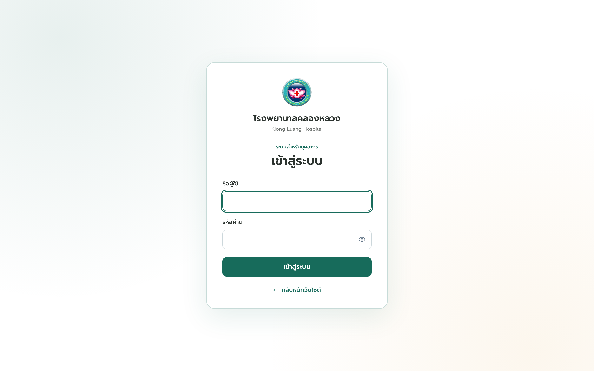
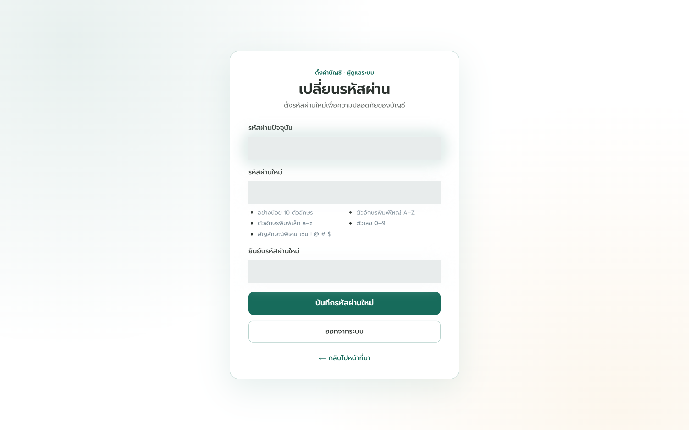
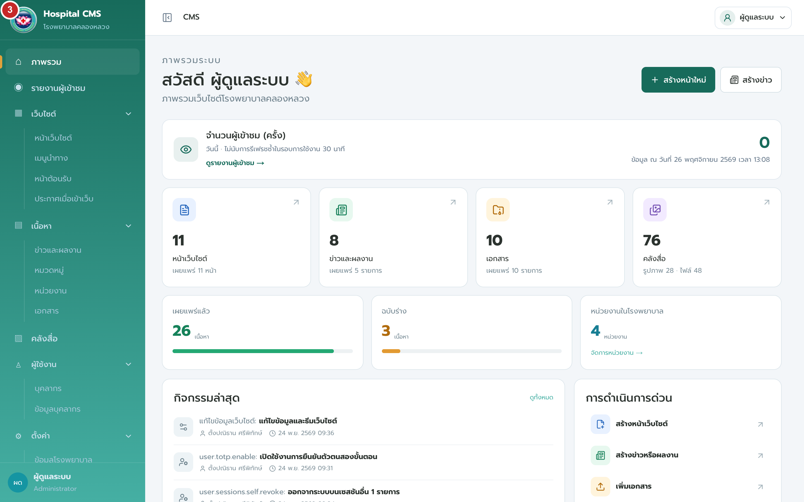

# บทที่ 1 เริ่มใช้งานระบบ

HOS-CMS มีเว็บไซต์สำหรับประชาชนและพื้นที่จัดการข้อมูลสำหรับผู้ดูแล บุคลากรที่ได้รับบัญชีสามารถเข้าสู่ระบบเพื่อดูหน้าที่จำกัดสิทธิ์และจัดการโปรไฟล์ของตน ส่วนเมนู `/admin` ใช้ได้เฉพาะบัญชีผู้ดูแลระบบ

## 1.1 เข้าสู่ระบบ

**วัตถุประสงค์:** ยืนยันตัวตนก่อนเข้าถึงข้อมูลหรือเครื่องมือที่ต้องใช้บัญชี  
**สิทธิ์:** บัญชีที่ผู้ดูแลสร้างไว้และยังใช้งานได้  
**ทางเข้า:** เปิดเว็บไซต์แล้วไปที่ **เข้าสู่ระบบ** หรือ `/login`

1. ในหน้า **เข้าสู่ระบบ** กรอก **ชื่อผู้ใช้** ที่ได้รับจากผู้ดูแล
2. กรอก **รหัสผ่าน** ในช่องถัดไป กดรูปดวงตาเมื่อจำเป็นต้องตรวจข้อความที่พิมพ์
3. กด **เข้าสู่ระบบ** หากบัญชีเปิดการยืนยันสองขั้นตอน ระบบจะพาไปหน้ากรอกรหัสจากแอป Authenticator หากใช้รหัสไม่ได้ ให้เลือกวิธีกู้บัญชีที่หน้าจอรองรับ
4. หากเป็นบัญชีใหม่หรือผู้ดูแลเพิ่งรีเซ็ตรหัสผ่าน ให้ตั้งรหัสผ่านใหม่ตามหน้าที่ระบบแสดงก่อนใช้งานส่วนอื่น

*ภาพที่ 1.1 หน้าเข้าสู่ระบบ แสดงช่องชื่อผู้ใช้ รหัสผ่าน และปุ่มเข้าสู่ระบบ*

**ผลลัพธ์:** หลังยืนยันสำเร็จ ระบบพาไปหน้าที่ร้องขอหรือหน้าเว็บไซต์ ผู้ดูแลสามารถเข้าเมนู **จัดการแอดมิน** ได้ หากระบบแจ้งว่าข้อมูลไม่ถูกต้อง ให้ตรวจชื่อผู้ใช้และรหัสผ่านกับผู้ดูแลโดยไม่ส่งรหัสผ่านผ่านช่องทางสาธารณะ

## 1.2 เปลี่ยนรหัสผ่าน

**วัตถุประสงค์:** ตั้งรหัสผ่านใหม่เมื่อระบบบังคับหรือเมื่อผู้ใช้ต้องการเปลี่ยน  
**สิทธิ์:** เจ้าของบัญชีที่เข้าสู่ระบบแล้ว  
**ทางเข้า:** **เมนูบัญชี → ความปลอดภัย → เปลี่ยนรหัสผ่าน** หรือหน้าที่ระบบพาไปเมื่อจำเป็น

1. กรอก **รหัสผ่านปัจจุบัน**
2. กรอก **รหัสผ่านใหม่** ตามเงื่อนไขที่แสดงใต้ช่องกรอก และกรอกซ้ำใน **ยืนยันรหัสผ่านใหม่**
3. ตรวจความถูกต้องก่อนกด **บันทึกรหัสผ่านใหม่**

*ภาพที่ 1.2 แบบฟอร์มเปลี่ยนรหัสผ่าน โดยปิดบังช่องรหัสทั้งหมด*

**ข้อควรระวัง:** อย่าใช้รหัสผ่านเดิมซ้ำหรือบอกรหัสผ่านแก่ผู้อื่น เมื่อเปลี่ยนสำเร็จ ระบบจะยกเลิกการเข้าสู่ระบบเดิมและให้เข้าสู่ระบบอีกครั้ง

## 1.3 เข้าสู่พื้นที่ผู้ดูแลและออกจากระบบ

**วัตถุประสงค์:** ไปยังเมนูจัดการและจบการใช้งานอย่างปลอดภัย  
**สิทธิ์:** ผู้ดูแลระบบ (`ADMIN`) สำหรับหน้า Admin; ทุกบัญชีที่เข้าสู่ระบบสำหรับคำสั่งออกจากระบบ

1. เปิด **เมนูบัญชี** ที่มุมบน แล้วเลือก **จัดการแอดมิน** ผู้ดูแลจะเห็นหน้า **ภาพรวม** และกลุ่มเมนูด้านซ้าย
2. เลือกกลุ่ม **เว็บไซต์**, **เนื้อหา**, **ผู้ใช้งาน** หรือ **ตั้งค่า** เพื่อเปิดเมนูย่อย งานแต่ละกลุ่มอธิบายในบทถัดไป
3. เมื่อเลิกใช้งาน เปิด **เมนูบัญชี → ออกจากระบบ** โดยเฉพาะเมื่อใช้เครื่องร่วมกัน

*ภาพที่ 1.3 หน้า **ภาพรวม** และกลุ่มเมนูผู้ดูแล*

บัญชีทั่วไป (`MEMBER`) จะไม่เห็นสิทธิ์จัดการ Admin ผู้ดูแลเป็นผู้กำหนดบทบาทและสิทธิ์เข้าถึงหน้าเฉพาะกลุ่ม
