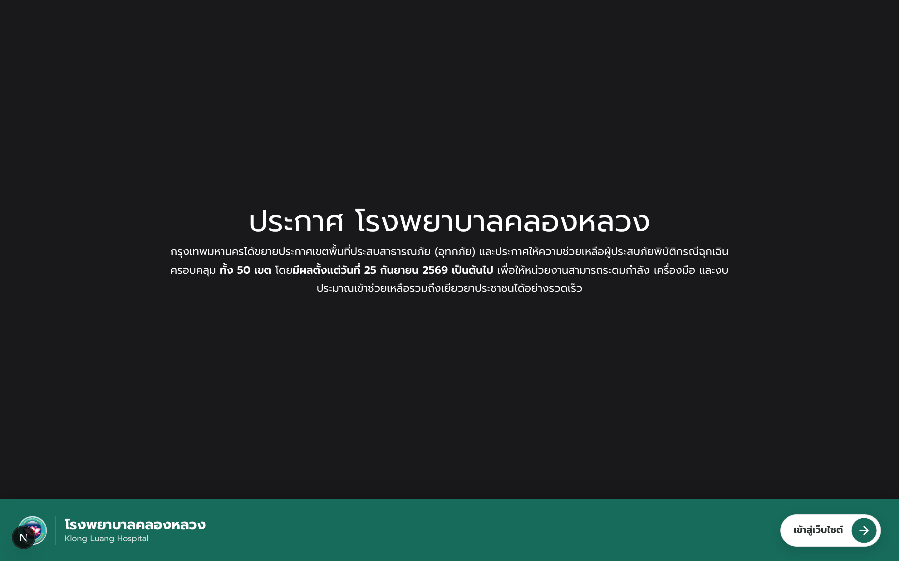
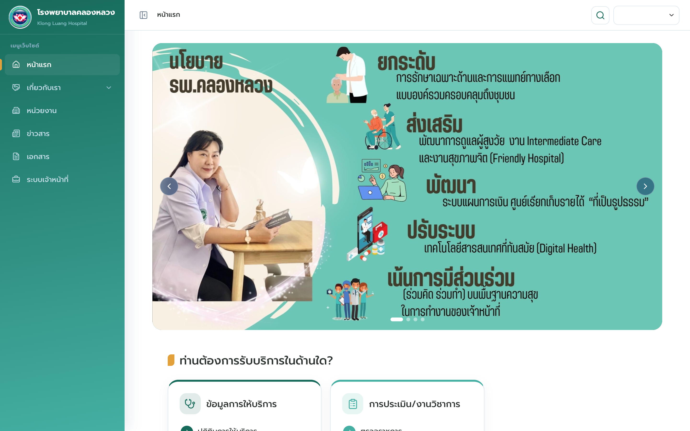
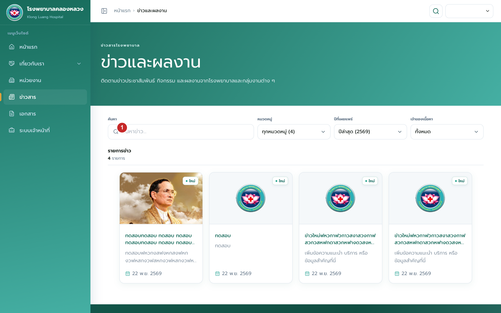
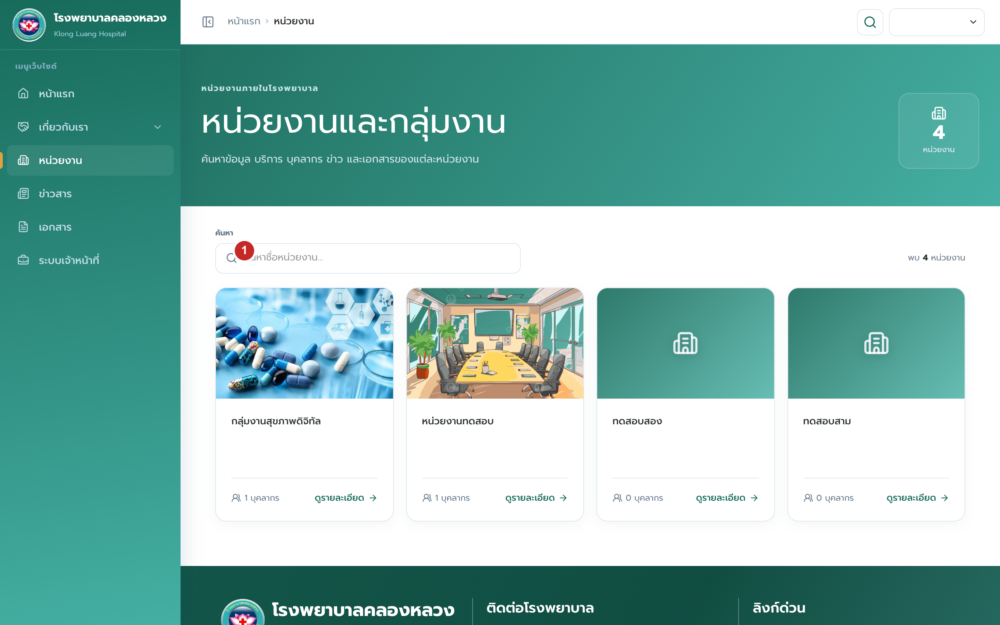
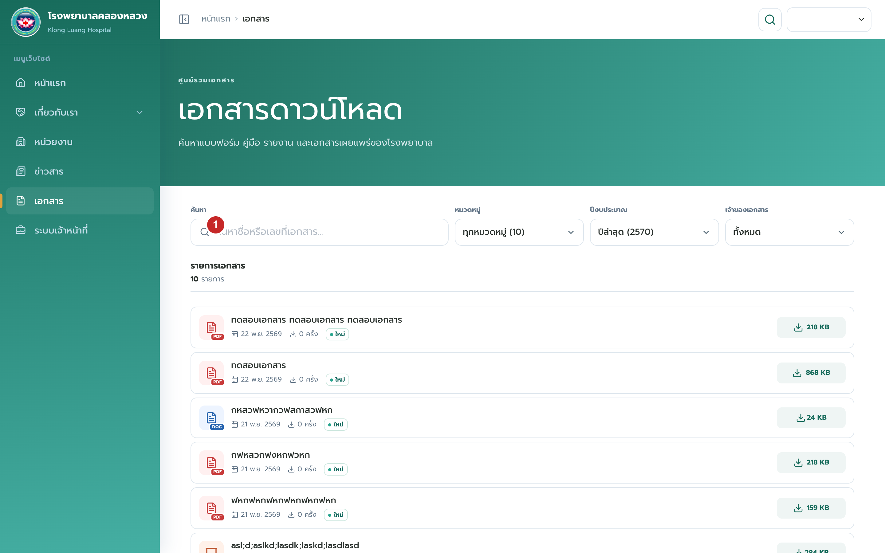
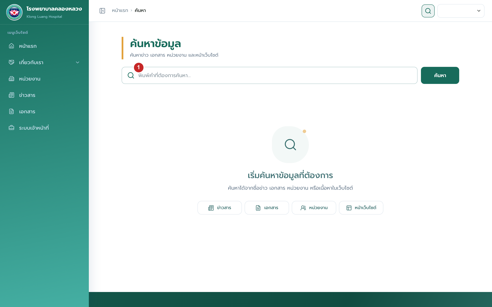
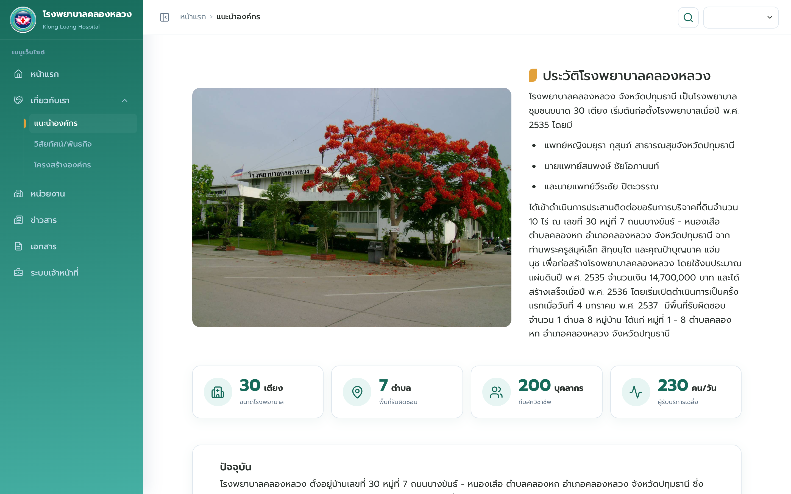
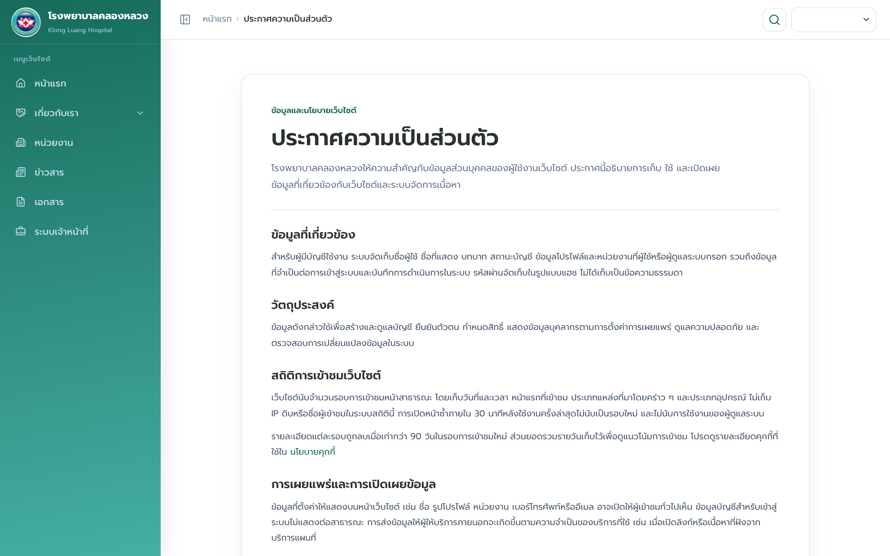

# บทที่ 2 รู้จักหน้าเว็บไซต์ประชาชน

เว็บไซต์ประชาชนแสดงเนื้อหาที่เผยแพร่แล้ว ผู้เยี่ยมชมทั่วไปดูหน้าสาธารณะได้โดยไม่ต้องเข้า Admin บางหน้าเว็บไซต์หรือหน้าหน่วยงานอาจกำหนดให้เฉพาะผู้เข้าสู่ระบบหรือผู้ได้รับสิทธิ์เท่านั้น

## 2.1 หน้าต้อนรับ หน้าแรก และเมนู

**วัตถุประสงค์:** เข้าสู่ข้อมูลหลักของโรงพยาบาล  
**สิทธิ์:** ทุกคนสำหรับเนื้อหาสาธารณะ  
**ทางเข้า:** เปิด URL เว็บไซต์

1. หากมี **หน้าต้อนรับ** ให้กด **เข้าสู่เว็บไซต์** เพื่อไปหน้าแรก
2. ใช้เมนูด้านบนเลือกหน้าองค์กร **แนะนำองค์กร**, **วิสัยทัศน์/พันธกิจ**, **โครงสร้างองค์กร**, **หน่วยงาน**, **ข่าวสาร**, **เอกสาร** หรือ **ระบบเจ้าหน้าที่** ตามที่แสดงในเมนูปัจจุบัน
3. เลื่อนลงเพื่ออ่านส่วนต่าง ๆ ของหน้าแรกและส่วนท้าย ซึ่งมีทางลัดและช่องทางติดต่อ เมนูและเนื้อหาอาจเปลี่ยนตามรายการที่ผู้ดูแลเผยแพร่

*ภาพที่ 2.1 หน้าต้อนรับและปุ่มเข้าสู่เว็บไซต์*

*ภาพที่ 2.2 หน้าแรกหลังผ่านหน้าต้อนรับ*

## 2.2 ค้นหาและอ่านข่าว

**วัตถุประสงค์:** ค้นข่าวหรือผลงานที่เผยแพร่  
**สิทธิ์:** ทุกคน  
**ทางเข้า:** **ข่าวสาร** หรือ `/news`

1. พิมพ์คำใน **ค้นหาข่าว...** เมื่อต้องการจำกัดรายการ
2. เลือก **ทุกหมวดหมู่**, ปี และหน่วยงานเจ้าของข่าวจากตัวกรองตามต้องการ
3. เลือกการ์ดข่าวเพื่ออ่านรายละเอียด วันเผยแพร่ และเนื้อหาที่ผู้ดูแลจัดไว้

*ภาพที่ 2.3 รายการข่าวและชุดตัวกรอง*

**ผลลัพธ์:** รายการลดลงตามเงื่อนไขที่เลือก หากไม่พบข่าวให้ล้างคำค้นหาหรือตัวกรอง

## 2.3 ค้นหาหน่วยงานและเอกสาร

**วัตถุประสงค์:** เปิดหน้าหน่วยงานและหาเอกสารเผยแพร่  
**สิทธิ์:** ทุกคนสำหรับรายการสาธารณะ; หน้าหน่วยงานบางหน้าอาจต้องเข้าสู่ระบบหรือได้รับสิทธิ์  
**ทางเข้า:** **หน่วยงาน** และ **เอกสาร**

1. ในหน้า **หน่วยงานและกลุ่มงาน** พิมพ์ชื่อในช่อง **ค้นหาหน่วยงาน** แล้วเลือกการ์ด **ดูรายละเอียด**
2. ในหน้า **เอกสารดาวน์โหลด** พิมพ์ชื่อหรือเลขที่เอกสารในช่องค้นหา เลือกหมวดหมู่และปีตามต้องการ
3. เปิดรายการที่ต้องการอ่านหรือดาวน์โหลดเฉพาะไฟล์ที่เผยแพร่แล้ว ตรวจชื่อเอกสารและปีให้ตรงก่อนนำไปใช้

*ภาพที่ 2.4 ช่องค้นหาและการ์ดหน่วยงาน*

*ภาพที่ 2.5 ช่องค้นหาและตัวกรองเอกสาร*

## 2.4 ค้นหาทั้งเว็บไซต์และอ่านข้อมูลทั่วไป

**วัตถุประสงค์:** หาเนื้อหาหลายประเภทจากจุดเดียว  
**สิทธิ์:** ทุกคนสำหรับผลการค้นหาสาธารณะ  
**ทางเข้า:** เมนูค้นหาของเว็บไซต์หรือ `/search`

1. พิมพ์คำในช่อง **พิมพ์คำที่ต้องการค้นหา…** แล้วกด **ค้นหา**
2. เลือกผลลัพธ์ที่ตรงกับความต้องการ หากไม่พบให้ลองคำที่สั้นลงหรือไปยังหมวดข่าว/เอกสารโดยตรง
3. ข้อมูลโรงพยาบาลอยู่ในหน้าองค์กร เช่น **แนะนำองค์กร** ส่วนลิงก์ **ประกาศความเป็นส่วนตัว** และ **นโยบายคุกกี้** อยู่บริเวณส่วนท้าย

*ภาพที่ 2.6 แบบฟอร์มค้นหาทั้งเว็บไซต์*

*ภาพที่ 2.7 ตัวอย่างหน้าเนื้อหาองค์กรที่ผู้ดูแลเผยแพร่*

*ภาพที่ 2.8 หน้าแจ้งข้อมูลความเป็นส่วนตัว*
