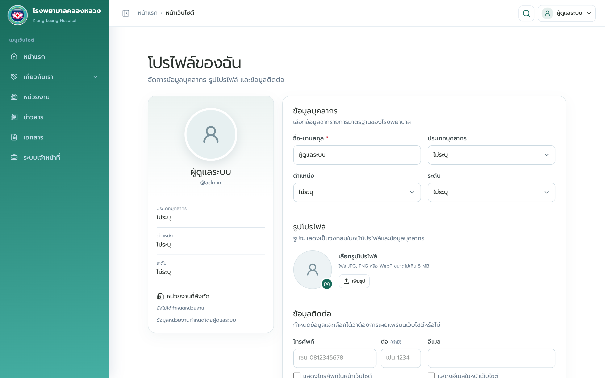
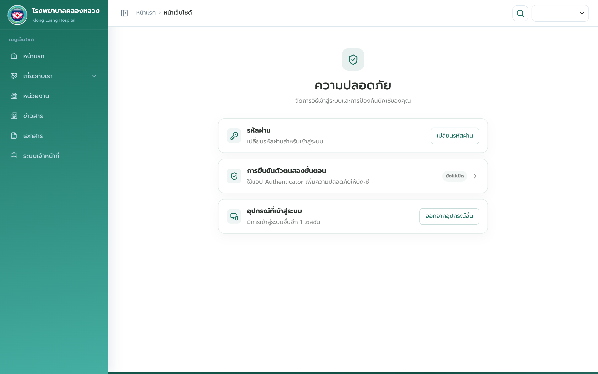
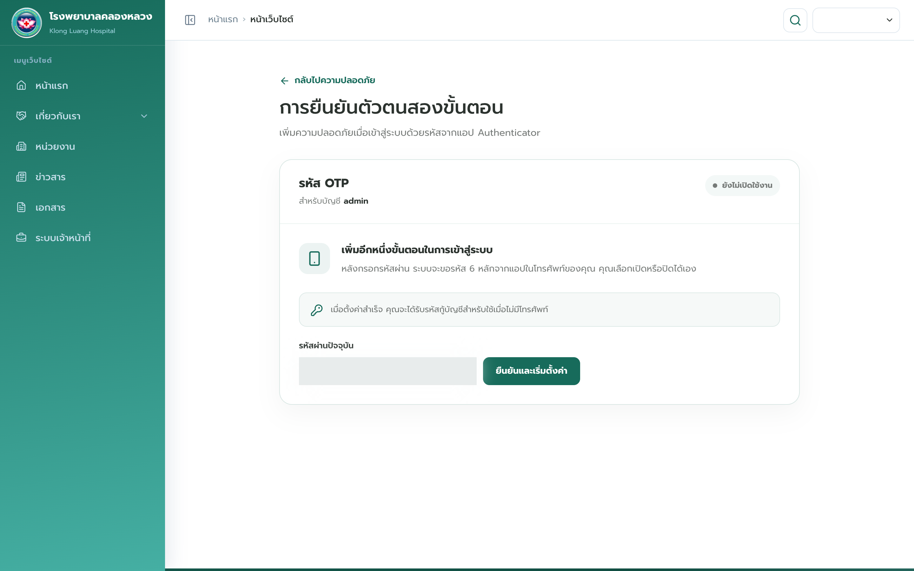

# บทที่ 3 บัญชีและความปลอดภัยของฉัน

เมนูบัญชีของผู้เข้าสู่ระบบมี **โปรไฟล์ของฉัน**, **ความปลอดภัย** และ **ออกจากระบบ** ผู้ดูแลจะเห็น **จัดการแอดมิน** เพิ่มเติม การแก้ข้อมูลในบทนี้ทำได้เฉพาะเจ้าของบัญชี ส่วนการรีเซ็ตบัญชีผู้อื่นเป็นหน้าที่ผู้ดูแล (บทที่ 13)

## 3.1 แก้โปรไฟล์ส่วนตัว

**วัตถุประสงค์:** ดูและปรับข้อมูลติดต่อ/ภาพที่แสดงกับบัญชี  
**สิทธิ์:** ผู้เข้าสู่ระบบ  
**ทางเข้า:** **เมนูบัญชี → โปรไฟล์ของฉัน**

1. ตรวจชื่อที่แสดงและข้อมูลบุคลากรในหน้า **โปรไฟล์ของฉัน**
2. เลือก **ประเภทบุคลากร**, **ตำแหน่ง** และ **ระดับ** จากรายการที่โรงพยาบาลกำหนด เมื่อเกี่ยวข้องกับตำแหน่งของตน
3. ระบุข้อมูลติดต่อ เช่น โทรศัพท์และเบอร์ต่อ เลือกการเผยแพร่ข้อมูลติดต่อเฉพาะที่ต้องการให้ปรากฏบนเว็บไซต์
4. กด **เพิ่มรูป** เมื่อต้องการเลือกรูปโปรไฟล์ ตรวจภาพและตำแหน่งก่อนบันทึก
5. กด **บันทึกโปรไฟล์** และตรวจข้อความตอบกลับของระบบ ขั้นตอนบันทึกไม่ได้ทดลองในรอบนี้

*ภาพที่ 3.1 ข้อมูลโปรไฟล์*

**ข้อควรระวัง:** ตรวจตัวเลือกการเผยแพร่โทรศัพท์/อีเมลก่อนบันทึก และใช้ภาพที่ได้รับอนุญาตให้เผยแพร่

## 3.2 จัดการความปลอดภัย

**วัตถุประสงค์:** ป้องกันการเข้าถึงบัญชีโดยไม่ได้รับอนุญาต  
**สิทธิ์:** เจ้าของบัญชี  
**ทางเข้า:** **เมนูบัญชี → ความปลอดภัย**

หน้า **ความปลอดภัย** แสดงทางเลือก **เปลี่ยนรหัสผ่าน**, **การยืนยันตัวตนสองขั้นตอน** และ **อุปกรณ์ที่เข้าสู่ระบบ**

1. เลือก **เปลี่ยนรหัสผ่าน** เมื่อต้องการตั้งรหัสใหม่ ตามบทที่ 1
2. เลือก **การยืนยันตัวตนสองขั้นตอน** เพื่อดูสถานะ OTP และคำแนะนำการตั้งค่า
3. หากพบการเข้าสู่ระบบจากอุปกรณ์ที่ไม่ใช้แล้ว ให้พิจารณา **ออกจากอุปกรณ์อื่น** การกดปุ่มนี้เพิกถอน session จึงควรทำเมื่อพร้อมเข้าสู่ระบบใหม่บนอุปกรณ์เหล่านั้น

*ภาพที่ 3.2 ทางเลือกสำหรับดูแลบัญชีและอุปกรณ์ที่เข้าสู่ระบบ*

## 3.3 การยืนยันตัวตนสองขั้นตอนและรหัสกู้บัญชี

**วัตถุประสงค์:** เพิ่มรหัสจากแอป Authenticator อีกชั้นหลังรหัสผ่าน  
**สิทธิ์:** เจ้าของบัญชีที่ยืนยันตัวตนซ้ำตามระบบ

1. เปิด **ความปลอดภัย → การยืนยันตัวตนสองขั้นตอน**
2. อ่านสถานะและกรอกรหัสผ่านปัจจุบันเพื่อเริ่มตั้งค่าเมื่อเลือกใช้งาน ระบบจะแสดงขั้นตอนเชื่อมแอป Authenticator และให้ยืนยันรหัส OTP
3. เก็บ **รหัสกู้บัญชี** ที่ระบบออกให้ในที่ปลอดภัย รหัสแต่ละชุดใช้ได้ครั้งเดียวและหน้ารหัสกู้บัญชีเปิดได้เฉพาะช่วงที่ระบบออกชุดใหม่

*ภาพที่ 3.3 หน้าสถานะการยืนยันสองขั้นตอน โดยปิดบังช่องข้อมูลความปลอดภัย*

**ผลลัพธ์ที่คาดหวัง:** หลังตั้งค่าเสร็จ การเข้าสู่ระบบครั้งถัดไปจะขอรหัส OTP หรือวิธีกู้บัญชีที่รองรับ **ข้อจำกัด:** ไม่ได้กดเริ่มตั้งค่า ปิดใช้งาน หรือออกรหัสกู้บัญชีใหม่ และไม่มีภาพ QR/รหัสจริงในคู่มือ เพื่อไม่ให้ความลับรั่วไหล
