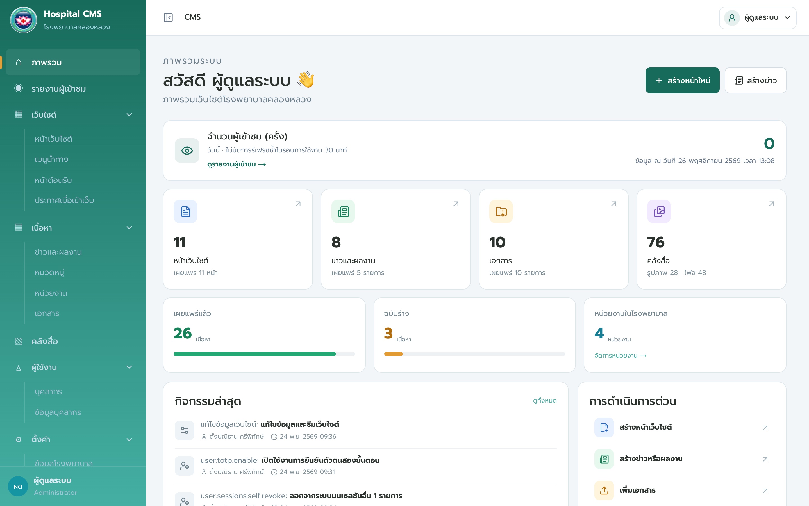
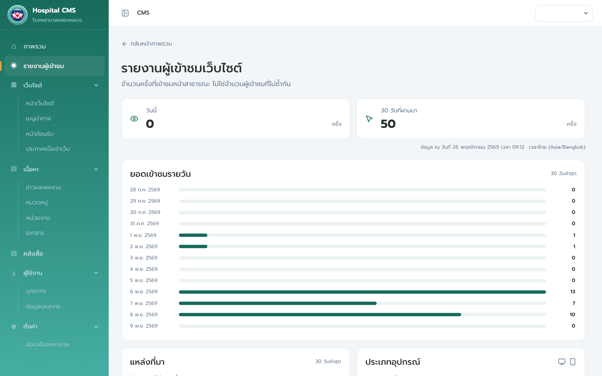

# บทที่ 4 ภาพรวมผู้ดูแลและรายงานผู้เข้าชม

## 4.1 อ่านหน้า **ภาพรวม**

**วัตถุประสงค์:** เห็นสถานะเว็บไซต์และทางลัดไปงานประจำ  
**สิทธิ์:** ผู้ดูแลระบบ  
**ทางเข้า:** **จัดการแอดมิน → ภาพรวม**

1. ดูจำนวน **ผู้เข้าชม (ครั้ง)** ของวันนี้ในแถบบน ระบบระบุว่าไม่นับการรีเฟรชซ้ำในรอบการใช้งาน 30 นาที
2. ดูจำนวนหน้าเว็บไซต์ ข่าวและผลงาน เอกสาร และรายการคลังสื่อจากการ์ดสรุป กดการ์ดเพื่อไปหน้ารายการนั้น
3. ดูยอด **เผยแพร่แล้ว** และ **ฉบับร่าง** เพื่อทราบงานที่ยังไม่ขึ้นเว็บไซต์
4. ใช้ **กิจกรรมล่าสุด** เพื่อตรวจสิ่งที่มีการดำเนินการ และ **การดำเนินการด่วน** เพื่อไปยังงานที่ใช้บ่อย เช่น สร้างหน้าเว็บไซต์หรือข่าว

*ภาพที่ 4.1 Dashboard ผู้ดูแล*

**ผลลัพธ์:** ผู้ดูแลเห็นสถานะปัจจุบันและเปิดหน้าจัดการที่ต้องการได้ทันที ตัวเลขเป็นข้อมูลตามเวลาที่ระบบแสดงในหน้าจอ จึงควรตรวจวันที่กำกับก่อนนำไปอ้างอิง

## 4.2 อ่านรายงานผู้เข้าชม

**วัตถุประสงค์:** ติดตามแนวโน้มการเข้าชมเว็บไซต์  
**สิทธิ์:** ผู้ดูแลระบบ  
**ทางเข้า:** **รายงานผู้เข้าชม** ในแถบซ้าย หรือ **ดูรายงานผู้เข้าชม →** จาก Dashboard

1. ดูยอด **วันนี้** และ **30 วันล่าสุด** ในการ์ดด้านบน
2. อ่านกราฟ **ยอดเข้าชมรายวัน** เพื่อดูวันที่มีการเข้าชมมากหรือน้อย
3. เลื่อนลงเพื่อดูส่วนสรุปเพิ่มเติมตามที่หน้าแสดง หากต้องการกลับหน้าแรกผู้ดูแล ให้กด **กลับหน้าภาพรวม**

*ภาพที่ 4.2 ตัวเลขและกราฟรายงานผู้เข้าชม*

**ข้อควรระวัง:** ยอดผู้เข้าชมเป็นสถิติการเข้าเว็บ ไม่ใช่จำนวนผู้ป่วยหรือผู้รับบริการ และไม่ควรนำไปตีความเป็นตัวชี้วัดทางการแพทย์
