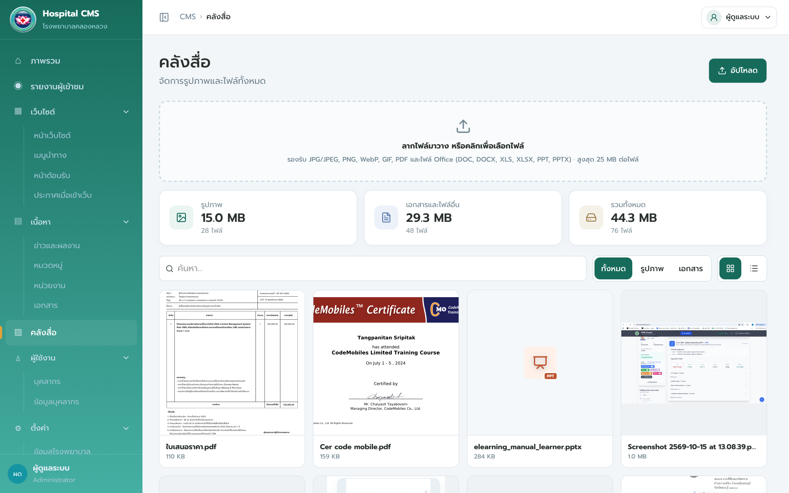
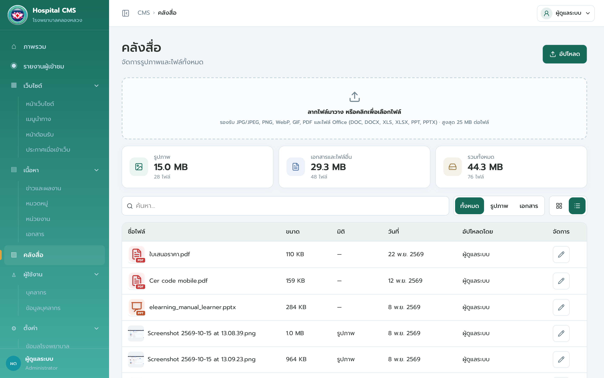

# บทที่ 5 คลังสื่อ

คลังสื่อเป็นที่เก็บรูปภาพและไฟล์ที่ใช้กับหน้า ข่าว หน่วยงาน และเอกสาร ผู้ดูแลควรอัปโหลดไฟล์ที่มีสิทธิ์เผยแพร่และตรวจชื่อไฟล์ก่อนนำไปใช้

## 5.1 ดู ค้นหา และกรองไฟล์

**วัตถุประสงค์:** หาไฟล์ที่มีอยู่เพื่อนำไปใช้ซ้ำ  
**สิทธิ์:** ผู้ดูแลระบบ  
**ทางเข้า:** เมนู **คลังสื่อ**

1. ดูสรุปจำนวนและขนาดพื้นที่ของรูปภาพ เอกสาร และไฟล์ทั้งหมด
2. พิมพ์คำใน **ค้นหา...** เพื่อจำกัดรายการ
3. เลือก **ทั้งหมด**, **รูปภาพ** หรือ **เอกสาร** เพื่อกรองชนิดไฟล์
4. เลือก **มุมมองตาราง** เพื่อเห็นภาพตัวอย่าง หรือ **มุมมองรายการ** เพื่อเห็นชื่อ ขนาด ชนิด และวันที่

*ภาพที่ 5.1 คลังสื่อและตัวกรอง*

*ภาพที่ 5.2 รายการไฟล์พร้อมข้อมูลประกอบ*

**ผลลัพธ์:** พบรายการที่ตรงกับคำค้นและชนิดที่เลือก การเปลี่ยนมุมมองไม่เปลี่ยนไฟล์ในระบบ

## 5.2 อัปโหลดและเลือกสื่อ

**วัตถุประสงค์:** เพิ่มไฟล์เพื่อใช้ประกอบเนื้อหา  
**สิทธิ์:** ผู้ดูแลระบบ  
**ทางเข้า:** **คลังสื่อ → อัปโหลด** หรือปุ่ม **เลือกจากคลังสื่อ** ในตัวแก้ไข

1. กด **อัปโหลด** หรือวางไฟล์ในพื้นที่อัปโหลด ระบบแสดงชนิดและขนาดไฟล์ที่รองรับบนหน้าจอ
2. ตรวจชื่อและตัวอย่างไฟล์ก่อนยืนยันการอัปโหลด หากใช้จากตัวแก้ไข ให้กด **เลือกจากคลังสื่อ** แล้วค้นหาไฟล์เดิมก่อนอัปโหลดซ้ำ
3. หลังเลือกไฟล์ ให้ตรวจว่ารูปปก/ไฟล์แนบแสดงในตำแหน่งที่ถูกต้อง แล้วจึงบันทึกเนื้อหาในงานนั้น

**ผลลัพธ์ที่คาดหวัง:** ไฟล์อยู่ในคลังสื่อและพร้อมเลือกใช้ **ข้อจำกัด:** ไม่ได้ทดลองอัปโหลดหรือแก้ไข metadata เพราะจะเปลี่ยนข้อมูลระบบ ภาพประกอบแสดงทางเข้าและรูปแบบรายการจริง

**ข้อควรระวัง:** หลีกเลี่ยงการอัปโหลดเอกสารที่มีข้อมูลผู้ป่วยหรือข้อมูลส่วนบุคคลโดยไม่ได้รับอนุญาต ชื่อไฟล์อาจปรากฏต่อผู้ใช้ที่ดาวน์โหลดได้
