# บทที่ 6 หน้าเว็บไซต์และ Page Builder

Page Builder ใช้จัดหน้าแรกและหน้าเว็บไซต์อื่นด้วยบล็อกเนื้อหา ผู้ดูแลสร้างฉบับร่าง ตรวจตัวอย่าง และเผยแพร่เมื่อพร้อม การเปลี่ยนหน้าแรกต้องระวังเป็นพิเศษ เพราะผู้เข้าชมเห็นทันทีหลังเผยแพร่

## 6.1 จัดการรายการหน้าเว็บไซต์

**วัตถุประสงค์:** ตรวจสถานะหน้าและเปิดหน้าที่ต้องแก้  
**สิทธิ์:** ผู้ดูแลระบบ  
**ทางเข้า:** **เว็บไซต์ → หน้าเว็บไซต์**

1. ดูการ์ด **ทั้งหมด**, **เผยแพร่แล้ว**, **ฉบับร่าง** และ **อยู่ในถังขยะ** เพื่อกรองสถานะ
2. พิมพ์ชื่อใน **ค้นหาหน้า...** แล้วเลือกแถวที่ต้องการ
3. กด **แก้ไขเนื้อหา** เพื่อเข้า Page Builder หรือ **ดูตัวอย่าง** เมื่อต้องการตรวจหน้าที่มีอยู่
4. ใช้ **ตัวเลือก** ของแถวสำหรับงานอื่น เช่น คัดลอก ยกเลิกเผยแพร่ หรือย้ายเข้าถังขยะ ตามสถานะของหน้านั้น การกู้คืนและลบถาวรอยู่ที่แท็บ **ถังขยะ**

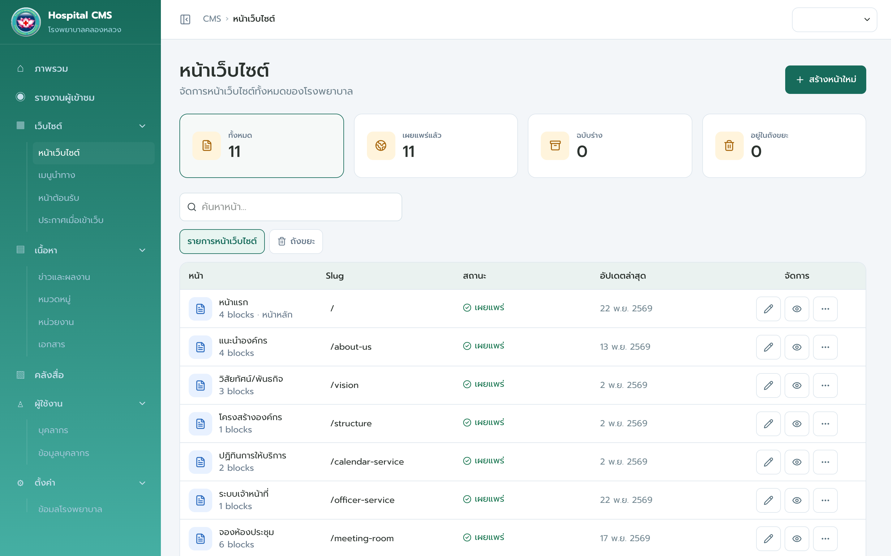

*ภาพที่ 6.1 รายการหน้า สถานะ และปุ่มแก้ไขเนื้อหา*

## 6.2 สร้างหน้าใหม่

**วัตถุประสงค์:** เพิ่มหน้าเนื้อหาที่ไม่ใช่หน้าแรก  
**สิทธิ์:** ผู้ดูแลระบบ  
**ทางเข้า:** **หน้าเว็บไซต์ → สร้างหน้าใหม่**

1. กรอก **ชื่อหน้า** ให้ผู้อ่านเข้าใจ เช่น ประวัติโรงพยาบาล
2. ตรวจ **URL ของหน้า** หรือ slug ที่ใช้ในลิงก์ ควรสั้น สื่อความหมาย และไม่ซ้ำหน้าอื่น
3. กด **สร้างและเปิด Page Builder** เพื่อเข้าสู่ตัวแก้ไข หน้านี้ยังไม่เผยแพร่จนกว่าจะดำเนินการเผยแพร่ใน Builder

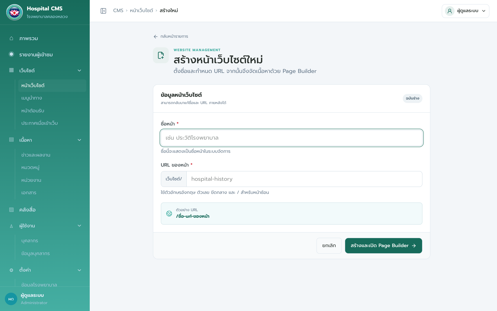

*ภาพที่ 6.2 ช่องชื่อหน้าและ URL ที่ต้องตรวจให้ถูกก่อนสร้าง*

## 6.3 ใช้พื้นที่ทำงานของ Page Builder

**วัตถุประสงค์:** เรียบเรียงลำดับเนื้อหาและกำหนดหน้าตา  
**สิทธิ์:** ผู้ดูแลระบบ  
**ทางเข้า:** **หน้าเว็บไซต์ → แก้ไขเนื้อหา** หรือ **หน้าแรก → Page Builder**

1. อ่านชื่อหน้าและสถานะที่แถบด้านบน กด **ตั้งค่าหน้า** เพื่อกำหนดส่วนหัวของหน้า เช่น ใช้ค่าเริ่มต้น กำหนดเอง หรือไม่แสดงส่วนหัว
2. กด **เพิ่ม Block ด้านบนสุด** หรือ **เพิ่ม Block ตรงนี้** ระหว่างบล็อก แล้วเลือกชนิดจากหน้าต่าง **เพิ่ม Block** สามารถใช้ **ค้นหา Block...** ได้
3. ใช้ที่จับลากของบล็อกเพื่อเปลี่ยนลำดับ กด **ตั้งค่า** เพื่อแก้รายละเอียด กด **ทำสำเนา**, **ซ่อน/แสดง** หรือ **ลบ** ตามความต้องการ การลบใน Builder เป็นการเปลี่ยนร่างก่อนบันทึก
4. ใช้ **ย้อนกลับ** และ **ทำซ้ำ** เมื่อจัดหน้า แล้วตรวจ **ดูตัวอย่าง** ในขนาดหน้าจอที่มีให้เลือก
5. กด **บันทึกร่าง** หากยังต้องตรวจต่อ หรือ **เผยแพร่** เมื่อผู้รับผิดชอบอนุมัติเนื้อหา ขั้นตอนนี้เปลี่ยนข้อมูลและไม่ได้กดทดลอง

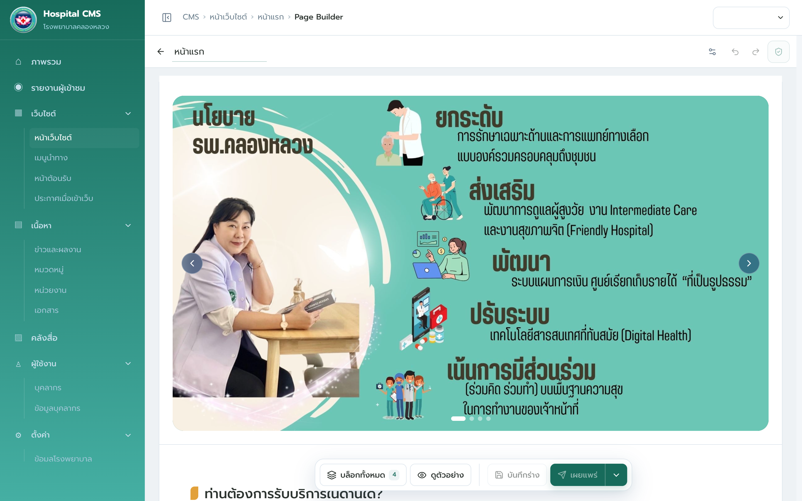

*ภาพที่ 6.3 พื้นที่จัดบล็อกของหน้าแรก*

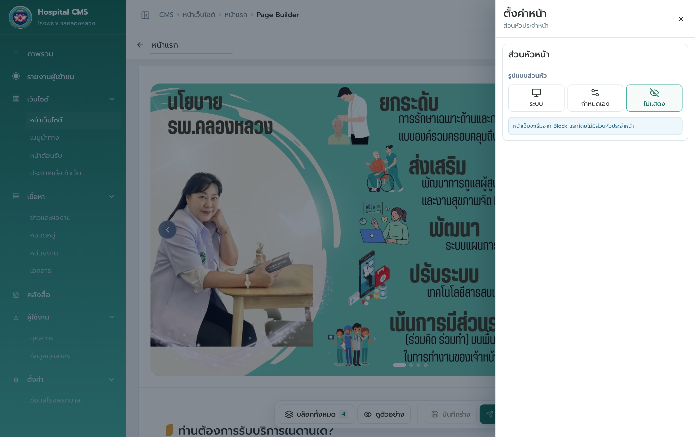

*ภาพที่ 6.4 แผงตั้งค่าส่วนหัวของหน้า*

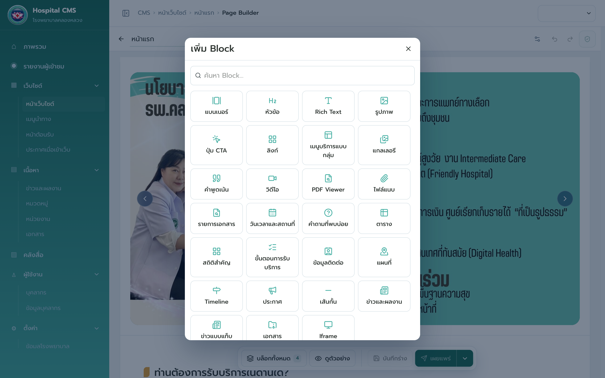

*ภาพที่ 6.5 ชนิดบล็อกช่วงบนของหน้าต่างเพิ่ม Block*

*ภาพที่ 6.6 ชนิดบล็อกช่วงล่างของหน้าต่างเดียวกัน*

## 6.4 สิทธิ์ของหน้า

**วัตถุประสงค์:** กำหนดว่าใครเปิดหน้าได้  
**สิทธิ์:** ผู้ดูแลระบบ  
**ทางเข้า:** ปุ่ม **สิทธิ์: ...** ใน Page Builder ของหน้าทั่วไป

1. เลือก **สาธารณะ** เมื่อทุกคนควรเปิดหน้าได้
2. เลือก **เฉพาะผู้เข้าสู่ระบบ** เมื่อทุกบัญชีที่ผ่านการเข้าสู่ระบบเปิดได้
3. เลือก **กำหนดผู้มีสิทธิ์** เมื่อจำกัดเฉพาะหน่วยงานหรือบุคคล แล้วเลือกผู้ได้รับสิทธิ์ในช่องที่ระบบแสดง
4. ถ้าเลือก **กำหนดผู้มีสิทธิ์** ต้องเพิ่มหน่วยงานหรือผู้ใช้อย่างน้อยหนึ่งรายการ จึงจะกด **ใช้สิทธิ์ที่เลือก** ได้
5. กด **ใช้สิทธิ์ที่เลือก** แล้วกด **บันทึกร่าง** หรือ **เผยแพร่** ใน Page Builder เพื่อเก็บการเปลี่ยนแปลง สิทธิ์ที่แก้จะมีผลต่อผู้เข้าชมหลังเผยแพร่ ตรวจให้รอบคอบหากหน้าเดิมเป็นสาธารณะ

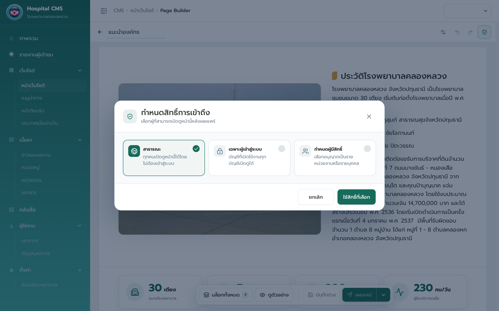

*ภาพที่ 6.7 ตัวเลือกสิทธิ์ของหน้าทั่วไป หน้าแรกถูกกำหนดให้เป็นสาธารณะเสมอ*

## 6.5 คู่มือบล็อกทุกประเภทที่เพิ่มได้

**วิธีร่วมสำหรับทุกบล็อก:** เปิด **เพิ่ม Block**, เลือกชื่อบล็อกตามตาราง, กดไอคอน **ตั้งค่า** บนบล็อก, กรอกข้อมูลสำคัญ, ตรวจตัวอย่างและลำดับ, แล้วบันทึกร่างหรือเผยแพร่เมื่อได้รับอนุญาต บล็อกมีการตั้งค่าทั่วไปด้านความกว้าง ตำแหน่ง พื้นหลัง ระยะห่าง และการแสดงผลตามชนิด ไม่จำเป็นต้องแก้ทุกตัวเลือก

| บล็อกในเมนู | ใช้เมื่อ | ช่องและตัวเลือกสำคัญ | ผลที่คาดหวัง/ข้อควรระวัง |
|---|---|---|---|
| แบนเนอร์ | เปิดหน้าด้วยภาพเด่นหรือสไลด์ | ภาพจากคลังสื่อ, ชื่อ/คำอธิบาย, ตำแหน่งภาพ, ความสูง, จำนวนสไลด์, เล่นอัตโนมัติ, ลิงก์ | ภาพและข้อความอ่านได้ทั้งจอใหญ่/เล็ก; ตรวจสิทธิ์ภาพ |
| หัวข้อ | แบ่งส่วนเนื้อหา | ข้อความ, คำอธิบาย, ระดับหัวข้อ, แนวจัด | โครงสร้างหัวข้ออ่านตามลำดับ |
| Rich Text | เนื้อหายาวหลายย่อหน้า | ข้อความ, ตัวหนา/ลิงก์/รายการตามแถบเครื่องมือ | ตรวจลิงก์และรูปแบบก่อนเผยแพร่ |
| รูปภาพ | แสดงภาพเดี่ยวหรือภาพกับข้อความ | ไฟล์, ข้อความทางเลือก, คำบรรยาย, สัดส่วน/การครอบ, ตำแหน่ง, โหมดรูปกับข้อความ | ภาพไม่ถูกตัดส่วนสำคัญ; ใส่คำอธิบายภาพที่มีความหมาย |
| ปุ่ม CTA | ชวนไปงานสำคัญ | ชื่อ, คำอธิบาย, ข้อความปุ่ม, ปลายทาง, รูปแบบ | ปุ่มพาไปปลายทางถูกต้อง |
| ลิงก์ | วางทางลัดเป็นการ์ด/รายการ | ชื่อ, คำอธิบาย, ไอคอน/ภาพ, จำนวนคอลัมน์, ปลายทาง | ลิงก์ไม่ซ้ำและใช้ได้จริง |
| เมนูบริการแบบกลุ่ม | รวมบริการเป็นหมวด | ชื่อกลุ่ม, ไอคอน, สีเน้น, รายการลิงก์, จำนวนคอลัมน์ | ผู้ใช้หาบริการได้ง่าย; ตรวจลิงก์ทุกกลุ่ม |
| แกลเลอรี | รวมภาพกิจกรรม | ภาพ, หัวข้อ, คำบรรยาย, รูปแบบตาราง/สไลด์, จำนวนคอลัมน์/ความถี่ | ใช้ภาพที่ได้รับอนุญาตเผยแพร่ |
| คำพูดเน้น | เน้นข้อความสั้น | ข้อความ, ผู้กล่าว/แหล่งที่มา | ไม่ระบุชื่อบุคคลโดยไม่ได้รับอนุญาต |
| วิดีโอ | ฝังวิดีโอ | URL, ชื่อ, คำบรรยาย, รูปแบบวิดีโอเดี่ยว/พร้อมข้อความ | ตรวจแหล่งวิดีโอและการเล่นจริง |
| PDF Viewer | แสดง PDF ในหน้า | เลือกไฟล์ PDF, ชื่อ, ความสูง, แนวจัด | ตรวจว่าไฟล์เปิดอ่านได้และไม่มีข้อมูลลับ |
| ไฟล์แนบ | ให้ดาวน์โหลดไฟล์ | ชื่อส่วน, รายการไฟล์, ชื่อที่แสดง | ตรวจรุ่นและชื่อไฟล์ก่อนเผยแพร่ |
| รายการเอกสาร | ทำสารบัญเอกสารมีลำดับ | หัวข้อ, คำอธิบาย, ลำดับเลข, รายการ/ไฟล์/ลิงก์ | เลขลำดับและปลายทางตรงกัน |
| วันเวลาและสถานที่ | แจ้งกำหนดกิจกรรม | วันที่, เวลา, สถานที่, คำอธิบาย | ระบุปีและสถานที่ชัดเจน |
| คำถามที่พบบ่อย | แสดงคำถามและคำตอบ | หัวข้อ, คำถาม, คำตอบแต่ละรายการ | ใช้คำตอบที่ได้รับการตรวจทาน |
| ตาราง | นำเสนอข้อมูลแบบแถว/คอลัมน์ | ชื่อตาราง, หัวคอลัมน์, แถว, ความกว้าง/แนวจัด | ตรวจบนมือถือไม่ให้ข้อมูลล้น |
| สถิติสำคัญ | แสดงตัวเลขสรุป | หัวข้อ, ค่า, หน่วย/ป้าย, คำอธิบาย, ไอคอน, จำนวนคอลัมน์ | ระบุวันที่/แหล่งข้อมูลเมื่อจำเป็น |
| ขั้นตอนการรับบริการ | แสดงลำดับการทำงาน | ชื่อและคำอธิบายแต่ละขั้น, รูปแบบการจัด | ขั้นตอนเรียงถูกต้องตามบริการจริง |
| ข้อมูลติดต่อ | แสดงช่องทางติดต่อ | ที่อยู่, โทรศัพท์/เบอร์ต่อ, อีเมล, เวลาทำการ | ตรวจหมายเลขและเวลาล่าสุด |
| แผนที่ | ชี้ตำแหน่งโรงพยาบาล | URL แผนที่, ชื่อ, คำอธิบาย, ความสูง | ตรวจ URL และตำแหน่งจริง |
| Timeline | แสดงเหตุการณ์ตามเวลา | วันที่/ปี, ชื่อเหตุการณ์, คำอธิบาย | เรียงลำดับเหตุการณ์ให้ถูก |
| ประกาศ | เน้นข้อความแจ้งเตือนในหน้า | หัวข้อ, เนื้อหา, ระดับสี/รูปแบบ | ใช้เฉพาะเรื่องสำคัญ ไม่สับสนกับประกาศเมื่อเข้าเว็บ |
| เส้นกั้น | แบ่งพื้นที่สายตา | รูปแบบเส้น | ไม่ใช้มากจนหน้าแตกเป็นส่วนย่อยเกินไป |
| ข่าวและผลงาน | ดึงข่าวที่เผยแพร่ | แหล่งข่าว, หมวด, จำนวน, รูปแบบ, ลิงก์ดูทั้งหมด | แสดงเฉพาะข่าวที่เผยแพร่ |
| ข่าวแบบแท็บ | จัดข่าวเป็นแท็บ | ชื่อแท็บ, แหล่งข่าว/หมวด, แสดงภาพ/วันที่/คำอธิบาย | ชื่อแท็บสั้นและไม่ซ้ำ |
| เอกสาร | ดึงเอกสารที่เผยแพร่ | ชื่อแท็บ, แหล่ง/หมวด/ปีงบประมาณ, จำนวน, รูปแบบ | แสดงรายการที่เผยแพร่ตามตัวกรอง |
| Iframe | ฝังเนื้อหาภายนอก | URL, ชื่อ, คำอธิบาย, ความสูง | ใช้เฉพาะแหล่งที่เชื่อถือได้ และทดสอบว่าฝังได้จริง |

บล็อกบางชื่อมีรูปแบบย่อยในแผงตั้งค่า เช่น **แบนเนอร์** ภาพเดี่ยว/หลายภาพ, **รูปภาพ** เดี่ยว/พร้อมข้อความ และ **ลิงก์** แบบการ์ด/รายการ จึงไม่ควรสร้างบล็อกซ้ำเพียงเพื่อเปลี่ยนรูปแบบ ให้ตรวจตัวเลือกในบล็อกเดิมก่อน

**การ์ดข้อความ** เป็นรูปแบบที่สลับจากบล็อก **Rich Text** ด้วยตัวเลือก **แสดงเป็นการ์ดข้อความ** ในแผงตั้งค่า ใช้เมื่อต้องการให้ข้อความมีกรอบการ์ด ชื่อการ์ด และพื้นที่แยกจากเนื้อหาข้างเคียง ตั้งค่าข้อความและตรวจผลก่อนบันทึก ภาพที่ 6.14 แสดงแผงของบล็อกรูปแบบนี้ บล็อก **บุคลากร** และ **ระยะห่าง** อาจพบในเนื้อหาเดิม แต่ไม่อยู่ในหน้าต่าง **เพิ่ม Block** ปัจจุบัน จึงไม่ได้แนะนำให้สร้างใหม่จากเมนูนี้

### ตัวอย่างแผงตั้งค่าจากบล็อกที่มีอยู่จริง

ภาพชุดต่อไปนี้ถ่ายเฉพาะแผงตั้งค่าของบล็อกที่มีอยู่จริงใน Page Builder ใช้ประกอบตำแหน่งตัวเลือก ส่วนบล็อกที่ไม่มีตัวอย่างอยู่ในหน้าปัจจุบันให้ใช้ตารางด้านบนและหน้าต่าง **เพิ่ม Block** เป็นแนวทาง

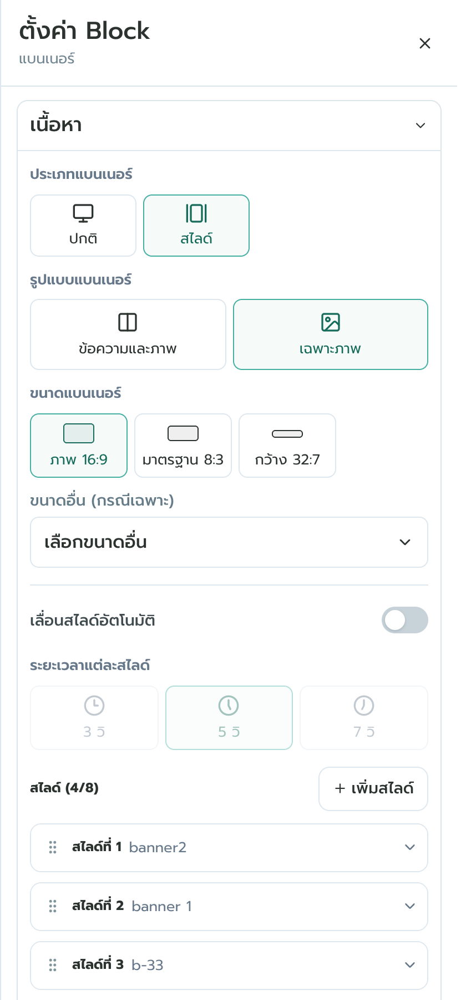

*ภาพที่ 6.8 รูปแบบและการจัดสไลด์ของบล็อกแบนเนอร์*

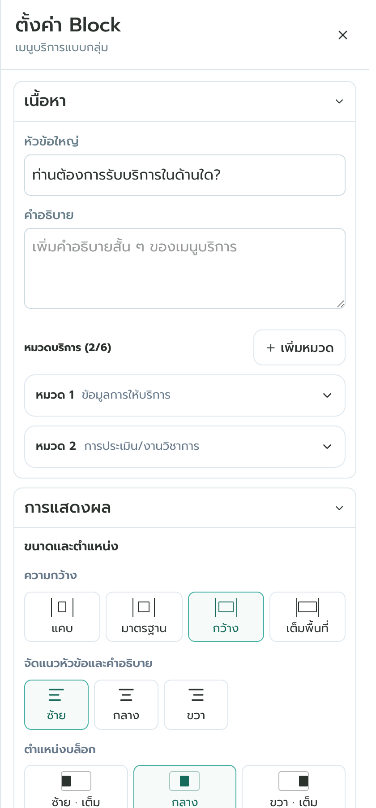

*ภาพที่ 6.9 กลุ่มบริการและรายการลิงก์ภายในกลุ่ม*

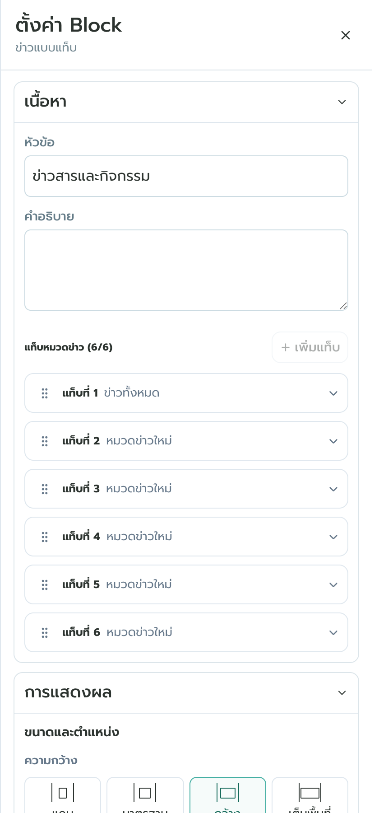

*ภาพที่ 6.10 แท็บและแหล่งข่าวของบล็อกข่าว*

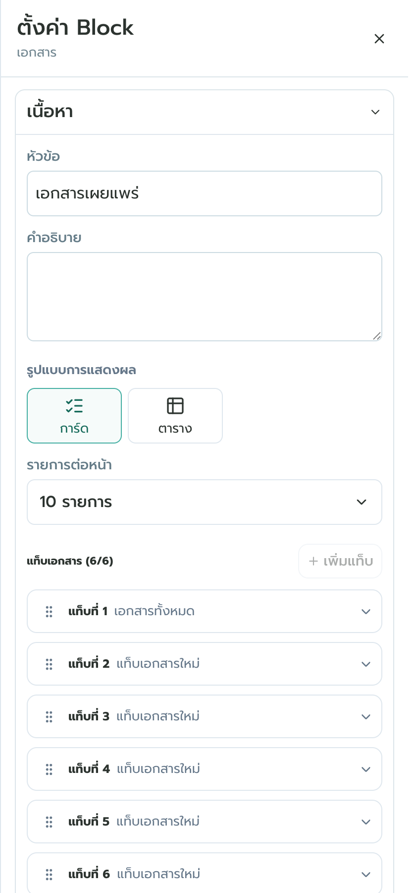

*ภาพที่ 6.11 แท็บเอกสารและรูปแบบการแสดงผล*

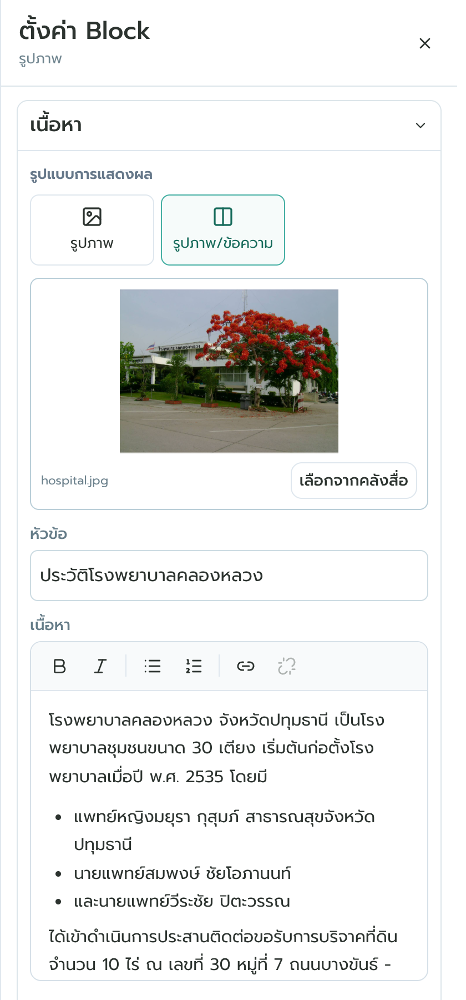

*ภาพที่ 6.12 ตัวเลือกรูปภาพเดี่ยวหรือรูปภาพพร้อมข้อความ*

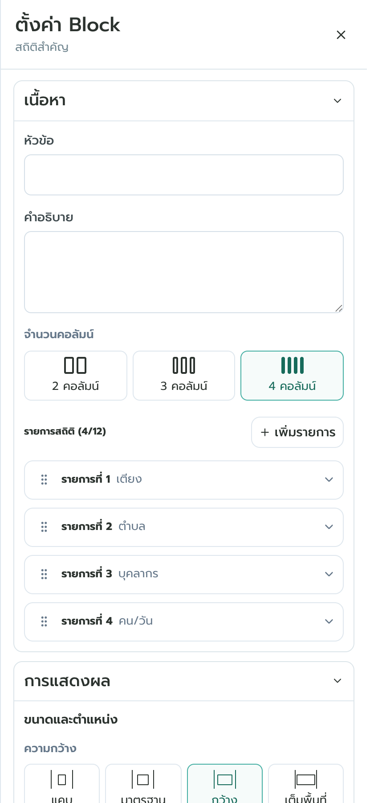

*ภาพที่ 6.13 จำนวนคอลัมน์และรายการตัวเลขสำคัญ*

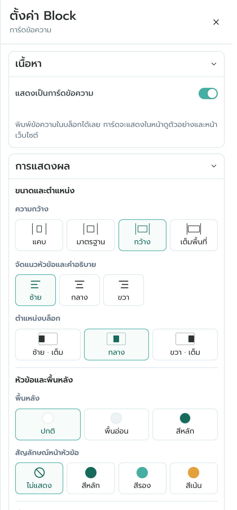

*ภาพที่ 6.14 การ์ดข้อความและการแสดงผล*

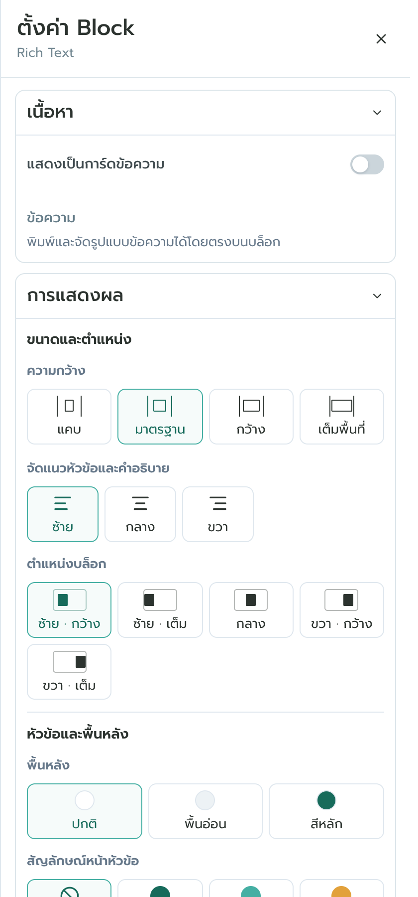

*ภาพที่ 6.15 ข้อความแบบ Rich Text และการจัดพื้นที่*

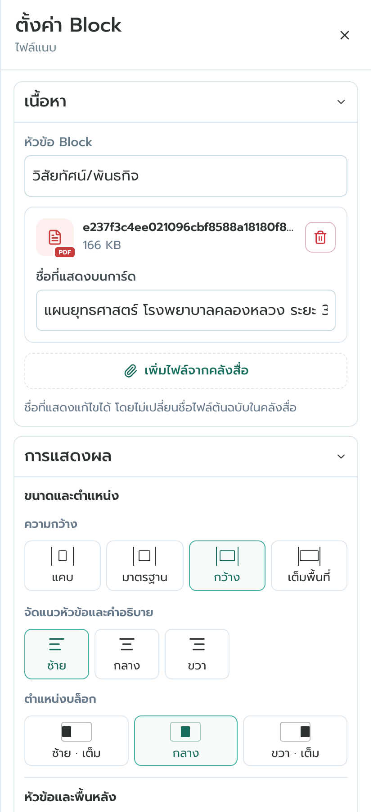

*ภาพที่ 6.16 รายการไฟล์แนบจากคลังสื่อ*

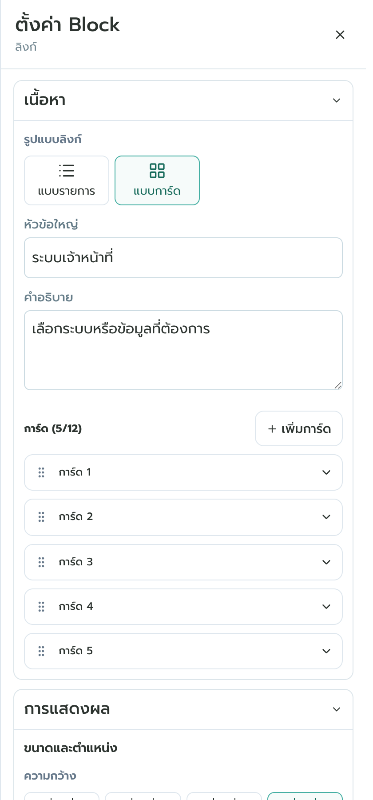

*ภาพที่ 6.17 ลิงก์แบบรายการหรือการ์ด*

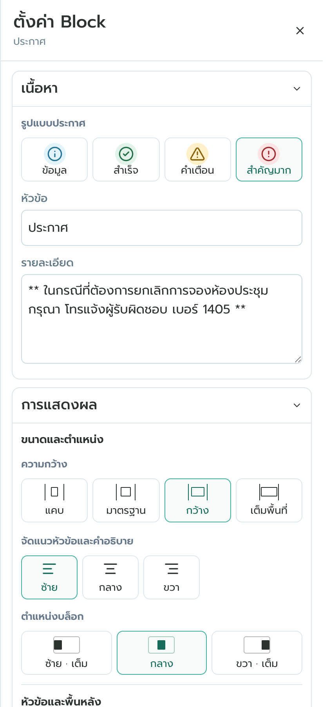

*ภาพที่ 6.18 ระดับสีของข้อความประกาศในหน้า*

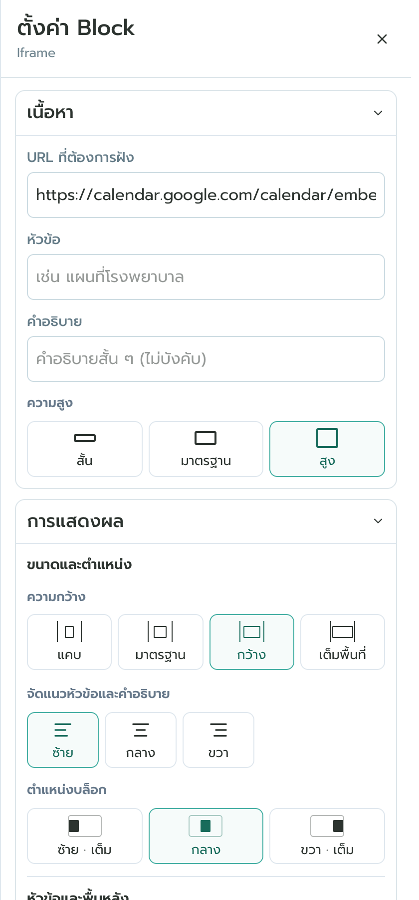

*ภาพที่ 6.19 ช่อง URL และความสูงของเนื้อหาภายนอก*

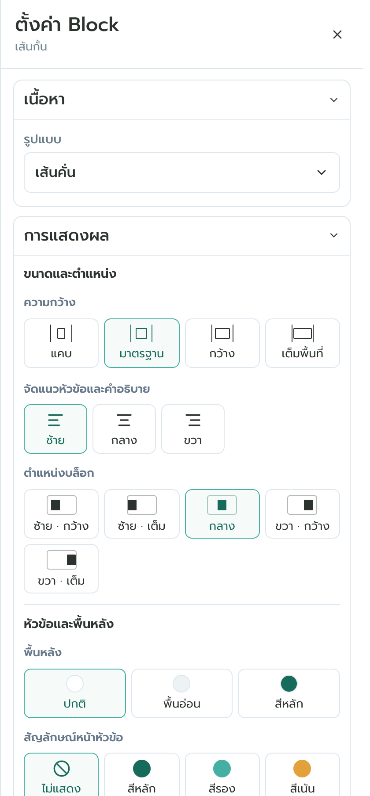

*ภาพที่ 6.20 รูปแบบเส้นกั้นและระยะห่าง*

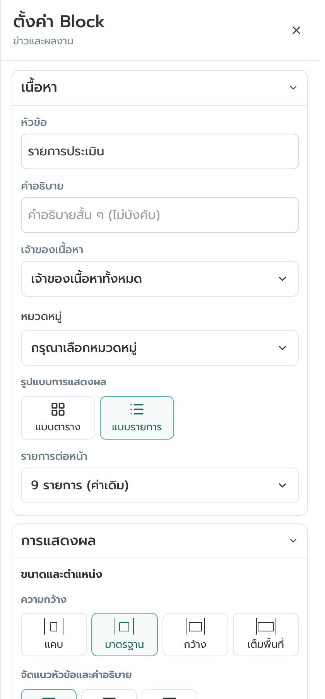

*ภาพที่ 6.21 แหล่งข่าว จำนวนรายการ และรูปแบบการแสดงผล*
