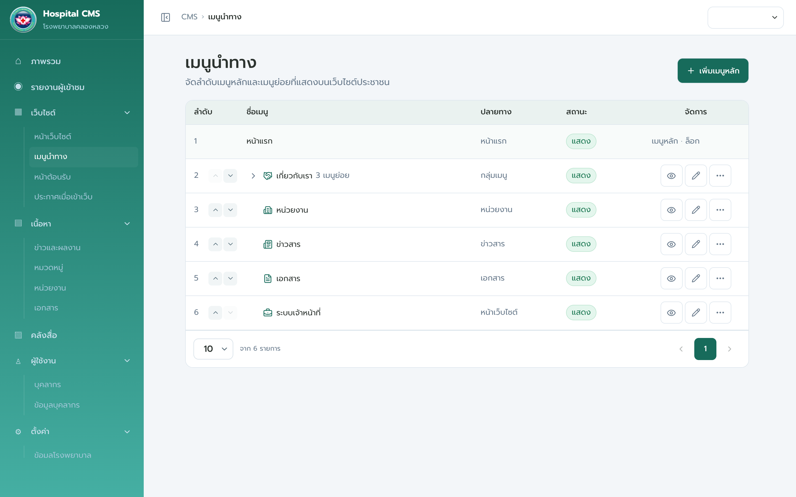
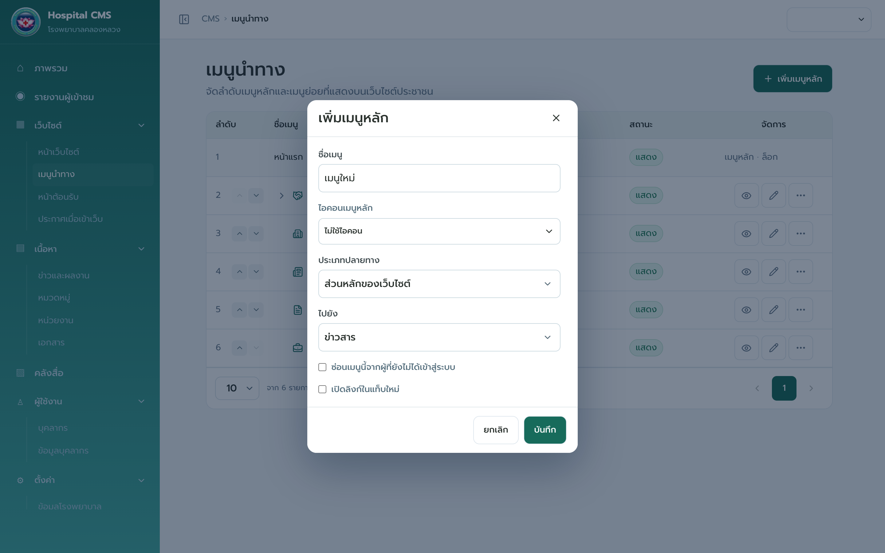

# บทที่ 7 เมนูนำทางเว็บไซต์

เมนูนำทางกำหนดทางเข้าหน้าเว็บไซต์ประชาชน ผู้ดูแลแก้โครงสร้างในหน้าจัดการก่อน แล้วจึงกด **บันทึกและเผยแพร่** เพื่อให้เมนูใหม่ปรากฏจริง

## 7.1 ตรวจและจัดลำดับเมนู

**วัตถุประสงค์:** ทำให้ผู้เยี่ยมชมพบข้อมูลตามลำดับที่เข้าใจง่าย  
**สิทธิ์:** ผู้ดูแลระบบ  
**ทางเข้า:** **เว็บไซต์ → เมนูนำทาง**

1. อ่านตาราง **เมนูนำทาง** ซึ่งมีลำดับ ชื่อเมนู ปลายทาง สถานะ และเครื่องมือจัดการ
2. กดปุ่มลูกศร **เลื่อนขึ้น/ลง** เพื่อเปลี่ยนลำดับ หรือกดปุ่ม **ขยายเมนูย่อย** เพื่อดูรายการภายในเมนูหลัก
3. ใช้ไอคอน **ซ่อน/แสดง**, **แก้ไข** หรือ **ตัวเลือกเพิ่มเติม** ของรายการที่ต้องการ
4. ตรวจแถบแจ้ง **มีการเปลี่ยนแปลงที่ยังไม่ได้เผยแพร่** ก่อนกด **บันทึกและเผยแพร่** การกดเผยแพร่จะเปลี่ยนเมนู Public จึงไม่ได้ทดลองในรอบนี้

*ภาพที่ 7.1 รายการเมนูและเครื่องมือเรียงลำดับ/แก้ไข*

## 7.2 เพิ่มเมนูหลักและเมนูย่อย

**วัตถุประสงค์:** เพิ่มทางลัดไปเนื้อหาที่เผยแพร่  
**สิทธิ์:** ผู้ดูแลระบบ

1. กด **เพิ่มเมนูหลัก** หรือเปิด **ตัวเลือกเพิ่มเติม** ของเมนูหลักแล้วเลือก **เพิ่มเมนูย่อย**
2. กรอก **ชื่อเมนู** ให้สั้นและตรงกับปลายทาง
3. เลือก **ประเภทปลายทาง** และรายการปลายทางที่ระบบแสดง เช่น ส่วนหลักของเว็บไซต์ หน้าเว็บไซต์ หน่วยงาน หรือลิงก์ตามประเภทที่รองรับ
4. ตรวจตัวเลือกการเปิดลิงก์และการซ่อนจากผู้ที่ยังไม่ได้เข้าสู่ระบบ เมื่อใช้กับหน้าจำกัดสิทธิ์
5. กด **บันทึก** ในหน้าต่างเพื่อเพิ่มรายการลงร่างเมนู จากนั้นตรวจลำดับและกด **บันทึกและเผยแพร่** เมื่อได้รับอนุมัติ

*ภาพที่ 7.2 ช่องชื่อเมนู ประเภทปลายทาง และตัวเลือกการแสดง*

**ผลลัพธ์ที่คาดหวัง:** เมนูที่เผยแพร่ปรากฏบนเว็บไซต์ Public และพาไปหน้าที่ถูกต้อง **ข้อควรระวัง:** การลบเมนูหลักอาจนำเมนูย่อยภายในออกจากโครงสร้าง ให้ตรวจรายการลูกก่อนยืนยัน การเปลี่ยนชื่อ URL ของหน้าไม่ควรใช้เป็นเหตุให้ละเลยการตรวจสิทธิ์ของหน้า
