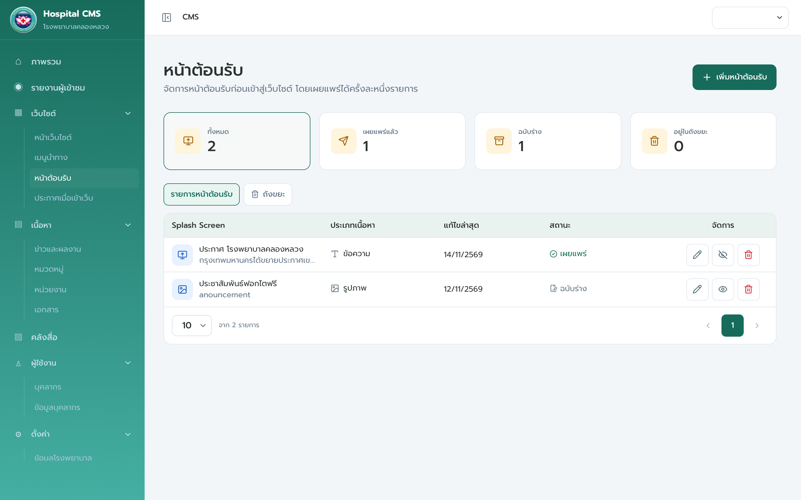
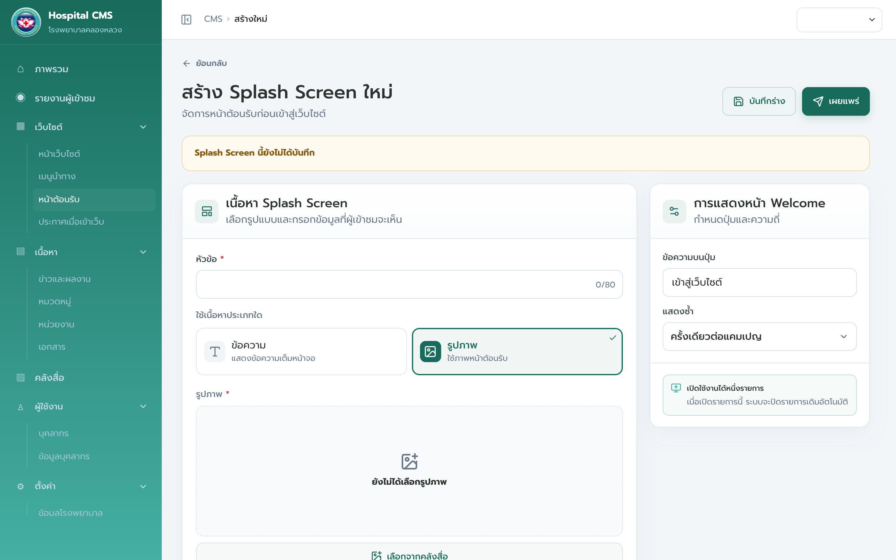
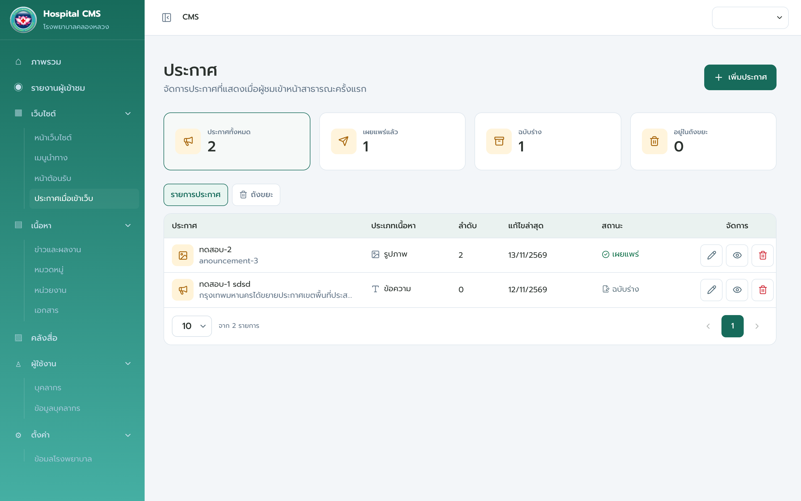
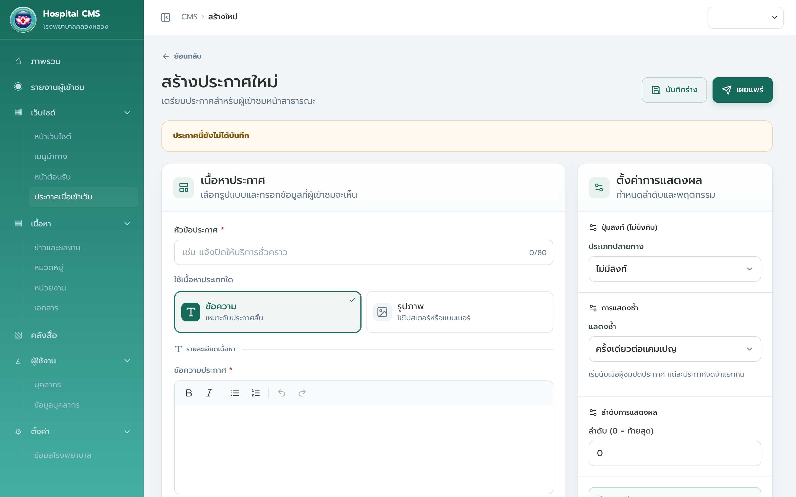

# บทที่ 8 หน้าต้อนรับและประกาศเมื่อเข้าเว็บ

สองเมนูนี้ต่างกัน: **หน้าต้อนรับ** เป็นหน้าก่อนเข้าสู่เว็บไซต์ ส่วน **ประกาศเมื่อเข้าเว็บ** เป็นหน้าต่างแจ้งข้อมูลบนเว็บไซต์ตามเงื่อนไขการแสดง ผู้ดูแลควรเลือกใช้ให้เหมาะกับความสำคัญของข่าวสาร

## 8.1 จัดการหน้าต้อนรับ

**วัตถุประสงค์:** แสดงสารสำคัญก่อนเข้าสู่หน้าแรก  
**สิทธิ์:** ผู้ดูแลระบบ  
**ทางเข้า:** **เว็บไซต์ → หน้าต้อนรับ**

1. ตรวจรายการและตัวกรอง **ทั้งหมด**, **เผยแพร่แล้ว**, **ฉบับร่าง**, **อยู่ในถังขยะ**
2. กด **เพิ่มหน้าต้อนรับ** เพื่อเปิดหน้า **สร้าง Splash Screen ใหม่**
3. กรอกหัวข้อ เลือก **ข้อความ** หรือ **รูปภาพ** แล้วเตรียมเนื้อหาหรือไฟล์จากคลังสื่อ
4. ตรวจ **การแสดงหน้า Welcome** รวมข้อความปุ่มและเงื่อนไขความถี่ที่หน้าจอแสดง
5. กด **บันทึกร่าง** เพื่อเก็บไว้ตรวจ หรือ **เผยแพร่** เมื่อได้รับอนุมัติ ก่อนเผยแพร่ควรใช้หน้า Preview ของรายการที่มีอยู่เพื่อตรวจว่าผู้เข้าชมมองเห็นครบ

*ภาพที่ 8.1 หน้ารายการและสถานะหน้าต้อนรับ*

*ภาพที่ 8.2 ตัวเลือกข้อความ/รูปภาพและการแสดงหน้า Welcome*

**ผลลัพธ์ที่คาดหวัง:** ผู้เยี่ยมชมเห็นหน้าต้อนรับตามเงื่อนไขและกดเข้าสู่เว็บไซต์ได้ **ข้อควรระวัง:** อย่าใช้ภาพที่อ่านไม่ได้บนจอเล็ก หรือแสดงหน้าต้อนรับซ้ำบ่อยจนขัดขวางการเข้าถึงข้อมูลสำคัญ

## 8.2 จัดการประกาศเมื่อเข้าเว็บ

**วัตถุประสงค์:** แจ้งเรื่องสำคัญแบบหน้าต่างบนเว็บไซต์  
**สิทธิ์:** ผู้ดูแลระบบ  
**ทางเข้า:** **เว็บไซต์ → ประกาศเมื่อเข้าเว็บ**

1. ตรวจสถานะประกาศและใช้รายการ/ถังขยะตามงานที่ต้องทำ
2. กด **เพิ่มประกาศ** กรอก **หัวข้อประกาศ** แล้วเลือก **ข้อความ** สำหรับข่าวสั้น หรือ **รูปภาพ** สำหรับโปสเตอร์
3. หากประกาศพาไปข้อมูลเพิ่มเติม ให้เลือกปลายทางลิงก์และตรวจข้อความปุ่ม
4. ตั้งค่าเงื่อนไขการแสดง เช่น ความถี่หรือช่วงเวลาตามตัวเลือกที่หน้าจอรองรับ
5. ตรวจเนื้อหาแล้วกด **บันทึกร่าง** หรือ **เผยแพร่** ตามกระบวนการอนุมัติ ผู้เข้าชมจะเห็นเฉพาะประกาศที่เผยแพร่และเข้าเงื่อนไข

*ภาพที่ 8.3 รายการประกาศพร้อมสถานะและเครื่องมือแก้ไข*

*ภาพที่ 8.4 แบบฟอร์มข้อความประกาศและเงื่อนไขการแสดง*

**ข้อควรระวัง:** ประกาศอาจบังเนื้อหาเมื่อผู้ใช้เปิดหน้า ตรวจว่าปุ่มปิดและเนื้อหาอ่านได้ครบ หากต้องการประกาศคงอยู่ในหน้า ควรพิจารณาบล็อก **ประกาศ** ใน Page Builder แทน
