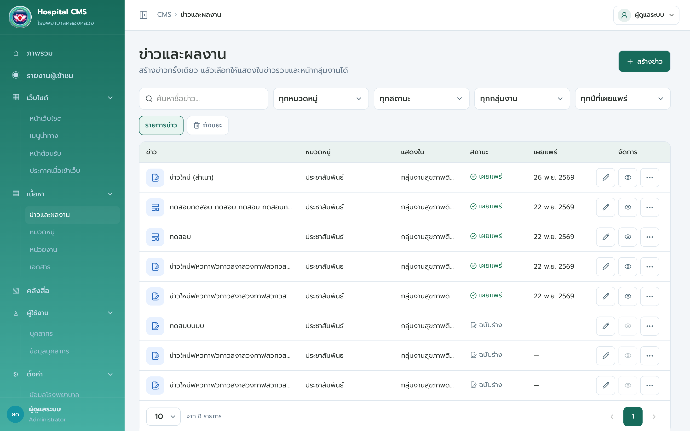
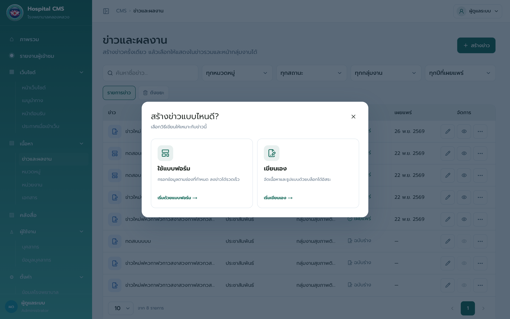
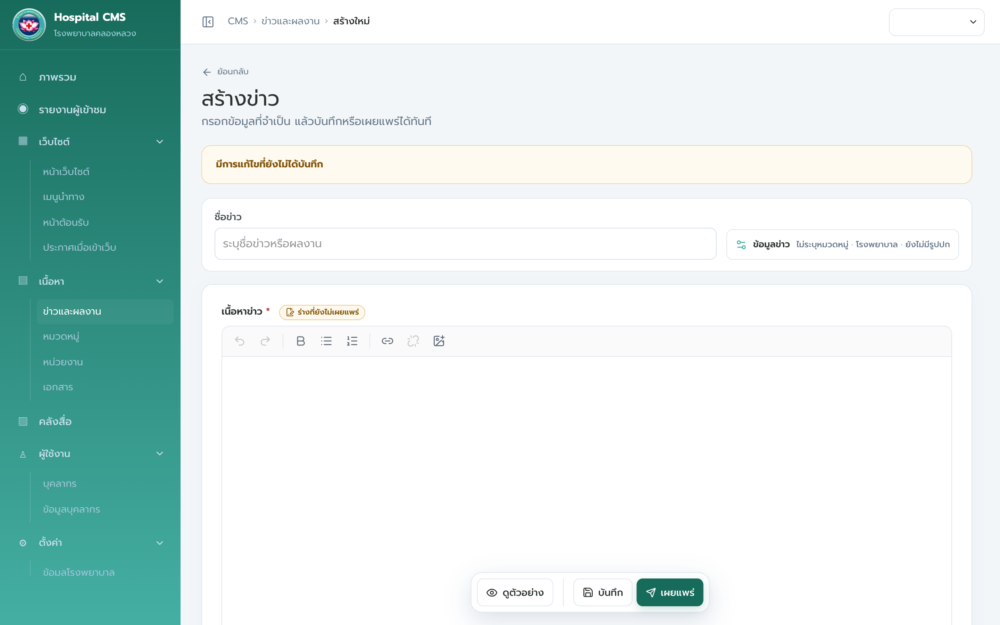
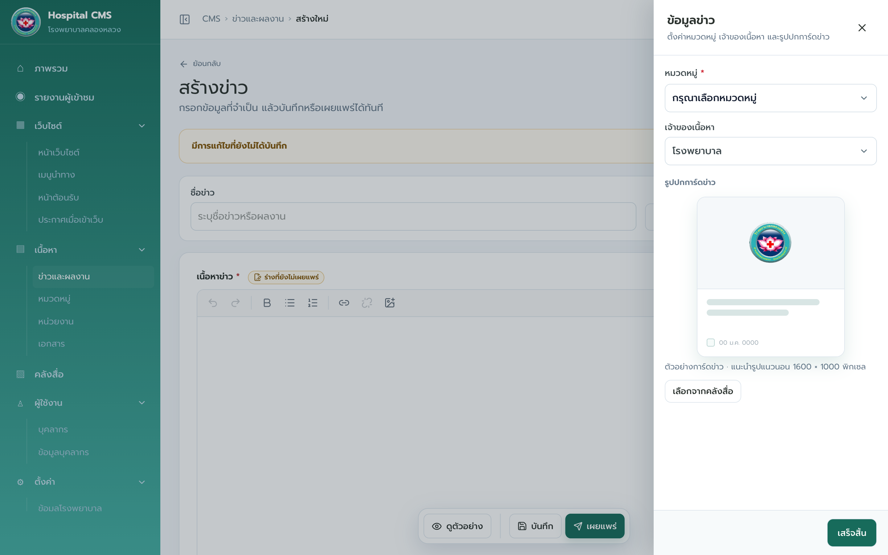
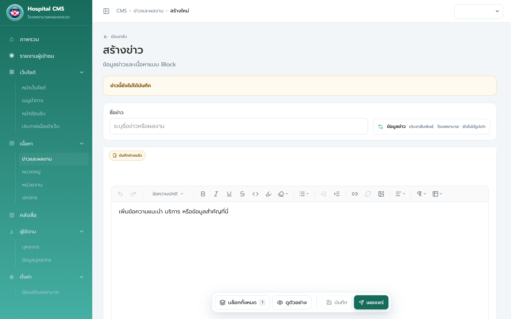

# บทที่ 9 ข่าวและผลงาน

ข่าวและผลงานแสดงต่อประชาชนหลังเผยแพร่ ผู้ดูแลเลือกวิธีเขียนได้สองแบบ: **ใช้แบบฟอร์ม** สำหรับลงข่าวรวดเร็ว และ **เขียนเอง** สำหรับจัดเนื้อหาด้วยบล็อก

## 9.1 ค้นหาและจัดการรายการข่าว

**วัตถุประสงค์:** หาเรื่องเดิม ตรวจสถานะ และเปิดแก้ไข  
**สิทธิ์:** ผู้ดูแลระบบ  
**ทางเข้า:** **เนื้อหา → ข่าวและผลงาน**

1. พิมพ์ใน **ค้นหาชื่อข่าว...** หรือเลือกตัวกรองหมวดหมู่ สถานะ กลุ่มงาน และปีที่เผยแพร่
2. เลือก **รายการข่าว** หรือ **ถังขยะ** ตามงานที่ต้องการ
3. กดไอคอน **แก้ไข** เพื่อเปิดข่าว หรือ **ตัวเลือกเพิ่มเติม** สำหรับคัดลอกเป็นฉบับร่าง ยกเลิกเผยแพร่ และลบตามสถานะ
4. เปิดข่าวที่เผยแพร่บนเว็บไซต์ Public เพื่อตรวจผลหลังเปลี่ยนเนื้อหา

*ภาพที่ 9.1 ตัวกรองและรายการข่าว/ผลงาน*

## 9.2 เลือกวิธีสร้างข่าว

**วัตถุประสงค์:** ใช้เครื่องมือให้เหมาะกับรูปแบบเนื้อหา  
**สิทธิ์:** ผู้ดูแลระบบ  
**ทางเข้า:** **ข่าวและผลงาน → สร้างข่าว**

1. เลือก **ใช้แบบฟอร์ม** เมื่อเนื้อหาเป็นข่าวทั่วไปและต้องการกรอกตามช่อง
2. เลือก **เขียนเอง** เมื่อต้องจัดลำดับบล็อก ภาพ และส่วนประกอบหลายแบบ
3. ทั้งสองวิธีใช้ข้อมูลข่าว เช่น หมวดหมู่ เจ้าของเนื้อหา และรูปปกการ์ดข่าวร่วมกัน

*ภาพที่ 9.2 ตัวเลือก **ใช้แบบฟอร์ม** และ **เขียนเอง***

## 9.3 เขียนข่าวด้วยแบบฟอร์ม

1. กรอก **ชื่อข่าวหรือผลงาน** ในช่องชื่อเรื่อง
2. กรอก **เนื้อหาข่าว** ด้วยเครื่องมือข้อความ เช่น ตัวหนา รายการ และลิงก์ แทรกรูป/วิดีโอ/PDF/ไฟล์แนบได้ตามเครื่องมือที่แสดง
3. เปิด **ข้อมูลข่าว** เลือก **หมวดหมู่**, **เจ้าของเนื้อหา** (โรงพยาบาลหรือหน่วยงาน) และรูปปกการ์ดข่าวจากคลังสื่อ
4. กด **ดูตัวอย่าง** เพื่อตรวจหน้าข่าวบนเดสก์ท็อป แท็บเล็ต หรือมือถือ
5. กด **บันทึก** เพื่อเก็บร่าง หรือ **เผยแพร่** เมื่อเนื้อหาได้รับอนุมัติ ข่าวที่เผยแพร่แล้วมีทางเลือกยกเลิกเผยแพร่

*ภาพที่ 9.3 ช่องชื่อและเนื้อหาข่าวแบบฟอร์ม*

*ภาพที่ 9.4 แผงหมวดหมู่ เจ้าของเนื้อหา และรูปปก*

## 9.4 เขียนข่าวด้วยบล็อก

**วัตถุประสงค์:** สร้างข่าวที่มีส่วนประกอบหลายชนิด  
**สิทธิ์:** ผู้ดูแลระบบ  
**ทางเข้า:** **สร้างข่าว → เขียนเอง**

1. ตั้งชื่อข่าวและเปิดข้อมูลข่าวเพื่อตรวจหมวดหมู่ เจ้าของ และรูปปก
2. ใช้พื้นที่บล็อกเพื่อเพิ่มส่วนข้อความ ภาพ หรือสื่อที่ข่าวรองรับ เลือกบล็อกตามเมนูที่ตัวแก้ไขข่าวแสดง ซึ่งเป็นชุดย่อยของ Page Builder
3. จัดลำดับและตั้งค่าบล็อกตามหลักในบทที่ 6 แล้วตรวจ **ดูตัวอย่าง**
4. บันทึกร่างหรือเผยแพร่ตามกระบวนการอนุมัติของโรงพยาบาล

*ภาพที่ 9.5 พื้นที่เขียนข่าวแบบบล็อก*

**ผลลัพธ์ที่คาดหวัง:** ข่าวร่างอยู่ในรายการผู้ดูแลแต่ยังไม่แสดงต่อประชาชน; ข่าวเผยแพร่ปรากฏที่หน้า **ข่าวสาร** **ข้อควรระวัง:** ตรวจคำผิด วันที่ ภาพบุคคล ลิงก์ และไฟล์แนบก่อนเผยแพร่ ไม่ลงข้อมูลผู้ป่วยหรือข้อมูลส่วนบุคคลโดยไม่มีสิทธิ์
