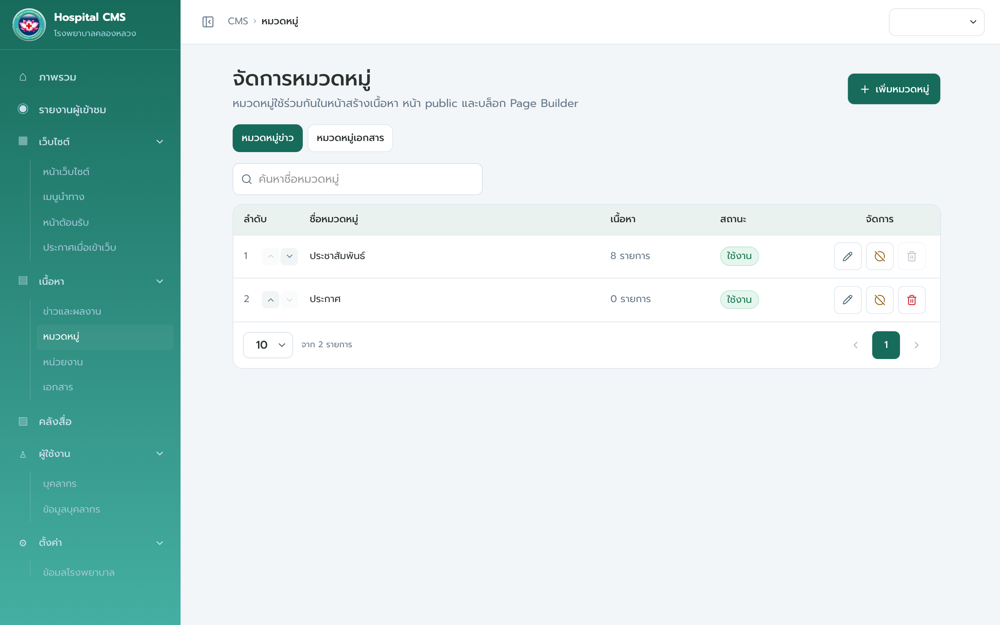
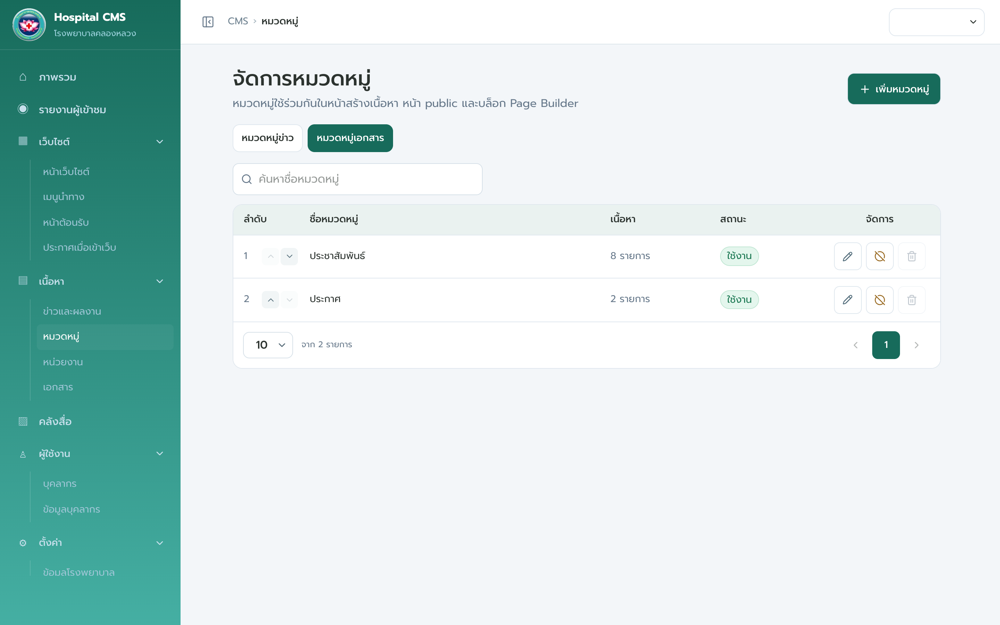
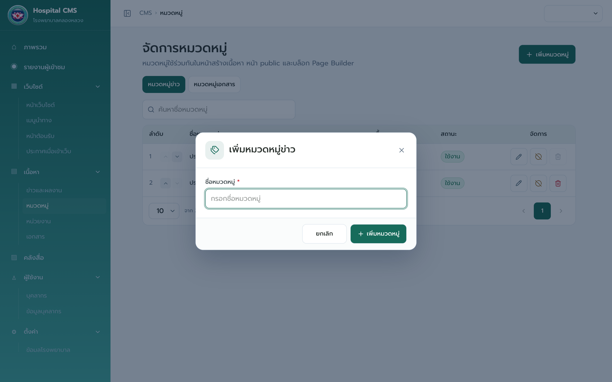

# บทที่ 10 หมวดหมู่ข่าวและเอกสาร

หมวดหมู่ช่วยให้ผู้ดูแลและผู้เข้าชมกรองรายการได้ ระบบแยกหมวด **ข่าว** กับ **เอกสาร** แต่จัดการอยู่หน้าเดียวกัน

## 10.1 เลือกและค้นหาหมวดหมู่

**วัตถุประสงค์:** ตรวจรายการก่อนเพิ่มหรือแก้ เพื่อไม่ให้ชื่อซ้ำ  
**สิทธิ์:** ผู้ดูแลระบบ  
**ทางเข้า:** **เนื้อหา → หมวดหมู่** หรือ **เอกสาร → จัดการหมวดหมู่**

1. เลือกแท็บ **หมวดหมู่ข่าว** หรือ **หมวดหมู่เอกสาร** ให้ตรงกับเนื้อหาที่จะจัด
2. พิมพ์ในช่อง **ค้นหาหมวดหมู่ข่าว/เอกสาร** เพื่อตรวจว่ามีชื่อที่ต้องการอยู่แล้วหรือไม่
3. ดูจำนวนรายการที่ใช้งานหมวดนั้นและสถานะ **ใช้งาน** ก่อนแก้หรือปิดใช้งาน

*ภาพที่ 10.1 แท็บและรายการหมวดหมู่ข่าว*

*ภาพที่ 10.2 แท็บและรายการหมวดหมู่เอกสาร*

## 10.2 เพิ่มและดูแลหมวดหมู่

**วัตถุประสงค์:** จัดโครงสร้างหมวดให้ใช้งานง่าย  
**สิทธิ์:** ผู้ดูแลระบบ

1. เลือกแท็บให้ถูก แล้วกด **เพิ่มหมวดหมู่**
2. กรอก **ชื่อหมวดหมู่** ให้สั้น ชัด และไม่ซ้ำ จากนั้นกดปุ่มเพิ่มในหน้าต่างเมื่อพร้อม
3. ใช้ลูกศร **เลื่อนขึ้น/ลง** เพื่อจัดลำดับ หรือปุ่ม **เปลี่ยนชื่อ** เมื่อคำเรียกไม่เหมาะสม
4. ใช้ **ปิดใช้งาน/เปิดใช้งาน** เมื่อไม่ต้องการให้เลือกหมวดนั้นชั่วคราว การ **ลบหมวดหมู่** ควรตรวจจำนวนเนื้อหาที่ใช้ก่อน

*ภาพที่ 10.3 แบบฟอร์มชื่อหมวดหมู่ใหม่*

**ผลลัพธ์ที่คาดหวัง:** หมวดใหม่ปรากฏในตัวเลือกของข่าวหรือเอกสารตามแท็บที่เลือก **ข้อควรระวัง:** เปลี่ยนหรือลบหมวดที่มีเนื้อหาอยู่ อาจกระทบตัวกรองและบล็อกที่ดึงข้อมูลตามหมวด ควรตรวจหน้าข่าว/เอกสารหลังจัดหมวดใหม่
