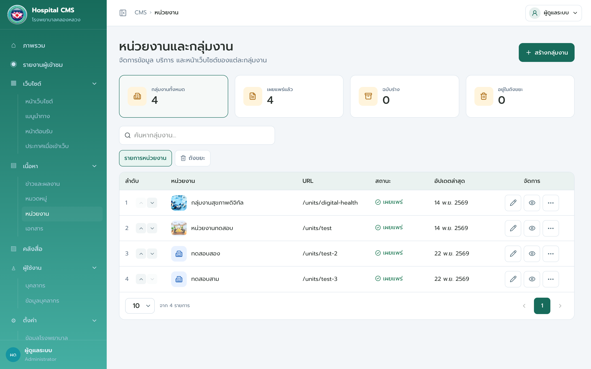
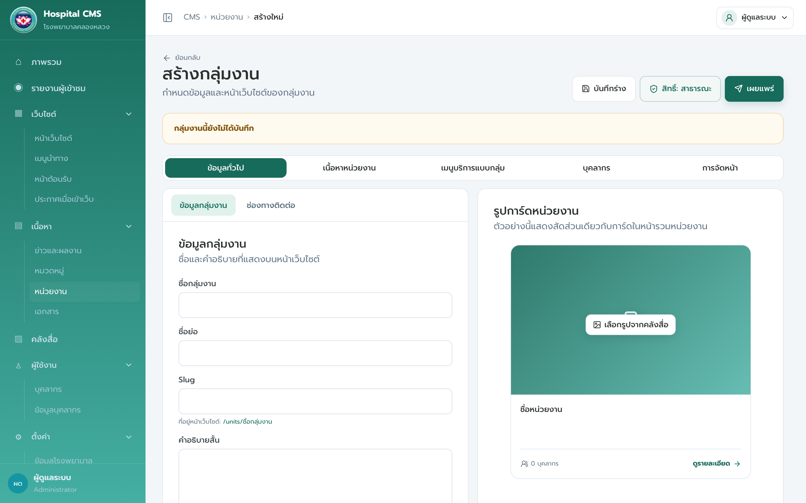
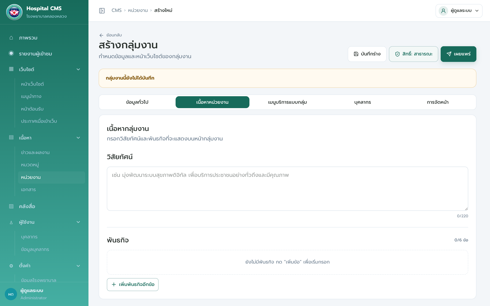
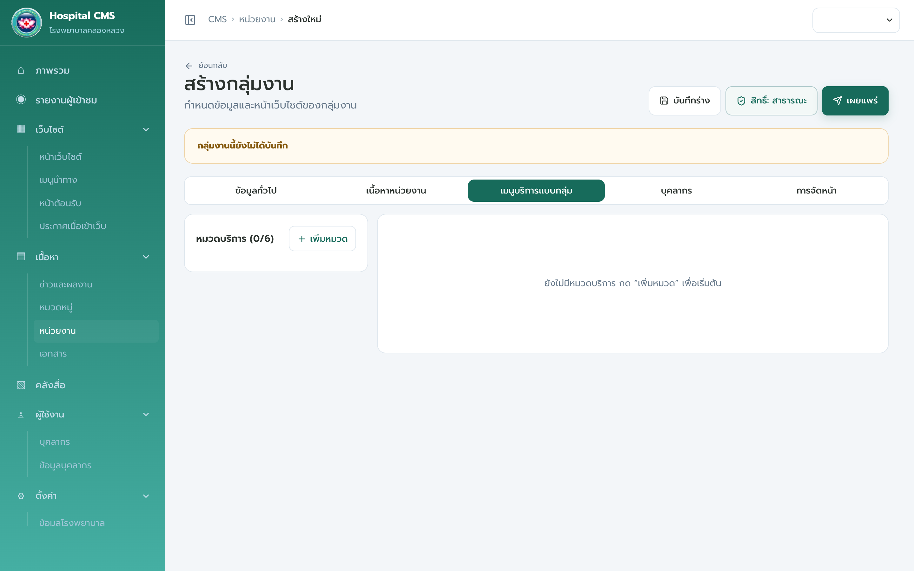
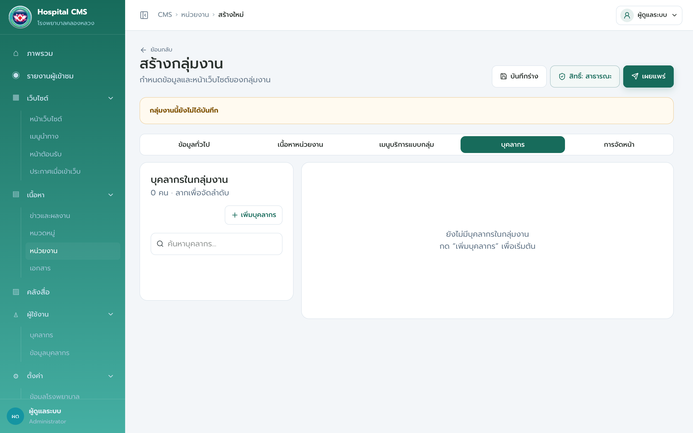
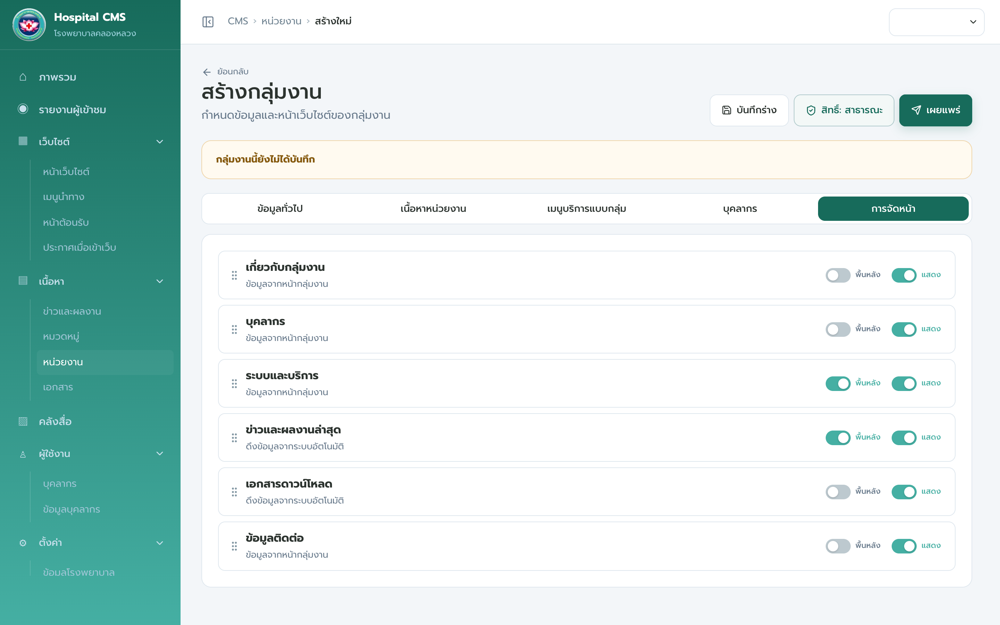

# บทที่ 11 หน่วยงานและหน้าหน่วยงาน

หน่วยงานเป็นกลุ่มเนื้อหาภายในโรงพยาบาล ไม่ใช่เว็บไซต์แยก ผู้ดูแลสร้างหน้าหน่วยงาน จัดข้อมูลติดต่อ บริการ บุคลากร และสิทธิ์การเข้าถึงได้

## 11.1 รายการหน่วยงาน

**วัตถุประสงค์:** ค้นหาและติดตามสถานะหน้า  
**สิทธิ์:** ผู้ดูแลระบบ  
**ทางเข้า:** **เนื้อหา → หน่วยงาน**

1. ดูตัวกรอง **ทั้งหมด**, **เผยแพร่แล้ว**, **ฉบับร่าง**, **อยู่ในถังขยะ** และค้นหาชื่อหน่วยงาน
2. กด **แก้ไข** ของแถวที่ต้องการ หรือ **สร้างกลุ่มงาน** เพื่อเปิดแบบฟอร์มใหม่
3. ใช้ปุ่มเลื่อนขึ้น/ลงเพื่อจัดลำดับที่แสดงบนหน้า Public ใช้ตัวเลือกเพิ่มเติมสำหรับสถานะและถังขยะเมื่อจำเป็น

*ภาพที่ 11.1 รายการหน่วยงานและสถานะ*

## 11.2 ข้อมูลทั่วไปและช่องทางติดต่อ

**วัตถุประสงค์:** ระบุชื่อและข้อมูลที่ผู้เข้าชมใช้ติดต่อ  
**สิทธิ์:** ผู้ดูแลระบบ  
**ทางเข้า:** **สร้างกลุ่มงาน/แก้ไข → ข้อมูลทั่วไป**

1. ในแท็บย่อย **ข้อมูลกลุ่มงาน** กรอกชื่อ คำอธิบาย URL หรือ slug และเลือกรูปการ์ดหน่วยงานจากคลังสื่อเมื่อจำเป็น
2. เปิดแท็บย่อย **ช่องทางติดต่อ** ใส่สถานที่ โทรศัพท์/เบอร์ต่อ อีเมล และเวลาให้บริการตามช่องที่มี
3. ตรวจการแสดงรูปการ์ดและตัวอย่างข้อมูลก่อนบันทึก

*ภาพที่ 11.2 ช่องข้อมูลกลุ่มงานและรูปการ์ด*

## 11.3 เนื้อหา เมนูบริการ และบุคลากร

**วัตถุประสงค์:** ทำหน้าหน่วยงานให้ผู้เข้าชมเข้าใจบริการและผู้รับผิดชอบ  
**สิทธิ์:** ผู้ดูแลระบบ

1. เปิดแท็บ **เนื้อหาหน่วยงาน** เพื่อใส่หัวข้อและข้อความแนะนำ รวมส่วนเนื้อหาที่หน้าแสดง
2. เปิด **เมนูบริการแบบกลุ่ม** เพิ่มชื่อกลุ่มและรายการบริการ เลือกปลายทางของแต่ละลิงก์และลำดับการแสดง
3. เปิด **บุคลากร** เพื่อเลือกบุคคลจากบัญชีที่เกี่ยวข้องและจัดลำดับ/รูปภาพตามที่หน้าแสดง ตรวจการอนุญาตเผยแพร่ข้อมูลบุคลากร

*ภาพที่ 11.3 พื้นที่เขียนเนื้อหาหน่วยงาน*

*ภาพที่ 11.4 แท็บจัดกลุ่มบริการและลิงก์*

*ภาพที่ 11.5 แท็บเลือกบุคลากรของหน่วยงาน*

## 11.4 การจัดหน้า สิทธิ์ และการเผยแพร่

**วัตถุประสงค์:** กำหนดส่วนที่ปรากฏและผู้เข้าถึงได้  
**สิทธิ์:** ผู้ดูแลระบบ

1. เปิด **การจัดหน้า** แล้วกำหนดการแสดงแต่ละส่วน เช่น ข่าว เอกสาร เมนูบริการ และข้อมูลติดต่อ ตามสวิตช์ในหน้าจอ
2. กดปุ่ม **สิทธิ์: ...** เลือก **สาธารณะ**, **เฉพาะผู้เข้าสู่ระบบ** หรือ **กำหนดผู้มีสิทธิ์** แล้วระบุผู้ใช้/หน่วยงานตามกรณี
3. กด **บันทึกร่าง** หากต้องตรวจต่อ หรือ **เผยแพร่** เมื่อทุกแท็บพร้อมและได้รับอนุมัติ หากหน่วยงานเคยเผยแพร่แล้ว ร่างใหม่ยังไม่เปลี่ยนหน้าที่ประชาชนเห็นจนกว่าจะเผยแพร่

*ภาพที่ 11.6 สวิตช์เลือกส่วนที่จะแสดงบนหน้าหน่วยงาน*

**ผลลัพธ์ที่คาดหวัง:** หน่วยงานที่เผยแพร่แล้วปรากฏในรายการ Public ตามสิทธิ์ที่กำหนด **ข้อควรระวัง:** ตรวจข้อมูลติดต่อและรายชื่อบุคลากรก่อนเผยแพร่ และอย่าเปลี่ยนสิทธิ์เป็นสาธารณะโดยไม่ตรวจเนื้อหาภายใน
