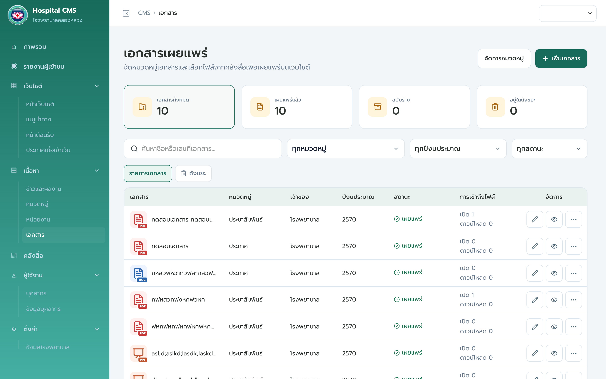
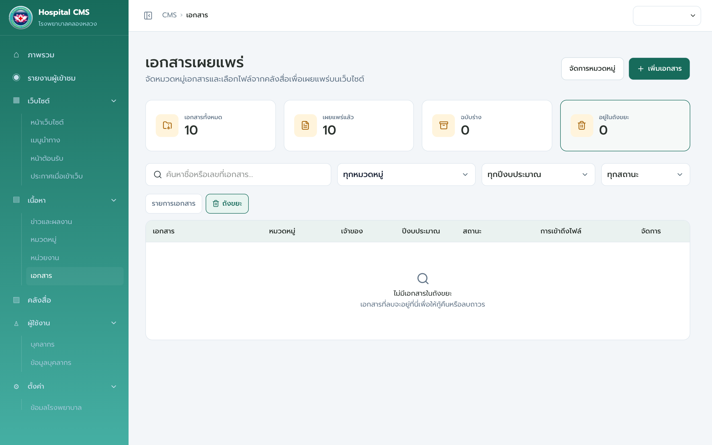
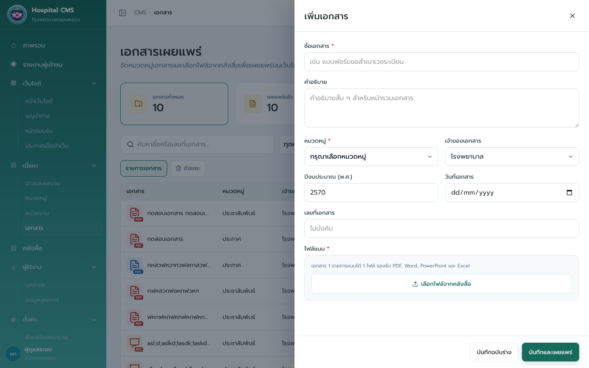

# บทที่ 12 เอกสารเผยแพร่

เมนูเอกสารใช้เผยแพร่ไฟล์พร้อมชื่อ หมวดหมู่ เจ้าของ และปีงบประมาณ ผู้เข้าชมเห็นเฉพาะรายการที่เผยแพร่แล้ว

## 12.1 ค้นหาและกรองเอกสาร

**วัตถุประสงค์:** หาไฟล์เดิมและตรวจสถานะก่อนแก้  
**สิทธิ์:** ผู้ดูแลระบบ  
**ทางเข้า:** **เนื้อหา → เอกสาร**

1. ดูการ์ด **เอกสารทั้งหมด**, **เผยแพร่แล้ว**, **ฉบับร่าง** และ **อยู่ในถังขยะ**
2. ค้นด้วย **ชื่อหรือเลขที่เอกสาร** แล้วกรอง **หมวดหมู่**, **ปีงบประมาณ** และ **สถานะ**
3. เลือก **แก้ไข** ของแถว หรือใช้ตัวเลือกของรายการสำหรับงานตามสถานะ เช่น ยกเลิกเผยแพร่ เก็บถาวร และลบ
4. ใช้แท็บ **ถังขยะ** เพื่อดูรายการที่ย้ายออกและกู้คืนเมื่อจำเป็น

*ภาพที่ 12.1 รายการเอกสารและชุดตัวกรอง*

*ภาพที่ 12.2 แท็บถังขยะ ซึ่งอาจว่างหากยังไม่มีรายการที่ลบ*

## 12.2 เพิ่มและแก้ไขเอกสาร

**วัตถุประสงค์:** เตรียมไฟล์ให้ผู้ใช้ค้นหาและดาวน์โหลดได้ถูกต้อง  
**สิทธิ์:** ผู้ดูแลระบบ  
**ทางเข้า:** **เอกสาร → เพิ่มเอกสาร** หรือปุ่มแก้ไขของรายการ

1. กรอก **ชื่อเอกสาร** ให้สื่อความหมาย และคำอธิบายเมื่อมี
2. เลือก **หมวดหมู่** และ **เจ้าของเอกสาร** ตรวจว่าเอกสารเป็นของโรงพยาบาลหรือหน่วยงานใด
3. กรอก **ปีงบประมาณ** และ **เลขที่เอกสาร** เมื่อเกี่ยวข้อง
4. เลือกไฟล์จากคลังสื่อหรือเพิ่มไฟล์ตามปุ่มที่แบบฟอร์มแสดง ตรวจชนิดไฟล์และข้อความแจ้งขนาด/ชนิดที่รองรับ
5. กด **บันทึกฉบับร่าง** เมื่อต้องตรวจต่อ หรือ **บันทึกและเผยแพร่** หลังตรวจไฟล์และได้รับอนุมัติ

*ภาพที่ 12.3 ช่องชื่อ หมวด เจ้าของ ปีงบประมาณ และไฟล์*

**ผลลัพธ์ที่คาดหวัง:** เอกสารร่างอยู่ในรายการผู้ดูแล; เอกสารเผยแพร่ปรากฏในหน้า **เอกสาร** ของเว็บไซต์และดาวน์โหลดได้ **ข้อควรระวัง:** ตรวจว่าไฟล์ไม่ใช่ร่างภายในหรือมีข้อมูลส่วนบุคคล ตรวจปีงบประมาณและเลขที่เอกสารก่อนเผยแพร่
