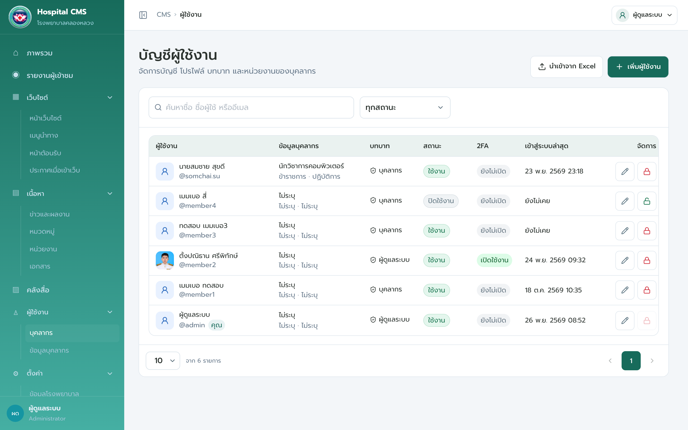
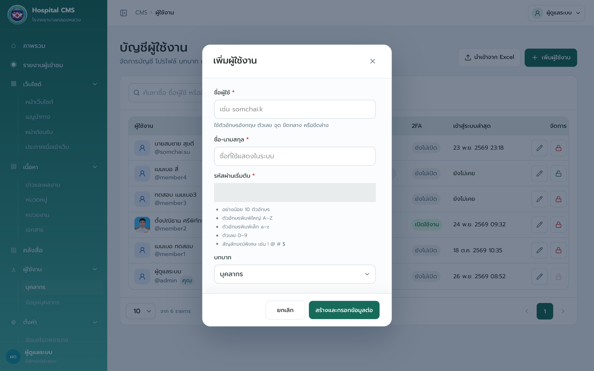
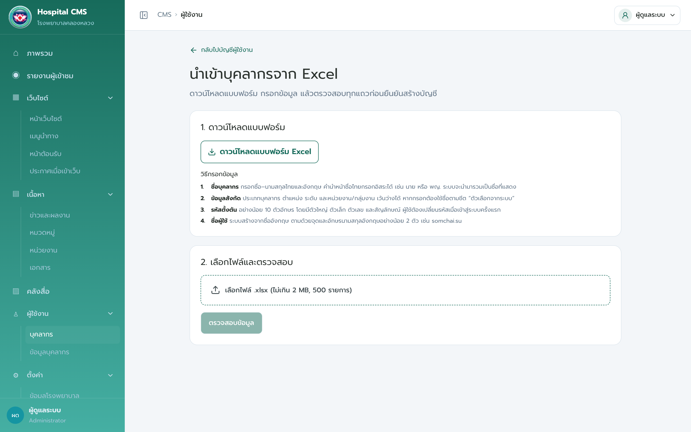
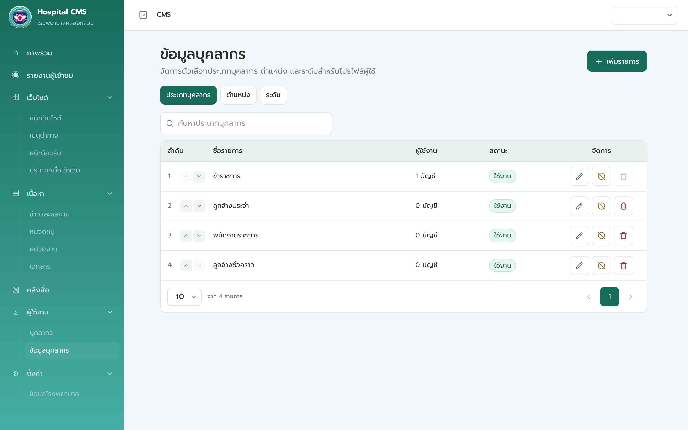

# บทที่ 13 บัญชีบุคลากรและข้อมูลบุคลากร

ผู้ดูแลสร้างบัญชีให้บุคลากร ไม่มีการลงทะเบียนสาธารณะ บัญชีใหม่และบัญชีที่ผู้ดูแลรีเซ็ตรหัสผ่านต้องเปลี่ยนรหัสผ่านเมื่อเข้าใช้ครั้งถัดไป การจัดการบัญชีมีผลต่อสิทธิ์และ session จึงควรตรวจตัวบุคคลก่อนทุกครั้ง

## 13.1 ค้นหาและจัดการบัญชีผู้ใช้งาน

**วัตถุประสงค์:** ตรวจบัญชี บทบาท และสถานะการเข้าใช้  
**สิทธิ์:** ผู้ดูแลระบบ  
**ทางเข้า:** **ผู้ใช้งาน → บุคลากร**

1. ค้นด้วย **ชื่อ ชื่อผู้ใช้ หรืออีเมล** แล้วเลือกตัวกรองสถานะ เช่น **ใช้งาน**, **ปิดใช้งาน**, **ล็อกชั่วคราว** หรือสถานะ OTP ที่ระบบแสดง
2. อ่านคอลัมน์บทบาท สถานะ และ 2FA ของบัญชีที่ต้องการ
3. กด **แก้ไข** เพื่อปรับข้อมูลที่อนุญาต หรือใช้ **ตัวเลือกเพิ่มเติม** เมื่อต้องปลดล็อก รีเซ็ตรหัสผ่าน/2FA เพิกถอน session หรือดำเนินการอื่นตามสถานะ

*ภาพที่ 13.1 ตัวกรองและตารางบัญชี*

## 13.2 เพิ่มบัญชีและกำหนดบทบาท

**วัตถุประสงค์:** ให้บุคลากรที่ได้รับอนุญาตเข้าใช้ระบบ  
**สิทธิ์:** ผู้ดูแลระบบ  
**ทางเข้า:** **บุคลากร → เพิ่มผู้ใช้งาน**

1. กรอกชื่อที่แสดงและชื่อผู้ใช้ตามช่องในหน้าต่างเพิ่มบัญชี
2. เลือกบทบาทให้ตรงหน้าที่: **ผู้ดูแลระบบ** ใช้เมนู Admin; **ผู้ใช้งานทั่วไป** ใช้หน้าและข้อมูลที่ได้รับสิทธิ์
3. กำหนดรหัสผ่านเริ่มต้นตามเงื่อนไขของระบบและตรวจข้อมูลบุคลากรที่เกี่ยวข้อง
4. กดปุ่มสร้างบัญชีเมื่อได้รับอนุมัติ แล้วแจ้งข้อมูลเริ่มต้นแก่เจ้าของบัญชีผ่านช่องทางปลอดภัยโดยไม่ส่งผ่านเอกสารคู่มือ

*ภาพที่ 13.2 หน้าต่างเพิ่มบัญชี*

**ข้อควรระวัง:** ให้สิทธิ์ผู้ดูแลเท่าที่จำเป็น อย่าลบบัญชีผู้ดูแลคนสุดท้ายที่ยังใช้งานได้ การเปลี่ยนบทบาทอาจเพิกถอน session เดิม

## 13.3 นำเข้าจาก Excel

**วัตถุประสงค์:** เตรียมบัญชีบุคลากรจำนวนมากจากไฟล์  
**สิทธิ์:** ผู้ดูแลระบบ  
**ทางเข้า:** **บุคลากร → นำเข้าจาก Excel**

1. อ่าน **ดาวน์โหลดแบบฟอร์ม** และคำอธิบายคอลัมน์ที่หน้าจอแสดง
2. เตรียมไฟล์ตามรูปแบบ โดยตรวจชื่อผู้ใช้และข้อมูลซ้ำก่อนนำเข้า
3. เลือกไฟล์แล้วกด **ตรวจสอบข้อมูล** เพื่อดูรายการก่อนยืนยันการนำเข้า
4. หากข้อมูลไม่ผ่าน ให้แก้ไฟล์และตรวจใหม่; หากผ่านให้ตรวจผลรวมก่อนดำเนินการยืนยันในหน้าถัดไป

*ภาพที่ 13.3 ขั้นตอนดาวน์โหลดแบบฟอร์มและตรวจไฟล์ก่อนนำเข้า*

## 13.4 จัดการข้อมูลบุคลากร

**วัตถุประสงค์:** รักษารายการตัวเลือกมาตรฐานในโปรไฟล์  
**สิทธิ์:** ผู้ดูแลระบบ  
**ทางเข้า:** **ผู้ใช้งาน → ข้อมูลบุคลากร**

1. เลือกแท็บ **ประเภทบุคลากร**, **ตำแหน่ง** หรือ **ระดับ**
2. ค้นหารายการเดิมก่อนกด **เพิ่มรายการ** เพื่อลดชื่อซ้ำ
3. ใช้ปุ่มเลื่อนขึ้น/ลงเพื่อเรียงลำดับ หรือ **เปลี่ยนชื่อ**, **ปิดใช้งาน**, **ลบ** ตามความจำเป็น
4. ตรวจจำนวนผู้ใช้ที่อ้างถึงรายการก่อนปิดใช้งานหรือลบ

*ภาพที่ 13.4 แท็บประเภทบุคลากร ตำแหน่ง และระดับ*

## 13.5 รีเซ็ตรหัสผ่านและ 2FA

เมื่อต้องช่วยผู้ใช้ ให้ค้นหาบัญชีให้ตรง เปิด **ตัวเลือกเพิ่มเติม** แล้วเลือกการดำเนินการที่จำเป็น เช่น **รีเซ็ตรหัสผ่าน**, **ปลดล็อกการเข้าสู่ระบบ** หรือ **รีเซ็ต 2FA** ระบบอาจขอรหัสผ่านผู้ดูแลเพื่อยืนยัน การรีเซ็ต 2FA ทำให้คีย์ OTP และรหัสกู้บัญชีเดิมใช้ไม่ได้ และบัญชีอาจออกจากระบบทุกอุปกรณ์ ดำเนินการเฉพาะหลังยืนยันตัวบุคคลตามระเบียบโรงพยาบาล
