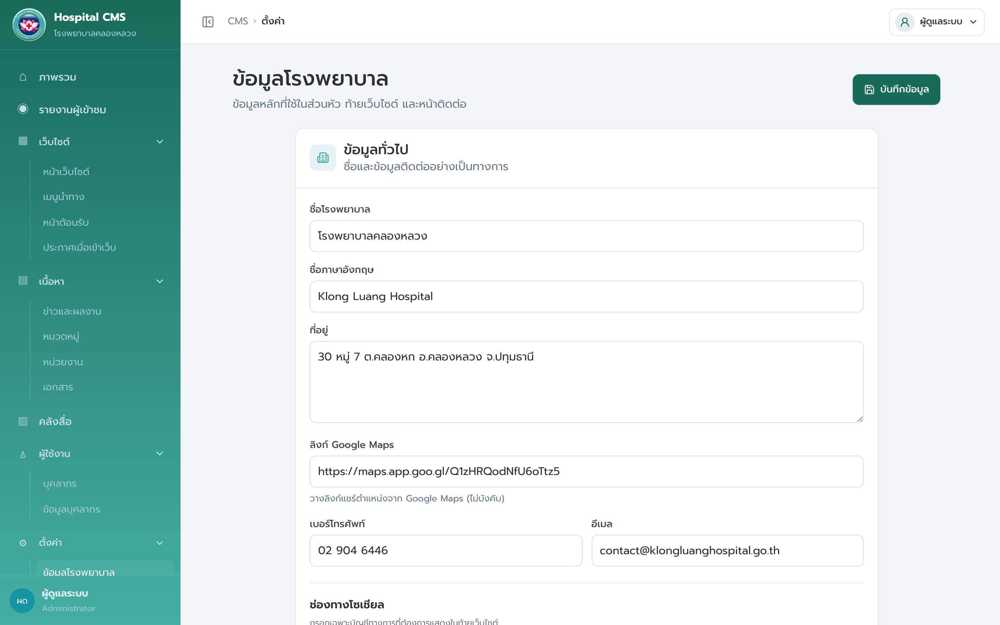
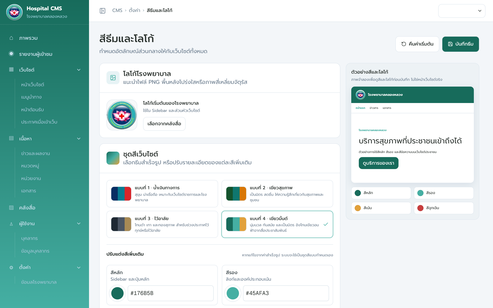

# บทที่ 14 ข้อมูลโรงพยาบาล สีธีม และโลโก้

การตั้งค่านี้มีผลต่อหลายหน้าของเว็บไซต์ ควรให้ผู้รับผิดชอบข้อมูลและภาพลักษณ์ตรวจความถูกต้องก่อนบันทึก

## 14.1 ข้อมูลโรงพยาบาล

**วัตถุประสงค์:** แสดงข้อมูลติดต่อและช่องทางทางการให้ตรงกันทุกหน้า  
**สิทธิ์:** ผู้ดูแลระบบ  
**ทางเข้า:** **ตั้งค่า → ข้อมูลโรงพยาบาล**

1. ตรวจชื่อโรงพยาบาล ชื่อภาษาอังกฤษ ที่อยู่ และลิงก์ **Google Maps** ในส่วน **ข้อมูลทั่วไป**
2. ตรวจโทรศัพท์ อีเมล และช่องทางโซเชียล เช่น Facebook, YouTube และ LINE OA ตามช่องที่หน้าแสดง
3. เปิดลิงก์ที่กรอกเพื่อตรวจว่าเป็นช่องทางทางการและใช้งานได้
4. กด **บันทึกข้อมูล** หลังได้รับการตรวจทาน แล้วเปิดเว็บไซต์ Public เพื่อตรวจส่วนหัว/ท้ายและหน้าติดต่อ

*ภาพที่ 14.1 แบบฟอร์มข้อมูลทั่วไปและช่องทางติดต่อ*

**ผลลัพธ์ที่คาดหวัง:** ข้อมูลโรงพยาบาลที่เผยแพร่แสดงตรงตามที่บันทึก **ข้อควรระวัง:** ใช้ลิงก์ที่ปลอดภัยและเป็นทางการ ไม่ใส่เบอร์ส่วนตัวในช่องสาธารณะ

## 14.2 สีธีมและโลโก้

**วัตถุประสงค์:** ควบคุมสีและภาพลักษณ์ของเว็บไซต์ให้สม่ำเสมอ  
**สิทธิ์:** ผู้ดูแลระบบ  
**ทางเข้า:** **ตั้งค่า → สีธีมและโลโก้**

1. ตรวจ **โลโก้โรงพยาบาล** แล้วกด **เลือกจากคลังสื่อ** หากต้องเปลี่ยนไฟล์
2. เลือกชุดสีที่หน้าแสดง เช่น แบบทางการ แบบสุขภาพ โทนไว้อาลัย หรือเขียวมิ้นต์ หรือปรับค่าสีตามตัวเลือกที่มี
3. ดูตัวอย่างส่วนหัว ปุ่ม ข้อความ และพื้นหลังในแผง Preview เพื่อเช็กความอ่านง่าย
4. กด **บันทึกธีม** เมื่อได้รับอนุมัติ หากต้องการกลับค่าเริ่มต้นให้พิจารณา **คืนค่าเริ่มต้น** และตรวจผลก่อนบันทึก

*ภาพที่ 14.2 โลโก้ ชุดสี และตัวอย่างเว็บไซต์*

**ข้อควรระวัง:** ตรวจความตัดกันของสีตัวอักษร/พื้นหลังและภาพบนมือถือก่อนใช้จริง ชุดสีเป็นการตั้งค่าระดับเว็บไซต์ ไม่ใช่ของบล็อกแต่ละชิ้น
