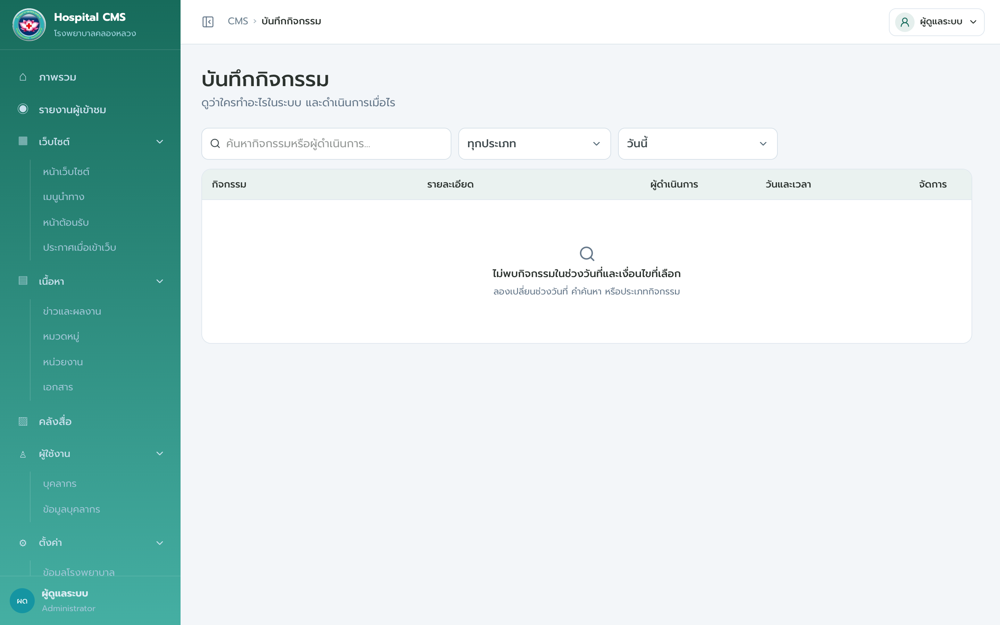
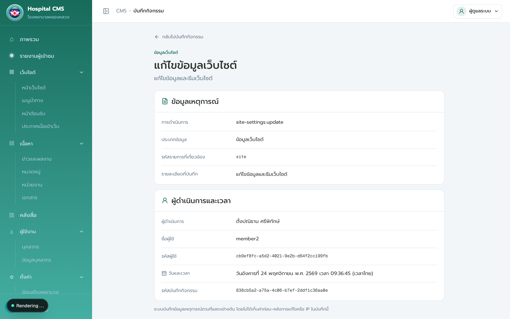
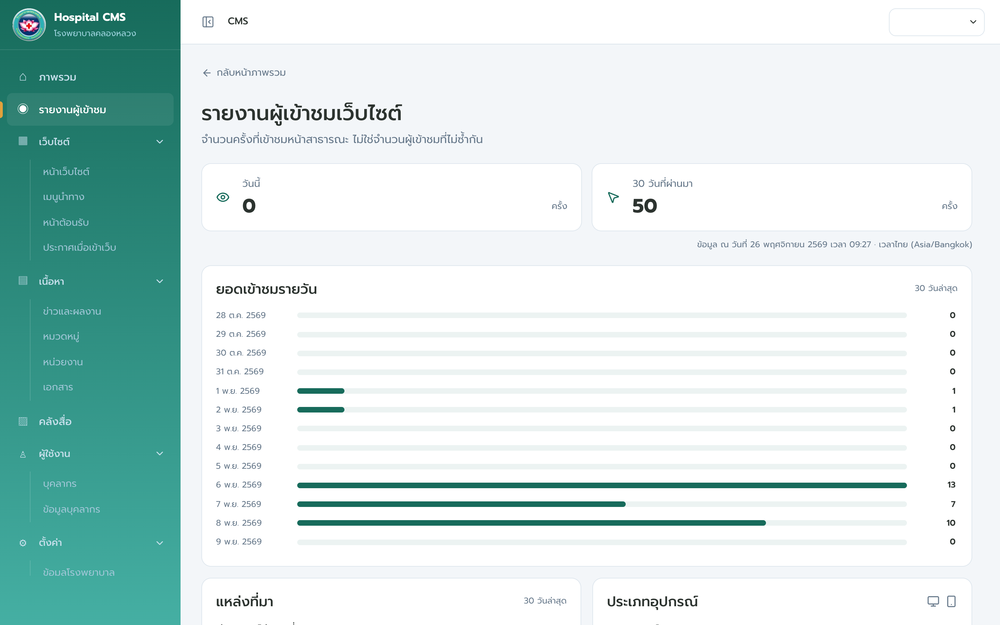

# บทที่ 15 บันทึกกิจกรรมและการติดตามระบบ

บันทึกกิจกรรมช่วยตรวจว่าใครดำเนินการกับข้อมูลในระบบและเมื่อใด ใช้ประกอบการติดตามงานหลังแก้ไขหรือเผยแพร่เนื้อหา ไม่ใช่หน้าสำหรับแก้ไขรายการย้อนหลัง

## 15.1 ค้นหาและกรองบันทึกกิจกรรม

**วัตถุประสงค์:** ค้นหาเหตุการณ์ที่เกี่ยวข้องกับงานหรือผู้ดำเนินการ  
**สิทธิ์:** ผู้ดูแลระบบ  
**ทางเข้า:** **ตั้งค่า → บันทึกกิจกรรม**

1. เลือกช่วงเวลา **วันนี้**, **เมื่อวาน**, **7 วันล่าสุด** หรือ **กำหนดช่วงวันที่** หากกำหนดเอง ให้กรอก **ตั้งแต่วันที่** และ **ถึงวันที่** แล้วกด **แสดงผล**
2. พิมพ์คำใน **ค้นหากิจกรรมหรือผู้ดำเนินการ...** ระบบค้นจากรายละเอียดกิจกรรม ชนิดการดำเนินการ และชื่อผู้ดำเนินการ
3. เลือก **ทุกประเภท** หรือประเภทข้อมูลที่มีบันทึกในช่วงเวลาที่เลือก เช่น บัญชีผู้ใช้ หน้าเว็บไซต์ ข่าวสาร หรือเอกสาร
4. อ่านตาราง **กิจกรรม**, **รายละเอียด**, **ผู้ดำเนินการ**, **วันและเวลา** และ **จัดการ** หากมีหลายรายการ ให้ใช้ตัวแบ่งหน้าและจำนวนรายการต่อหน้า

*ภาพที่ 15.1 ช่องค้นหา ตัวกรองช่วงเวลา/ประเภท และตารางกิจกรรม*

**ผลลัพธ์:** เห็นรายการที่ตรงเงื่อนไข หากระบบแสดง **ไม่พบกิจกรรมในช่วงวันที่และเงื่อนไขที่เลือก** ให้ขยายช่วงเวลาหรือลดตัวกรองก่อนสรุปว่าไม่มีเหตุการณ์

## 15.2 เปิดรายละเอียดเหตุการณ์

**วัตถุประสงค์:** ตรวจรายการที่เกี่ยวข้อง ผู้ดำเนินการ และเวลาให้ชัดเจน  
**สิทธิ์:** ผู้ดูแลระบบ  
**ทางเข้า:** **บันทึกกิจกรรม → ดูรายละเอียด** ในคอลัมน์ **จัดการ**

1. ค้นหารายการตามข้อ 15.1 แล้วกดไอคอน **ดูรายละเอียด** ที่แถวนั้น
2. อ่าน **ข้อมูลเหตุการณ์** ได้แก่ การดำเนินการ ประเภทข้อมูล รหัสรายการที่เกี่ยวข้อง และรายละเอียดที่บันทึก
3. อ่าน **ผู้ดำเนินการและเวลา** ซึ่งแสดงชื่อผู้ดำเนินการ ชื่อผู้ใช้เมื่อยังมีบัญชีอยู่ วันเวลาไทย และรหัสบันทึกกิจกรรม
4. กด **กลับไปบันทึกกิจกรรม** เพื่อกลับรายการพร้อมตัวกรองเดิม

*ภาพที่ 15.2 รายละเอียดเหตุการณ์ ผู้ดำเนินการ และวันเวลา*

**ข้อควรระวัง:** หน้ารายละเอียดระบุว่าบันทึกนี้ไม่เก็บค่าก่อน–หลังการแก้ไขหรือ IP จึงไม่ควรใช้สรุปเนื้อหาที่เปลี่ยนไปจากบันทึกเพียงรายการเดียว

## 15.3 ตรวจผลหลังเผยแพร่หรือแก้ไข

**วัตถุประสงค์:** ตรวจว่างานที่ทำปรากฏในหน้าที่ผู้ใช้เห็น  
**สิทธิ์:** ผู้ดูแลระบบ; หน้า Public ที่เผยแพร่เปิดได้ตามสิทธิ์ของหน้านั้น  
**ทางเข้า:** หน้ารายการเนื้อหาที่เกี่ยวข้อง, **บันทึกกิจกรรม**, แล้วเปิดเว็บไซต์ Public

1. กลับไปหน้ารายการของหน้าเว็บไซต์ ข่าว หน่วยงาน เอกสาร หรือเมนูที่ดำเนินการ แล้วตรวจสถานะที่ระบบแสดง
2. เปิด **บันทึกกิจกรรม** กรองช่วงเวลาที่ทำงาน และค้นหาชื่อรายการหรือผู้ดำเนินการเพื่อตรวจเหตุการณ์ที่บันทึกไว้
3. เปิดเว็บไซต์ Public และเข้าหน้าหรือเมนูที่เกี่ยวข้องเพื่อตรวจข้อความ ภาพ ลิงก์ และสิทธิ์การเข้าถึงตามที่ตั้งไว้
4. หากผลไม่ตรง ให้ตรวจว่ารายการยังเป็น **ฉบับร่าง**, **เผยแพร่แล้ว** หรืออยู่ใน **ถังขยะ** และตรวจสิทธิ์ของหน้า/หน่วยงานก่อนส่งต่อผู้ดูแล

*ภาพที่ 15.3 รายงานผู้เข้าชมสำหรับติดตามภาพรวมหลังเผยแพร่เนื้อหา; รายละเอียดการอ่านกราฟอยู่ในบทที่ 4*

**ข้อจำกัด:** คู่มือนี้ไม่ได้บันทึก เผยแพร่ ลบ หรือเปลี่ยนข้อมูลเพื่อสร้างเหตุการณ์ทดลอง จึงไม่ยืนยันผลของการกระทำเหล่านั้นผ่าน Browser
