คู่มือนี้อธิบายการใช้งานเว็บไซต์ประชาชนและระบบผู้ดูแล HOS-CMS ตามหน้าจอของ Local Development Server ณ วันที่จัดทำ ภาพเป็นภาพจริงจาก Playwright บน Chromium ขนาดหน้าจอ 1440 × 900 พิกเซล ขั้นตอนที่เปลี่ยนข้อมูลไม่ได้ถูกกดทดลอง โปรดตรวจข้อความและสิทธิ์ก่อนบันทึกหรือเผยแพร่

## สารบัญ

- [บทที่ 1 เริ่มใช้งานระบบ](#บทที่-1-เริ่มใช้งานระบบ)
- [บทที่ 2 รู้จักหน้าเว็บไซต์ประชาชน](#บทที่-2-รู้จักหน้าเว็บไซต์ประชาชน)
- [บทที่ 3 บัญชีและความปลอดภัยของฉัน](#บทที่-3-บัญชีและความปลอดภัยของฉัน)
- [บทที่ 4 ภาพรวมผู้ดูแลและรายงานผู้เข้าชม](#บทที่-4-ภาพรวมผู้ดูแลและรายงานผู้เข้าชม)
- [บทที่ 5 คลังสื่อ](#บทที่-5-คลังสื่อ)
- [บทที่ 6 หน้าเว็บไซต์และ Page Builder](#บทที่-6-หน้าเว็บไซต์และ-page-builder)
- [บทที่ 7 เมนูนำทางเว็บไซต์](#บทที่-7-เมนูนำทางเว็บไซต์)
- [บทที่ 8 หน้าต้อนรับและประกาศเมื่อเข้าเว็บ](#บทที่-8-หน้าต้อนรับและประกาศเมื่อเข้าเว็บ)
- [บทที่ 9 ข่าวและผลงาน](#บทที่-9-ข่าวและผลงาน)
- [บทที่ 10 หมวดหมู่ข่าวและเอกสาร](#บทที่-10-หมวดหมู่ข่าวและเอกสาร)
- [บทที่ 11 หน่วยงานและหน้าหน่วยงาน](#บทที่-11-หน่วยงานและหน้าหน่วยงาน)
- [บทที่ 12 เอกสารเผยแพร่](#บทที่-12-เอกสารเผยแพร่)
- [บทที่ 13 บัญชีบุคลากรและข้อมูลบุคลากร](#บทที่-13-บัญชีบุคลากรและข้อมูลบุคลากร)
- [บทที่ 14 ข้อมูลโรงพยาบาล สีธีม และโลโก้](#บทที่-14-ข้อมูลโรงพยาบาล-สีธีม-และโลโก้)
- [บทที่ 15 บันทึกกิจกรรมและการติดตามระบบ](#บทที่-15-บันทึกกิจกรรมและการติดตามระบบ)
- [บทที่ 16 ภาคผนวกและคำอธิบายการใช้งาน](#บทที่-16-ภาคผนวกและคำอธิบายการใช้งาน)

---

# บทที่ 1 เริ่มใช้งานระบบ

HOS-CMS มีเว็บไซต์สำหรับประชาชนและพื้นที่จัดการข้อมูลสำหรับผู้ดูแล บุคลากรที่ได้รับบัญชีสามารถเข้าสู่ระบบเพื่อดูหน้าที่จำกัดสิทธิ์และจัดการโปรไฟล์ของตน ส่วนเมนู `/admin` ใช้ได้เฉพาะบัญชีผู้ดูแลระบบ

## 1.1 เข้าสู่ระบบ

**วัตถุประสงค์:** ยืนยันตัวตนก่อนเข้าถึงข้อมูลหรือเครื่องมือที่ต้องใช้บัญชี  
**สิทธิ์:** บัญชีที่ผู้ดูแลสร้างไว้และยังใช้งานได้  
**ทางเข้า:** เปิดเว็บไซต์แล้วไปที่ **เข้าสู่ระบบ** หรือ `/login`

1. ในหน้า **เข้าสู่ระบบ** กรอก **ชื่อผู้ใช้** ที่ได้รับจากผู้ดูแล
2. กรอก **รหัสผ่าน** ในช่องถัดไป กดรูปดวงตาเมื่อจำเป็นต้องตรวจข้อความที่พิมพ์
3. กด **เข้าสู่ระบบ** หากบัญชีเปิดการยืนยันสองขั้นตอน ระบบจะพาไปหน้ากรอกรหัสจากแอป Authenticator หากใช้รหัสไม่ได้ ให้เลือกวิธีกู้บัญชีที่หน้าจอรองรับ
4. หากเป็นบัญชีใหม่หรือผู้ดูแลเพิ่งรีเซ็ตรหัสผ่าน ให้ตั้งรหัสผ่านใหม่ตามหน้าที่ระบบแสดงก่อนใช้งานส่วนอื่น

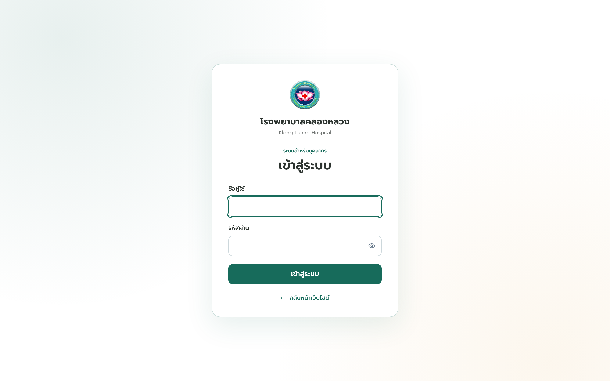

*ภาพที่ 1.1 หน้าเข้าสู่ระบบ แสดงช่องชื่อผู้ใช้ รหัสผ่าน และปุ่มเข้าสู่ระบบ*

**ผลลัพธ์:** หลังยืนยันสำเร็จ ระบบพาไปหน้าที่ร้องขอหรือหน้าเว็บไซต์ ผู้ดูแลสามารถเข้าเมนู **จัดการแอดมิน** ได้ หากระบบแจ้งว่าข้อมูลไม่ถูกต้อง ให้ตรวจชื่อผู้ใช้และรหัสผ่านกับผู้ดูแลโดยไม่ส่งรหัสผ่านผ่านช่องทางสาธารณะ

## 1.2 เปลี่ยนรหัสผ่าน

**วัตถุประสงค์:** ตั้งรหัสผ่านใหม่เมื่อระบบบังคับหรือเมื่อผู้ใช้ต้องการเปลี่ยน  
**สิทธิ์:** เจ้าของบัญชีที่เข้าสู่ระบบแล้ว  
**ทางเข้า:** **เมนูบัญชี → ความปลอดภัย → เปลี่ยนรหัสผ่าน** หรือหน้าที่ระบบพาไปเมื่อจำเป็น

1. กรอก **รหัสผ่านปัจจุบัน**
2. กรอก **รหัสผ่านใหม่** ตามเงื่อนไขที่แสดงใต้ช่องกรอก และกรอกซ้ำใน **ยืนยันรหัสผ่านใหม่**
3. ตรวจความถูกต้องก่อนกด **บันทึกรหัสผ่านใหม่**

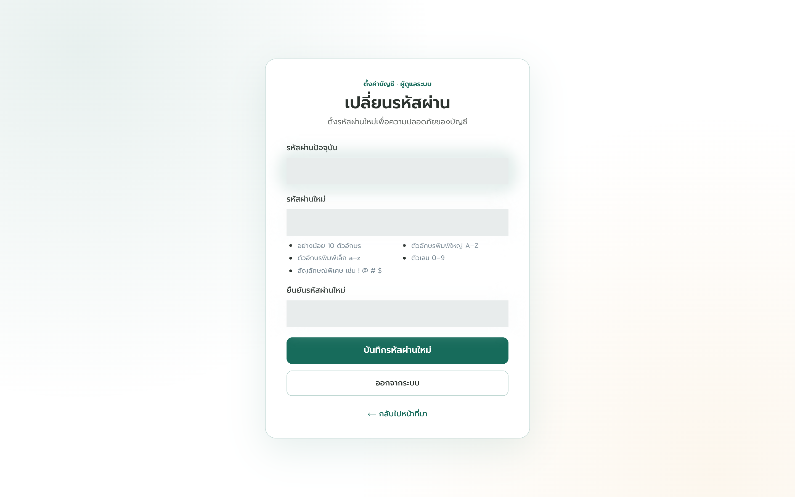

*ภาพที่ 1.2 แบบฟอร์มเปลี่ยนรหัสผ่าน โดยปิดบังช่องรหัสทั้งหมด*

**ข้อควรระวัง:** อย่าใช้รหัสผ่านเดิมซ้ำหรือบอกรหัสผ่านแก่ผู้อื่น เมื่อเปลี่ยนสำเร็จ ระบบจะยกเลิกการเข้าสู่ระบบเดิมและให้เข้าสู่ระบบอีกครั้ง

## 1.3 เข้าสู่พื้นที่ผู้ดูแลและออกจากระบบ

**วัตถุประสงค์:** ไปยังเมนูจัดการและจบการใช้งานอย่างปลอดภัย  
**สิทธิ์:** ผู้ดูแลระบบ (`ADMIN`) สำหรับหน้า Admin; ทุกบัญชีที่เข้าสู่ระบบสำหรับคำสั่งออกจากระบบ

1. เปิด **เมนูบัญชี** ที่มุมบน แล้วเลือก **จัดการแอดมิน** ผู้ดูแลจะเห็นหน้า **ภาพรวม** และกลุ่มเมนูด้านซ้าย
2. เลือกกลุ่ม **เว็บไซต์**, **เนื้อหา**, **ผู้ใช้งาน** หรือ **ตั้งค่า** เพื่อเปิดเมนูย่อย งานแต่ละกลุ่มอธิบายในบทถัดไป
3. เมื่อเลิกใช้งาน เปิด **เมนูบัญชี → ออกจากระบบ** โดยเฉพาะเมื่อใช้เครื่องร่วมกัน

*ภาพที่ 1.3 หน้า **ภาพรวม** และกลุ่มเมนูผู้ดูแล*

บัญชีทั่วไป (`MEMBER`) จะไม่เห็นสิทธิ์จัดการ Admin ผู้ดูแลเป็นผู้กำหนดบทบาทและสิทธิ์เข้าถึงหน้าเฉพาะกลุ่ม

---

# บทที่ 2 รู้จักหน้าเว็บไซต์ประชาชน

เว็บไซต์ประชาชนแสดงเนื้อหาที่เผยแพร่แล้ว ผู้เยี่ยมชมทั่วไปดูหน้าสาธารณะได้โดยไม่ต้องเข้า Admin บางหน้าเว็บไซต์หรือหน้าหน่วยงานอาจกำหนดให้เฉพาะผู้เข้าสู่ระบบหรือผู้ได้รับสิทธิ์เท่านั้น

## 2.1 หน้าต้อนรับ หน้าแรก และเมนู

**วัตถุประสงค์:** เข้าสู่ข้อมูลหลักของโรงพยาบาล  
**สิทธิ์:** ทุกคนสำหรับเนื้อหาสาธารณะ  
**ทางเข้า:** เปิด URL เว็บไซต์

1. หากมี **หน้าต้อนรับ** ให้กด **เข้าสู่เว็บไซต์** เพื่อไปหน้าแรก
2. ใช้เมนูด้านบนเลือกหน้าองค์กร **แนะนำองค์กร**, **วิสัยทัศน์/พันธกิจ**, **โครงสร้างองค์กร**, **หน่วยงาน**, **ข่าวสาร**, **เอกสาร** หรือ **ระบบเจ้าหน้าที่** ตามที่แสดงในเมนูปัจจุบัน
3. เลื่อนลงเพื่ออ่านส่วนต่าง ๆ ของหน้าแรกและส่วนท้าย ซึ่งมีทางลัดและช่องทางติดต่อ เมนูและเนื้อหาอาจเปลี่ยนตามรายการที่ผู้ดูแลเผยแพร่

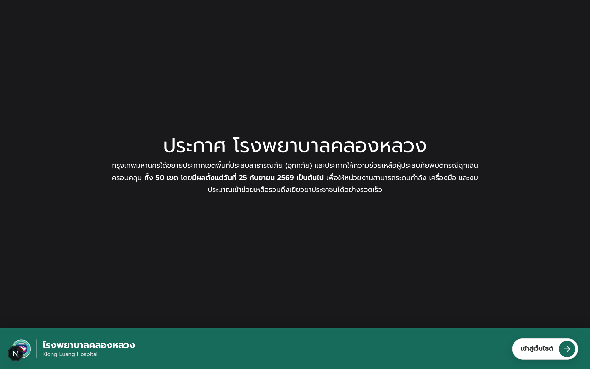

*ภาพที่ 2.1 หน้าต้อนรับและปุ่มเข้าสู่เว็บไซต์*

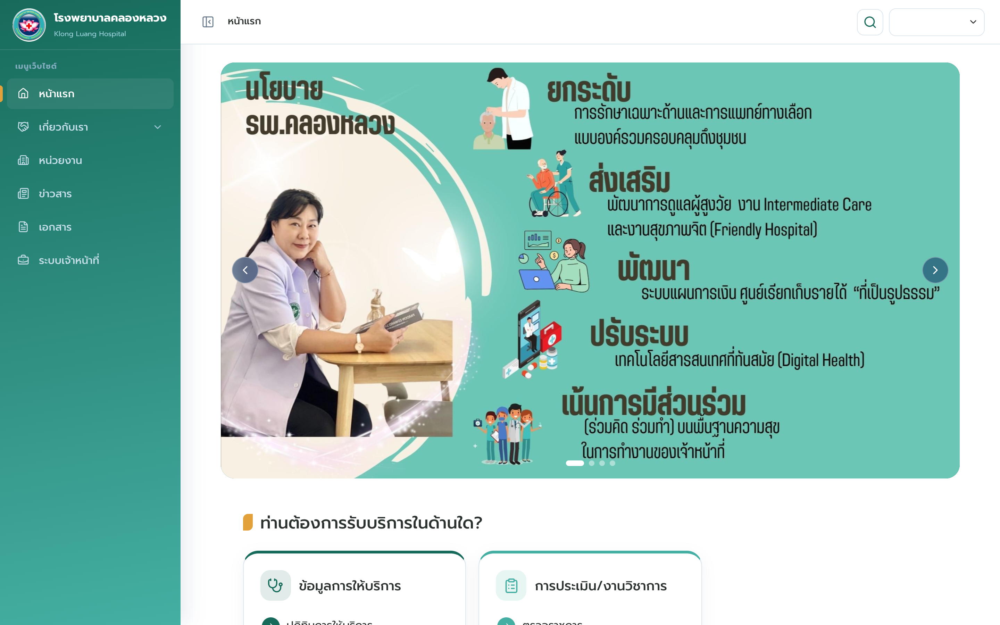

*ภาพที่ 2.2 หน้าแรกหลังผ่านหน้าต้อนรับ*

## 2.2 ค้นหาและอ่านข่าว

**วัตถุประสงค์:** ค้นข่าวหรือผลงานที่เผยแพร่  
**สิทธิ์:** ทุกคน  
**ทางเข้า:** **ข่าวสาร** หรือ `/news`

1. พิมพ์คำใน **ค้นหาข่าว...** เมื่อต้องการจำกัดรายการ
2. เลือก **ทุกหมวดหมู่**, ปี และหน่วยงานเจ้าของข่าวจากตัวกรองตามต้องการ
3. เลือกการ์ดข่าวเพื่ออ่านรายละเอียด วันเผยแพร่ และเนื้อหาที่ผู้ดูแลจัดไว้

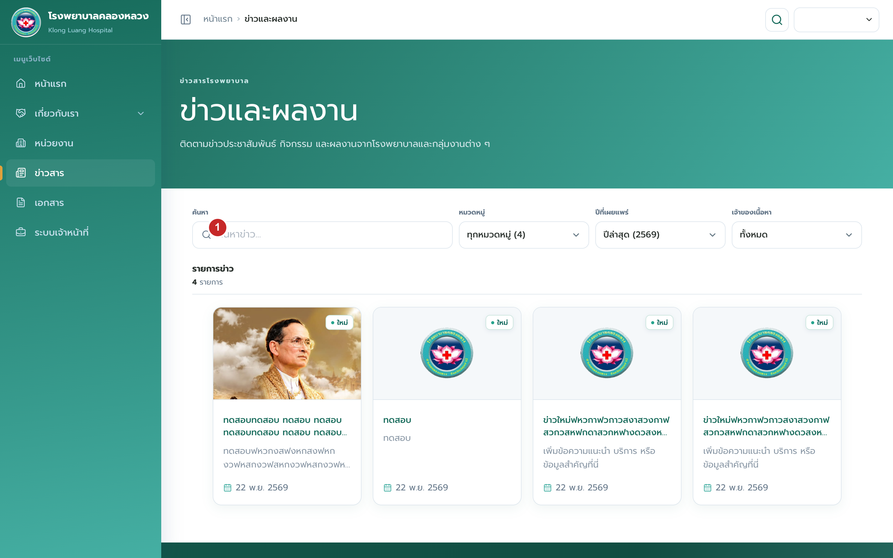

*ภาพที่ 2.3 รายการข่าวและชุดตัวกรอง*

**ผลลัพธ์:** รายการลดลงตามเงื่อนไขที่เลือก หากไม่พบข่าวให้ล้างคำค้นหาหรือตัวกรอง

## 2.3 ค้นหาหน่วยงานและเอกสาร

**วัตถุประสงค์:** เปิดหน้าหน่วยงานและหาเอกสารเผยแพร่  
**สิทธิ์:** ทุกคนสำหรับรายการสาธารณะ; หน้าหน่วยงานบางหน้าอาจต้องเข้าสู่ระบบหรือได้รับสิทธิ์  
**ทางเข้า:** **หน่วยงาน** และ **เอกสาร**

1. ในหน้า **หน่วยงานและกลุ่มงาน** พิมพ์ชื่อในช่อง **ค้นหาหน่วยงาน** แล้วเลือกการ์ด **ดูรายละเอียด**
2. ในหน้า **เอกสารดาวน์โหลด** พิมพ์ชื่อหรือเลขที่เอกสารในช่องค้นหา เลือกหมวดหมู่และปีตามต้องการ
3. เปิดรายการที่ต้องการอ่านหรือดาวน์โหลดเฉพาะไฟล์ที่เผยแพร่แล้ว ตรวจชื่อเอกสารและปีให้ตรงก่อนนำไปใช้

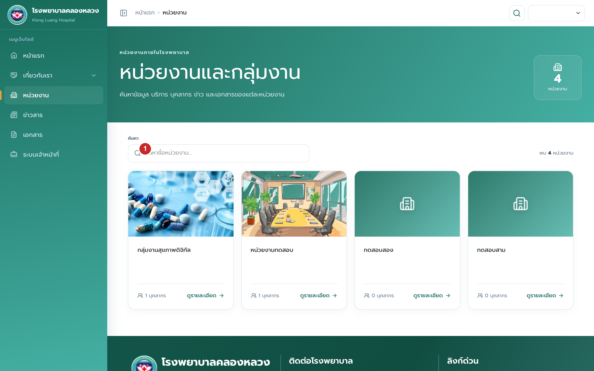

*ภาพที่ 2.4 ช่องค้นหาและการ์ดหน่วยงาน*

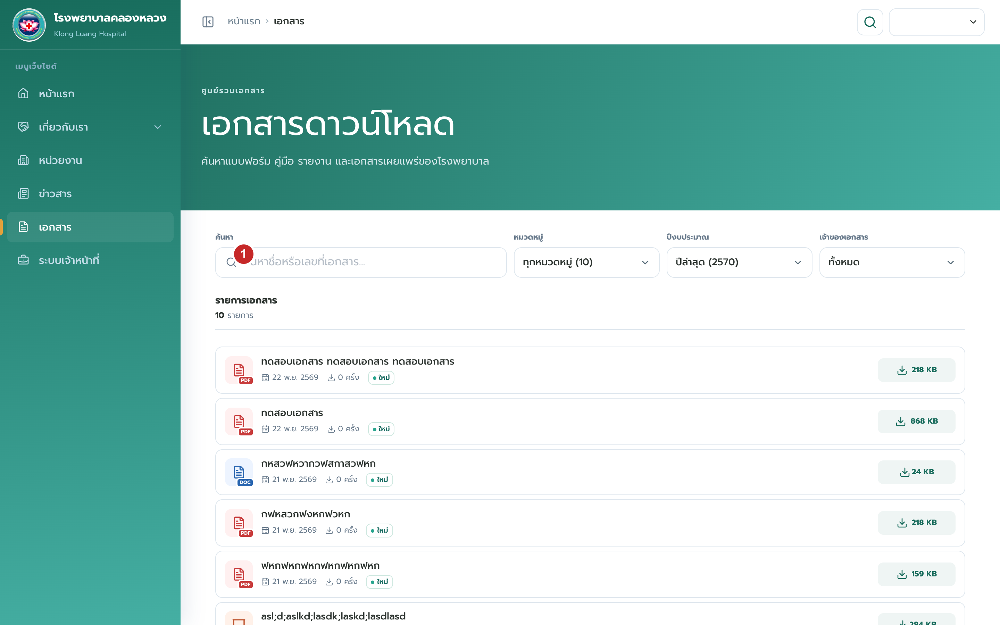

*ภาพที่ 2.5 ช่องค้นหาและตัวกรองเอกสาร*

## 2.4 ค้นหาทั้งเว็บไซต์และอ่านข้อมูลทั่วไป

**วัตถุประสงค์:** หาเนื้อหาหลายประเภทจากจุดเดียว  
**สิทธิ์:** ทุกคนสำหรับผลการค้นหาสาธารณะ  
**ทางเข้า:** เมนูค้นหาของเว็บไซต์หรือ `/search`

1. พิมพ์คำในช่อง **พิมพ์คำที่ต้องการค้นหา…** แล้วกด **ค้นหา**
2. เลือกผลลัพธ์ที่ตรงกับความต้องการ หากไม่พบให้ลองคำที่สั้นลงหรือไปยังหมวดข่าว/เอกสารโดยตรง
3. ข้อมูลโรงพยาบาลอยู่ในหน้าองค์กร เช่น **แนะนำองค์กร** ส่วนลิงก์ **ประกาศความเป็นส่วนตัว** และ **นโยบายคุกกี้** อยู่บริเวณส่วนท้าย

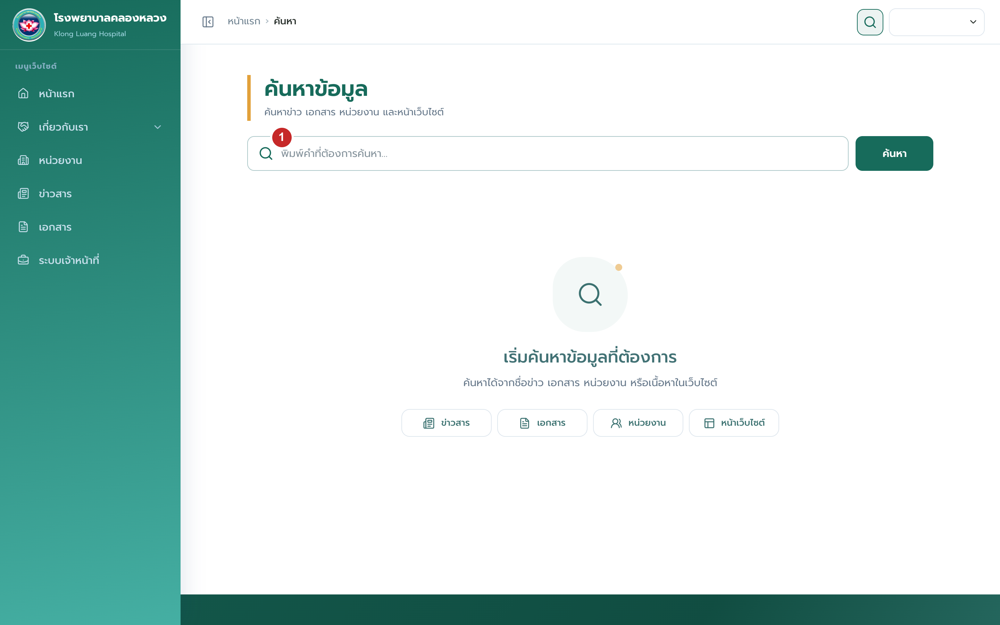

*ภาพที่ 2.6 แบบฟอร์มค้นหาทั้งเว็บไซต์*

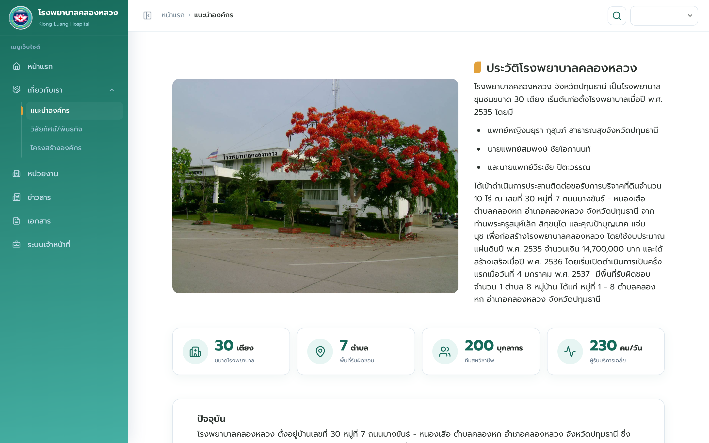

*ภาพที่ 2.7 ตัวอย่างหน้าเนื้อหาองค์กรที่ผู้ดูแลเผยแพร่*

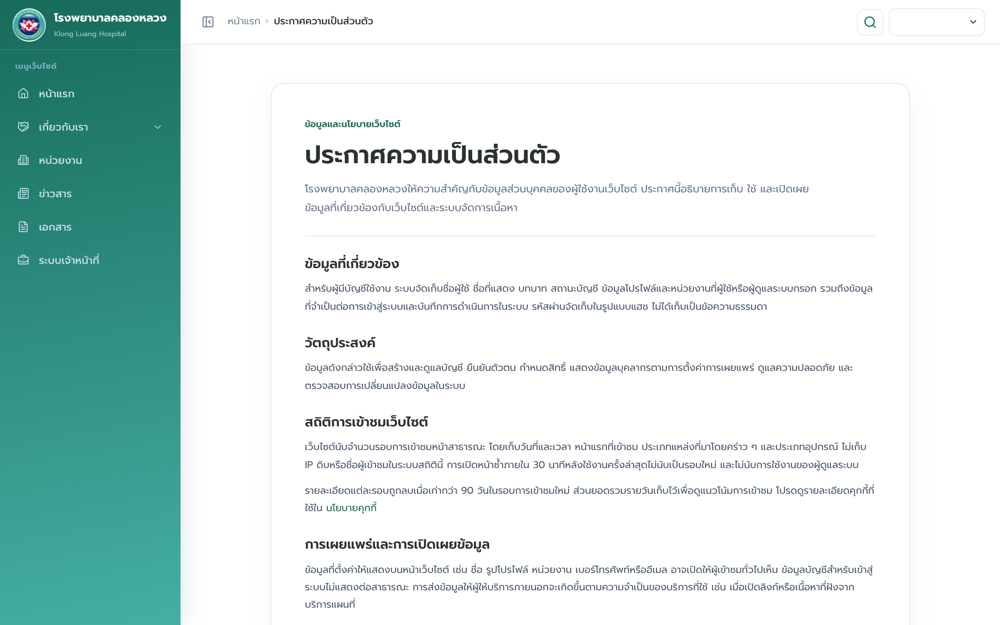

*ภาพที่ 2.8 หน้าแจ้งข้อมูลความเป็นส่วนตัว*

---

# บทที่ 3 บัญชีและความปลอดภัยของฉัน

เมนูบัญชีของผู้เข้าสู่ระบบมี **โปรไฟล์ของฉัน**, **ความปลอดภัย** และ **ออกจากระบบ** ผู้ดูแลจะเห็น **จัดการแอดมิน** เพิ่มเติม การแก้ข้อมูลในบทนี้ทำได้เฉพาะเจ้าของบัญชี ส่วนการรีเซ็ตบัญชีผู้อื่นเป็นหน้าที่ผู้ดูแล (บทที่ 13)

## 3.1 แก้โปรไฟล์ส่วนตัว

**วัตถุประสงค์:** ดูและปรับข้อมูลติดต่อ/ภาพที่แสดงกับบัญชี  
**สิทธิ์:** ผู้เข้าสู่ระบบ  
**ทางเข้า:** **เมนูบัญชี → โปรไฟล์ของฉัน**

1. ตรวจชื่อที่แสดงและข้อมูลบุคลากรในหน้า **โปรไฟล์ของฉัน**
2. เลือก **ประเภทบุคลากร**, **ตำแหน่ง** และ **ระดับ** จากรายการที่โรงพยาบาลกำหนด เมื่อเกี่ยวข้องกับตำแหน่งของตน
3. ระบุข้อมูลติดต่อ เช่น โทรศัพท์และเบอร์ต่อ เลือกการเผยแพร่ข้อมูลติดต่อเฉพาะที่ต้องการให้ปรากฏบนเว็บไซต์
4. กด **เพิ่มรูป** เมื่อต้องการเลือกรูปโปรไฟล์ ตรวจภาพและตำแหน่งก่อนบันทึก
5. กด **บันทึกโปรไฟล์** และตรวจข้อความตอบกลับของระบบ ขั้นตอนบันทึกไม่ได้ทดลองในรอบนี้

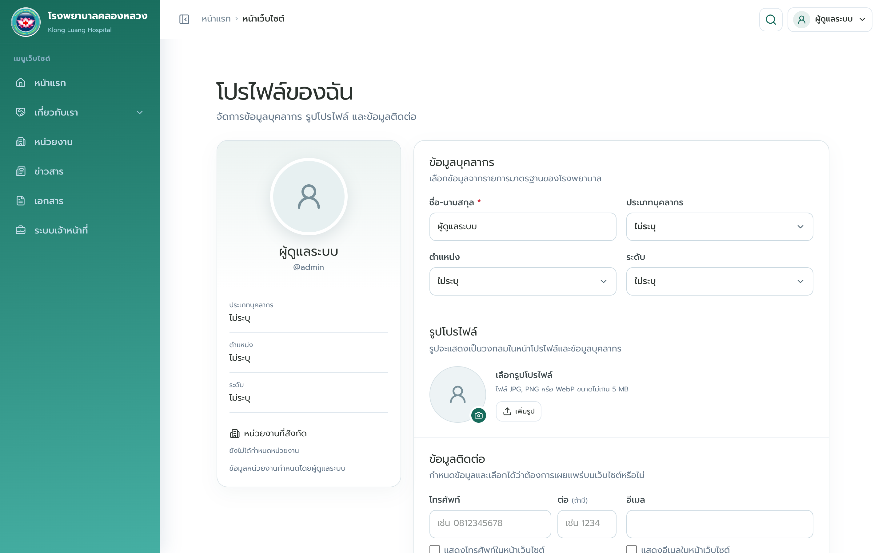

*ภาพที่ 3.1 ข้อมูลโปรไฟล์*

**ข้อควรระวัง:** ตรวจตัวเลือกการเผยแพร่โทรศัพท์/อีเมลก่อนบันทึก และใช้ภาพที่ได้รับอนุญาตให้เผยแพร่

## 3.2 จัดการความปลอดภัย

**วัตถุประสงค์:** ป้องกันการเข้าถึงบัญชีโดยไม่ได้รับอนุญาต  
**สิทธิ์:** เจ้าของบัญชี  
**ทางเข้า:** **เมนูบัญชี → ความปลอดภัย**

หน้า **ความปลอดภัย** แสดงทางเลือก **เปลี่ยนรหัสผ่าน**, **การยืนยันตัวตนสองขั้นตอน** และ **อุปกรณ์ที่เข้าสู่ระบบ**

1. เลือก **เปลี่ยนรหัสผ่าน** เมื่อต้องการตั้งรหัสใหม่ ตามบทที่ 1
2. เลือก **การยืนยันตัวตนสองขั้นตอน** เพื่อดูสถานะ OTP และคำแนะนำการตั้งค่า
3. หากพบการเข้าสู่ระบบจากอุปกรณ์ที่ไม่ใช้แล้ว ให้พิจารณา **ออกจากอุปกรณ์อื่น** การกดปุ่มนี้เพิกถอน session จึงควรทำเมื่อพร้อมเข้าสู่ระบบใหม่บนอุปกรณ์เหล่านั้น

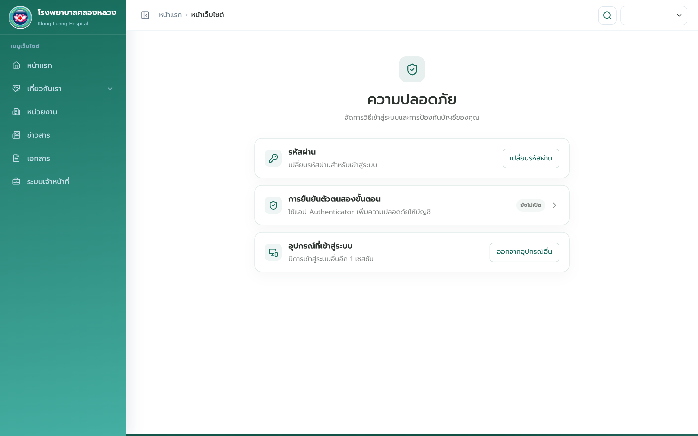

*ภาพที่ 3.2 ทางเลือกสำหรับดูแลบัญชีและอุปกรณ์ที่เข้าสู่ระบบ*

## 3.3 การยืนยันตัวตนสองขั้นตอนและรหัสกู้บัญชี

**วัตถุประสงค์:** เพิ่มรหัสจากแอป Authenticator อีกชั้นหลังรหัสผ่าน  
**สิทธิ์:** เจ้าของบัญชีที่ยืนยันตัวตนซ้ำตามระบบ

1. เปิด **ความปลอดภัย → การยืนยันตัวตนสองขั้นตอน**
2. อ่านสถานะและกรอกรหัสผ่านปัจจุบันเพื่อเริ่มตั้งค่าเมื่อเลือกใช้งาน ระบบจะแสดงขั้นตอนเชื่อมแอป Authenticator และให้ยืนยันรหัส OTP
3. เก็บ **รหัสกู้บัญชี** ที่ระบบออกให้ในที่ปลอดภัย รหัสแต่ละชุดใช้ได้ครั้งเดียวและหน้ารหัสกู้บัญชีเปิดได้เฉพาะช่วงที่ระบบออกชุดใหม่

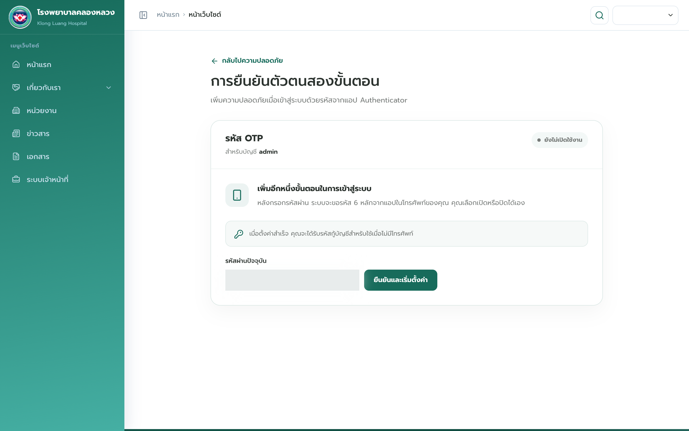

*ภาพที่ 3.3 หน้าสถานะการยืนยันสองขั้นตอน โดยปิดบังช่องข้อมูลความปลอดภัย*

**ผลลัพธ์ที่คาดหวัง:** หลังตั้งค่าเสร็จ การเข้าสู่ระบบครั้งถัดไปจะขอรหัส OTP หรือวิธีกู้บัญชีที่รองรับ **ข้อจำกัด:** ไม่ได้กดเริ่มตั้งค่า ปิดใช้งาน หรือออกรหัสกู้บัญชีใหม่ และไม่มีภาพ QR/รหัสจริงในคู่มือ เพื่อไม่ให้ความลับรั่วไหล

---

# บทที่ 4 ภาพรวมผู้ดูแลและรายงานผู้เข้าชม

## 4.1 อ่านหน้า **ภาพรวม**

**วัตถุประสงค์:** เห็นสถานะเว็บไซต์และทางลัดไปงานประจำ  
**สิทธิ์:** ผู้ดูแลระบบ  
**ทางเข้า:** **จัดการแอดมิน → ภาพรวม**

1. ดูจำนวน **ผู้เข้าชม (ครั้ง)** ของวันนี้ในแถบบน ระบบระบุว่าไม่นับการรีเฟรชซ้ำในรอบการใช้งาน 30 นาที
2. ดูจำนวนหน้าเว็บไซต์ ข่าวและผลงาน เอกสาร และรายการคลังสื่อจากการ์ดสรุป กดการ์ดเพื่อไปหน้ารายการนั้น
3. ดูยอด **เผยแพร่แล้ว** และ **ฉบับร่าง** เพื่อทราบงานที่ยังไม่ขึ้นเว็บไซต์
4. ใช้ **กิจกรรมล่าสุด** เพื่อตรวจสิ่งที่มีการดำเนินการ และ **การดำเนินการด่วน** เพื่อไปยังงานที่ใช้บ่อย เช่น สร้างหน้าเว็บไซต์หรือข่าว

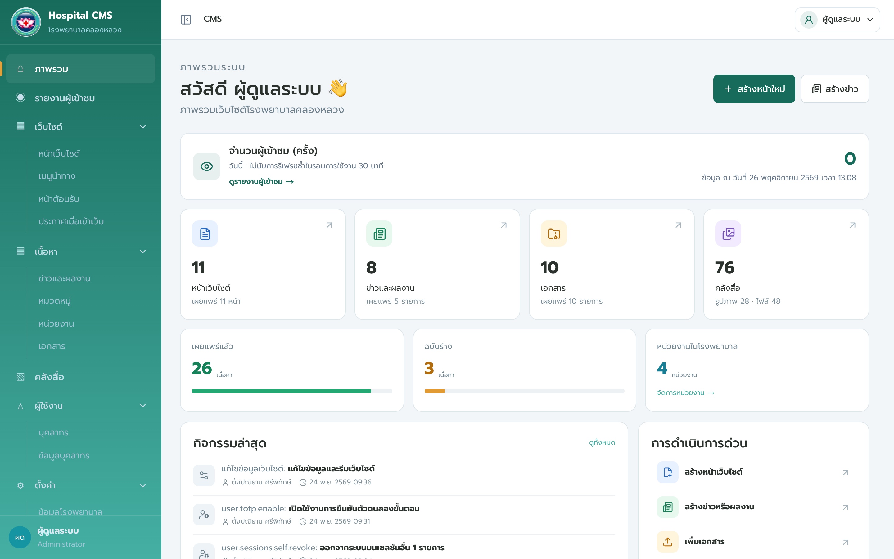

*ภาพที่ 4.1 Dashboard ผู้ดูแล*

**ผลลัพธ์:** ผู้ดูแลเห็นสถานะปัจจุบันและเปิดหน้าจัดการที่ต้องการได้ทันที ตัวเลขเป็นข้อมูลตามเวลาที่ระบบแสดงในหน้าจอ จึงควรตรวจวันที่กำกับก่อนนำไปอ้างอิง

## 4.2 อ่านรายงานผู้เข้าชม

**วัตถุประสงค์:** ติดตามแนวโน้มการเข้าชมเว็บไซต์  
**สิทธิ์:** ผู้ดูแลระบบ  
**ทางเข้า:** **รายงานผู้เข้าชม** ในแถบซ้าย หรือ **ดูรายงานผู้เข้าชม →** จาก Dashboard

1. ดูยอด **วันนี้** และ **30 วันล่าสุด** ในการ์ดด้านบน
2. อ่านกราฟ **ยอดเข้าชมรายวัน** เพื่อดูวันที่มีการเข้าชมมากหรือน้อย
3. เลื่อนลงเพื่อดูส่วนสรุปเพิ่มเติมตามที่หน้าแสดง หากต้องการกลับหน้าแรกผู้ดูแล ให้กด **กลับหน้าภาพรวม**

*ภาพที่ 4.2 ตัวเลขและกราฟรายงานผู้เข้าชม*

**ข้อควรระวัง:** ยอดผู้เข้าชมเป็นสถิติการเข้าเว็บ ไม่ใช่จำนวนผู้ป่วยหรือผู้รับบริการ และไม่ควรนำไปตีความเป็นตัวชี้วัดทางการแพทย์

---

# บทที่ 5 คลังสื่อ

คลังสื่อเป็นที่เก็บรูปภาพและไฟล์ที่ใช้กับหน้า ข่าว หน่วยงาน และเอกสาร ผู้ดูแลควรอัปโหลดไฟล์ที่มีสิทธิ์เผยแพร่และตรวจชื่อไฟล์ก่อนนำไปใช้

## 5.1 ดู ค้นหา และกรองไฟล์

**วัตถุประสงค์:** หาไฟล์ที่มีอยู่เพื่อนำไปใช้ซ้ำ  
**สิทธิ์:** ผู้ดูแลระบบ  
**ทางเข้า:** เมนู **คลังสื่อ**

1. ดูสรุปจำนวนและขนาดพื้นที่ของรูปภาพ เอกสาร และไฟล์ทั้งหมด
2. พิมพ์คำใน **ค้นหา...** เพื่อจำกัดรายการ
3. เลือก **ทั้งหมด**, **รูปภาพ** หรือ **เอกสาร** เพื่อกรองชนิดไฟล์
4. เลือก **มุมมองตาราง** เพื่อเห็นภาพตัวอย่าง หรือ **มุมมองรายการ** เพื่อเห็นชื่อ ขนาด ชนิด และวันที่

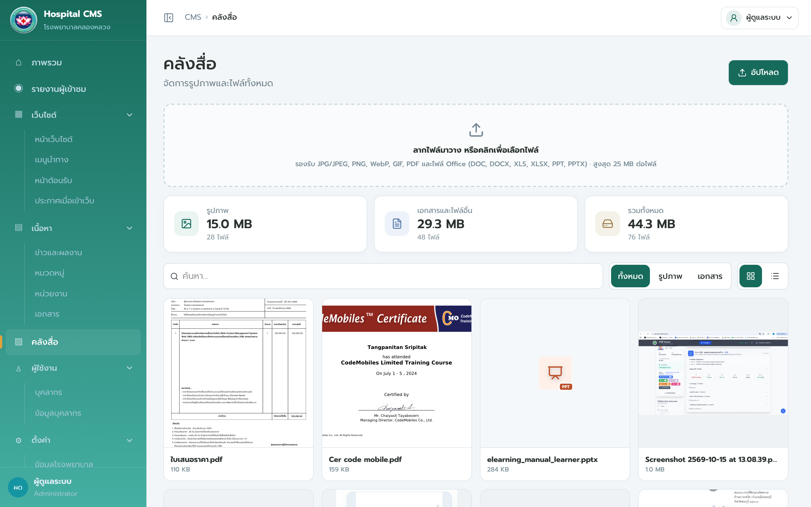

*ภาพที่ 5.1 คลังสื่อและตัวกรอง*

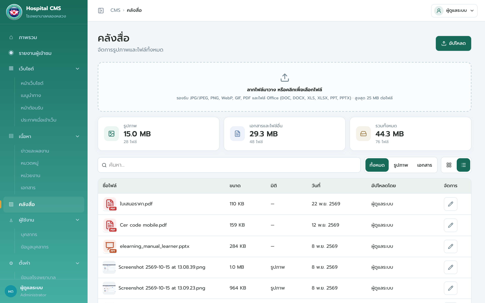

*ภาพที่ 5.2 รายการไฟล์พร้อมข้อมูลประกอบ*

**ผลลัพธ์:** พบรายการที่ตรงกับคำค้นและชนิดที่เลือก การเปลี่ยนมุมมองไม่เปลี่ยนไฟล์ในระบบ

## 5.2 อัปโหลดและเลือกสื่อ

**วัตถุประสงค์:** เพิ่มไฟล์เพื่อใช้ประกอบเนื้อหา  
**สิทธิ์:** ผู้ดูแลระบบ  
**ทางเข้า:** **คลังสื่อ → อัปโหลด** หรือปุ่ม **เลือกจากคลังสื่อ** ในตัวแก้ไข

1. กด **อัปโหลด** หรือวางไฟล์ในพื้นที่อัปโหลด ระบบแสดงชนิดและขนาดไฟล์ที่รองรับบนหน้าจอ
2. ตรวจชื่อและตัวอย่างไฟล์ก่อนยืนยันการอัปโหลด หากใช้จากตัวแก้ไข ให้กด **เลือกจากคลังสื่อ** แล้วค้นหาไฟล์เดิมก่อนอัปโหลดซ้ำ
3. หลังเลือกไฟล์ ให้ตรวจว่ารูปปก/ไฟล์แนบแสดงในตำแหน่งที่ถูกต้อง แล้วจึงบันทึกเนื้อหาในงานนั้น

**ผลลัพธ์ที่คาดหวัง:** ไฟล์อยู่ในคลังสื่อและพร้อมเลือกใช้ **ข้อจำกัด:** ไม่ได้ทดลองอัปโหลดหรือแก้ไข metadata เพราะจะเปลี่ยนข้อมูลระบบ ภาพประกอบแสดงทางเข้าและรูปแบบรายการจริง

**ข้อควรระวัง:** หลีกเลี่ยงการอัปโหลดเอกสารที่มีข้อมูลผู้ป่วยหรือข้อมูลส่วนบุคคลโดยไม่ได้รับอนุญาต ชื่อไฟล์อาจปรากฏต่อผู้ใช้ที่ดาวน์โหลดได้

---

# บทที่ 6 หน้าเว็บไซต์และ Page Builder

Page Builder ใช้จัดหน้าแรกและหน้าเว็บไซต์อื่นด้วยบล็อกเนื้อหา ผู้ดูแลสร้างฉบับร่าง ตรวจตัวอย่าง และเผยแพร่เมื่อพร้อม การเปลี่ยนหน้าแรกต้องระวังเป็นพิเศษ เพราะผู้เข้าชมเห็นทันทีหลังเผยแพร่

## 6.1 จัดการรายการหน้าเว็บไซต์

**วัตถุประสงค์:** ตรวจสถานะหน้าและเปิดหน้าที่ต้องแก้  
**สิทธิ์:** ผู้ดูแลระบบ  
**ทางเข้า:** **เว็บไซต์ → หน้าเว็บไซต์**

1. ดูการ์ด **ทั้งหมด**, **เผยแพร่แล้ว**, **ฉบับร่าง** และ **อยู่ในถังขยะ** เพื่อกรองสถานะ
2. พิมพ์ชื่อใน **ค้นหาหน้า...** แล้วเลือกแถวที่ต้องการ
3. กด **แก้ไขเนื้อหา** เพื่อเข้า Page Builder หรือ **ดูตัวอย่าง** เมื่อต้องการตรวจหน้าที่มีอยู่
4. ใช้ **ตัวเลือก** ของแถวสำหรับงานอื่น เช่น คัดลอก ยกเลิกเผยแพร่ หรือย้ายเข้าถังขยะ ตามสถานะของหน้านั้น การกู้คืนและลบถาวรอยู่ที่แท็บ **ถังขยะ**

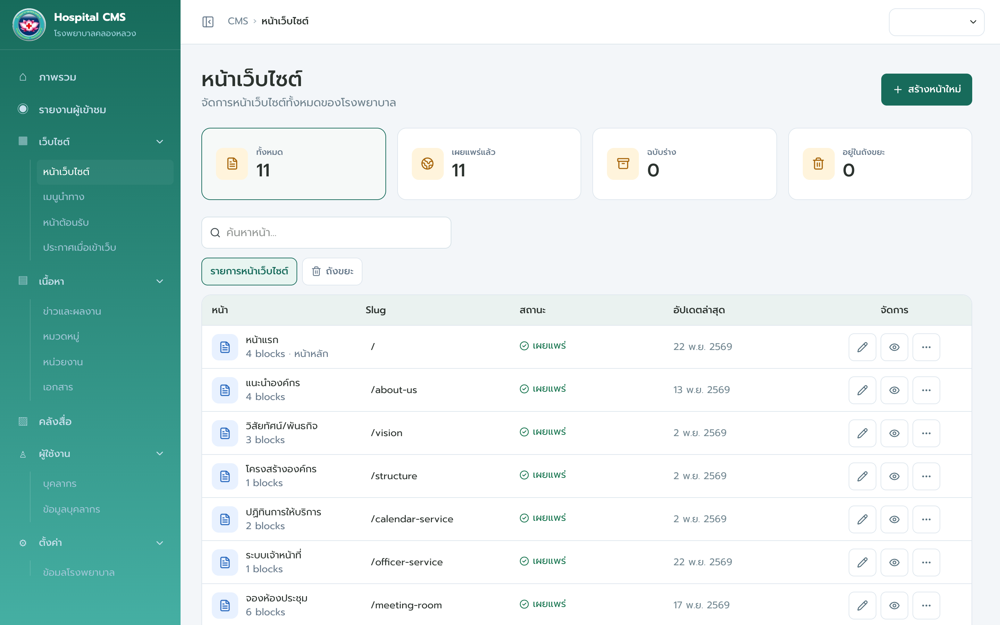

*ภาพที่ 6.1 รายการหน้า สถานะ และปุ่มแก้ไขเนื้อหา*

## 6.2 สร้างหน้าใหม่

**วัตถุประสงค์:** เพิ่มหน้าเนื้อหาที่ไม่ใช่หน้าแรก  
**สิทธิ์:** ผู้ดูแลระบบ  
**ทางเข้า:** **หน้าเว็บไซต์ → สร้างหน้าใหม่**

1. กรอก **ชื่อหน้า** ให้ผู้อ่านเข้าใจ เช่น ประวัติโรงพยาบาล
2. ตรวจ **URL ของหน้า** หรือ slug ที่ใช้ในลิงก์ ควรสั้น สื่อความหมาย และไม่ซ้ำหน้าอื่น
3. กด **สร้างและเปิด Page Builder** เพื่อเข้าสู่ตัวแก้ไข หน้านี้ยังไม่เผยแพร่จนกว่าจะดำเนินการเผยแพร่ใน Builder

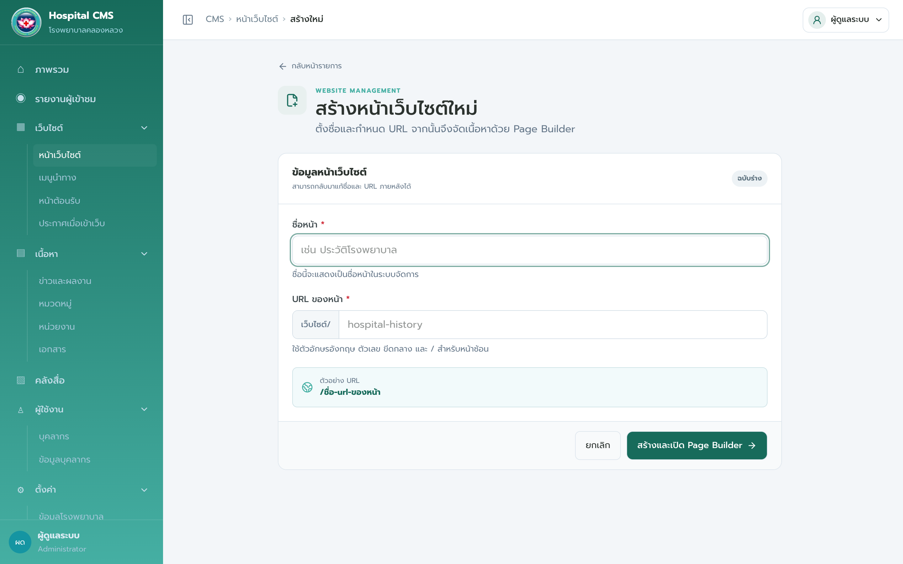

*ภาพที่ 6.2 ช่องชื่อหน้าและ URL ที่ต้องตรวจให้ถูกก่อนสร้าง*

## 6.3 ใช้พื้นที่ทำงานของ Page Builder

**วัตถุประสงค์:** เรียบเรียงลำดับเนื้อหาและกำหนดหน้าตา  
**สิทธิ์:** ผู้ดูแลระบบ  
**ทางเข้า:** **หน้าเว็บไซต์ → แก้ไขเนื้อหา** หรือ **หน้าแรก → Page Builder**

1. อ่านชื่อหน้าและสถานะที่แถบด้านบน กด **ตั้งค่าหน้า** เพื่อกำหนดส่วนหัวของหน้า เช่น ใช้ค่าเริ่มต้น กำหนดเอง หรือไม่แสดงส่วนหัว
2. กด **เพิ่ม Block ด้านบนสุด** หรือ **เพิ่ม Block ตรงนี้** ระหว่างบล็อก แล้วเลือกชนิดจากหน้าต่าง **เพิ่ม Block** สามารถใช้ **ค้นหา Block...** ได้
3. ใช้ที่จับลากของบล็อกเพื่อเปลี่ยนลำดับ กด **ตั้งค่า** เพื่อแก้รายละเอียด กด **ทำสำเนา**, **ซ่อน/แสดง** หรือ **ลบ** ตามความต้องการ การลบใน Builder เป็นการเปลี่ยนร่างก่อนบันทึก
4. ใช้ **ย้อนกลับ** และ **ทำซ้ำ** เมื่อจัดหน้า แล้วตรวจ **ดูตัวอย่าง** ในขนาดหน้าจอที่มีให้เลือก
5. กด **บันทึกร่าง** หากยังต้องตรวจต่อ หรือ **เผยแพร่** เมื่อผู้รับผิดชอบอนุมัติเนื้อหา ขั้นตอนนี้เปลี่ยนข้อมูลและไม่ได้กดทดลอง

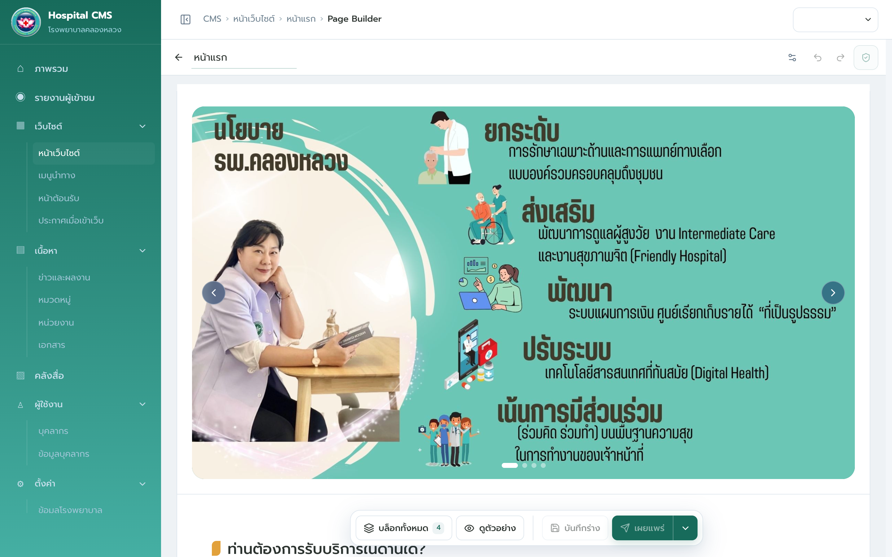

*ภาพที่ 6.3 พื้นที่จัดบล็อกของหน้าแรก*

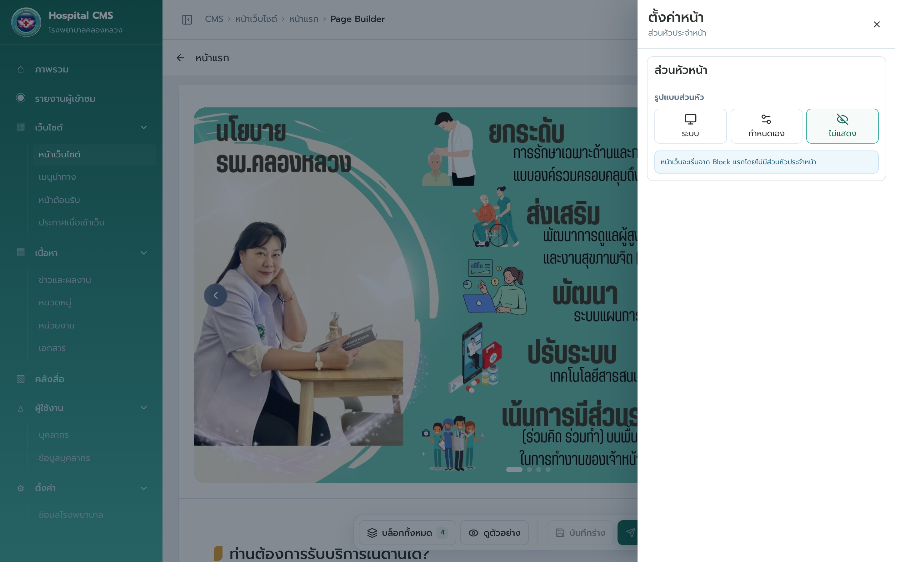

*ภาพที่ 6.4 แผงตั้งค่าส่วนหัวของหน้า*

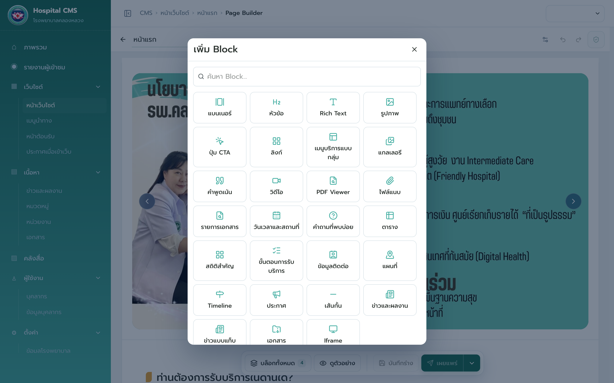

*ภาพที่ 6.5 ชนิดบล็อกช่วงบนของหน้าต่างเพิ่ม Block*

*ภาพที่ 6.6 ชนิดบล็อกช่วงล่างของหน้าต่างเดียวกัน*

## 6.4 สิทธิ์ของหน้า

**วัตถุประสงค์:** กำหนดว่าใครเปิดหน้าได้  
**สิทธิ์:** ผู้ดูแลระบบ  
**ทางเข้า:** ปุ่ม **สิทธิ์: ...** ใน Page Builder ของหน้าทั่วไป

1. เลือก **สาธารณะ** เมื่อทุกคนควรเปิดหน้าได้
2. เลือก **เฉพาะผู้เข้าสู่ระบบ** เมื่อทุกบัญชีที่ผ่านการเข้าสู่ระบบเปิดได้
3. เลือก **กำหนดผู้มีสิทธิ์** เมื่อจำกัดเฉพาะหน่วยงานหรือบุคคล แล้วเลือกผู้ได้รับสิทธิ์ในช่องที่ระบบแสดง
4. ถ้าเลือก **กำหนดผู้มีสิทธิ์** ต้องเพิ่มหน่วยงานหรือผู้ใช้อย่างน้อยหนึ่งรายการ จึงจะกด **ใช้สิทธิ์ที่เลือก** ได้
5. กด **ใช้สิทธิ์ที่เลือก** แล้วกด **บันทึกร่าง** หรือ **เผยแพร่** ใน Page Builder เพื่อเก็บการเปลี่ยนแปลง สิทธิ์ที่แก้จะมีผลต่อผู้เข้าชมหลังเผยแพร่ ตรวจให้รอบคอบหากหน้าเดิมเป็นสาธารณะ

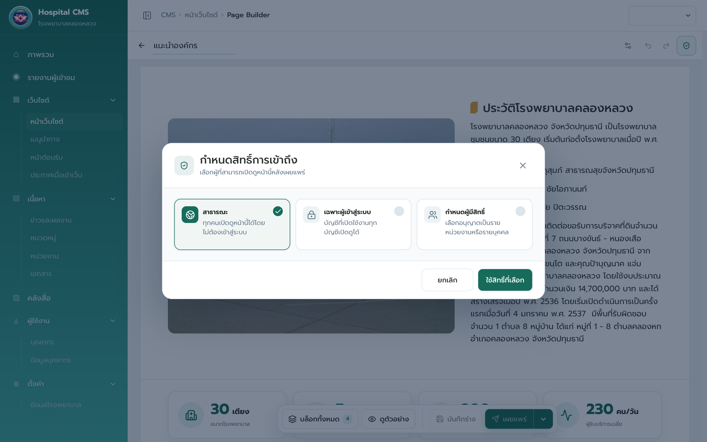

*ภาพที่ 6.7 ตัวเลือกสิทธิ์ของหน้าทั่วไป หน้าแรกถูกกำหนดให้เป็นสาธารณะเสมอ*

## 6.5 คู่มือบล็อกทุกประเภทที่เพิ่มได้

**วิธีร่วมสำหรับทุกบล็อก:** เปิด **เพิ่ม Block**, เลือกชื่อบล็อกตามตาราง, กดไอคอน **ตั้งค่า** บนบล็อก, กรอกข้อมูลสำคัญ, ตรวจตัวอย่างและลำดับ, แล้วบันทึกร่างหรือเผยแพร่เมื่อได้รับอนุญาต บล็อกมีการตั้งค่าทั่วไปด้านความกว้าง ตำแหน่ง พื้นหลัง ระยะห่าง และการแสดงผลตามชนิด ไม่จำเป็นต้องแก้ทุกตัวเลือก

| บล็อกในเมนู | ใช้เมื่อ | ช่องและตัวเลือกสำคัญ | ผลที่คาดหวัง/ข้อควรระวัง |
|---|---|---|---|
| แบนเนอร์ | เปิดหน้าด้วยภาพเด่นหรือสไลด์ | ภาพจากคลังสื่อ, ชื่อ/คำอธิบาย, ตำแหน่งภาพ, ความสูง, จำนวนสไลด์, เล่นอัตโนมัติ, ลิงก์ | ภาพและข้อความอ่านได้ทั้งจอใหญ่/เล็ก; ตรวจสิทธิ์ภาพ |
| หัวข้อ | แบ่งส่วนเนื้อหา | ข้อความ, คำอธิบาย, ระดับหัวข้อ, แนวจัด | โครงสร้างหัวข้ออ่านตามลำดับ |
| Rich Text | เนื้อหายาวหลายย่อหน้า | ข้อความ, ตัวหนา/ลิงก์/รายการตามแถบเครื่องมือ | ตรวจลิงก์และรูปแบบก่อนเผยแพร่ |
| รูปภาพ | แสดงภาพเดี่ยวหรือภาพกับข้อความ | ไฟล์, ข้อความทางเลือก, คำบรรยาย, สัดส่วน/การครอบ, ตำแหน่ง, โหมดรูปกับข้อความ | ภาพไม่ถูกตัดส่วนสำคัญ; ใส่คำอธิบายภาพที่มีความหมาย |
| ปุ่ม CTA | ชวนไปงานสำคัญ | ชื่อ, คำอธิบาย, ข้อความปุ่ม, ปลายทาง, รูปแบบ | ปุ่มพาไปปลายทางถูกต้อง |
| ลิงก์ | วางทางลัดเป็นการ์ด/รายการ | ชื่อ, คำอธิบาย, ไอคอน/ภาพ, จำนวนคอลัมน์, ปลายทาง | ลิงก์ไม่ซ้ำและใช้ได้จริง |
| เมนูบริการแบบกลุ่ม | รวมบริการเป็นหมวด | ชื่อกลุ่ม, ไอคอน, สีเน้น, รายการลิงก์, จำนวนคอลัมน์ | ผู้ใช้หาบริการได้ง่าย; ตรวจลิงก์ทุกกลุ่ม |
| แกลเลอรี | รวมภาพกิจกรรม | ภาพ, หัวข้อ, คำบรรยาย, รูปแบบตาราง/สไลด์, จำนวนคอลัมน์/ความถี่ | ใช้ภาพที่ได้รับอนุญาตเผยแพร่ |
| คำพูดเน้น | เน้นข้อความสั้น | ข้อความ, ผู้กล่าว/แหล่งที่มา | ไม่ระบุชื่อบุคคลโดยไม่ได้รับอนุญาต |
| วิดีโอ | ฝังวิดีโอ | URL, ชื่อ, คำบรรยาย, รูปแบบวิดีโอเดี่ยว/พร้อมข้อความ | ตรวจแหล่งวิดีโอและการเล่นจริง |
| PDF Viewer | แสดง PDF ในหน้า | เลือกไฟล์ PDF, ชื่อ, ความสูง, แนวจัด | ตรวจว่าไฟล์เปิดอ่านได้และไม่มีข้อมูลลับ |
| ไฟล์แนบ | ให้ดาวน์โหลดไฟล์ | ชื่อส่วน, รายการไฟล์, ชื่อที่แสดง | ตรวจรุ่นและชื่อไฟล์ก่อนเผยแพร่ |
| รายการเอกสาร | ทำสารบัญเอกสารมีลำดับ | หัวข้อ, คำอธิบาย, ลำดับเลข, รายการ/ไฟล์/ลิงก์ | เลขลำดับและปลายทางตรงกัน |
| วันเวลาและสถานที่ | แจ้งกำหนดกิจกรรม | วันที่, เวลา, สถานที่, คำอธิบาย | ระบุปีและสถานที่ชัดเจน |
| คำถามที่พบบ่อย | แสดงคำถามและคำตอบ | หัวข้อ, คำถาม, คำตอบแต่ละรายการ | ใช้คำตอบที่ได้รับการตรวจทาน |
| ตาราง | นำเสนอข้อมูลแบบแถว/คอลัมน์ | ชื่อตาราง, หัวคอลัมน์, แถว, ความกว้าง/แนวจัด | ตรวจบนมือถือไม่ให้ข้อมูลล้น |
| สถิติสำคัญ | แสดงตัวเลขสรุป | หัวข้อ, ค่า, หน่วย/ป้าย, คำอธิบาย, ไอคอน, จำนวนคอลัมน์ | ระบุวันที่/แหล่งข้อมูลเมื่อจำเป็น |
| ขั้นตอนการรับบริการ | แสดงลำดับการทำงาน | ชื่อและคำอธิบายแต่ละขั้น, รูปแบบการจัด | ขั้นตอนเรียงถูกต้องตามบริการจริง |
| ข้อมูลติดต่อ | แสดงช่องทางติดต่อ | ที่อยู่, โทรศัพท์/เบอร์ต่อ, อีเมล, เวลาทำการ | ตรวจหมายเลขและเวลาล่าสุด |
| แผนที่ | ชี้ตำแหน่งโรงพยาบาล | URL แผนที่, ชื่อ, คำอธิบาย, ความสูง | ตรวจ URL และตำแหน่งจริง |
| Timeline | แสดงเหตุการณ์ตามเวลา | วันที่/ปี, ชื่อเหตุการณ์, คำอธิบาย | เรียงลำดับเหตุการณ์ให้ถูก |
| ประกาศ | เน้นข้อความแจ้งเตือนในหน้า | หัวข้อ, เนื้อหา, ระดับสี/รูปแบบ | ใช้เฉพาะเรื่องสำคัญ ไม่สับสนกับประกาศเมื่อเข้าเว็บ |
| เส้นกั้น | แบ่งพื้นที่สายตา | รูปแบบเส้น | ไม่ใช้มากจนหน้าแตกเป็นส่วนย่อยเกินไป |
| ข่าวและผลงาน | ดึงข่าวที่เผยแพร่ | แหล่งข่าว, หมวด, จำนวน, รูปแบบ, ลิงก์ดูทั้งหมด | แสดงเฉพาะข่าวที่เผยแพร่ |
| ข่าวแบบแท็บ | จัดข่าวเป็นแท็บ | ชื่อแท็บ, แหล่งข่าว/หมวด, แสดงภาพ/วันที่/คำอธิบาย | ชื่อแท็บสั้นและไม่ซ้ำ |
| เอกสาร | ดึงเอกสารที่เผยแพร่ | ชื่อแท็บ, แหล่ง/หมวด/ปีงบประมาณ, จำนวน, รูปแบบ | แสดงรายการที่เผยแพร่ตามตัวกรอง |
| Iframe | ฝังเนื้อหาภายนอก | URL, ชื่อ, คำอธิบาย, ความสูง | ใช้เฉพาะแหล่งที่เชื่อถือได้ และทดสอบว่าฝังได้จริง |

บล็อกบางชื่อมีรูปแบบย่อยในแผงตั้งค่า เช่น **แบนเนอร์** ภาพเดี่ยว/หลายภาพ, **รูปภาพ** เดี่ยว/พร้อมข้อความ และ **ลิงก์** แบบการ์ด/รายการ จึงไม่ควรสร้างบล็อกซ้ำเพียงเพื่อเปลี่ยนรูปแบบ ให้ตรวจตัวเลือกในบล็อกเดิมก่อน

**การ์ดข้อความ** เป็นรูปแบบที่สลับจากบล็อก **Rich Text** ด้วยตัวเลือก **แสดงเป็นการ์ดข้อความ** ในแผงตั้งค่า ใช้เมื่อต้องการให้ข้อความมีกรอบการ์ด ชื่อการ์ด และพื้นที่แยกจากเนื้อหาข้างเคียง ตั้งค่าข้อความและตรวจผลก่อนบันทึก ภาพที่ 6.14 แสดงแผงของบล็อกรูปแบบนี้ บล็อก **บุคลากร** และ **ระยะห่าง** อาจพบในเนื้อหาเดิม แต่ไม่อยู่ในหน้าต่าง **เพิ่ม Block** ปัจจุบัน จึงไม่ได้แนะนำให้สร้างใหม่จากเมนูนี้

### ตัวอย่างแผงตั้งค่าจากบล็อกที่มีอยู่จริง

ภาพชุดต่อไปนี้ถ่ายเฉพาะแผงตั้งค่าของบล็อกที่มีอยู่จริงใน Page Builder ใช้ประกอบตำแหน่งตัวเลือก ส่วนบล็อกที่ไม่มีตัวอย่างอยู่ในหน้าปัจจุบันให้ใช้ตารางด้านบนและหน้าต่าง **เพิ่ม Block** เป็นแนวทาง

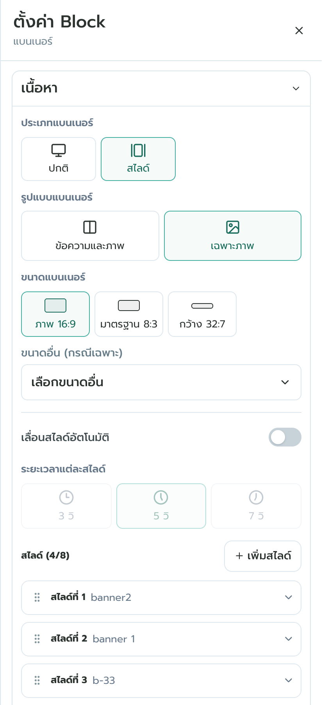

*ภาพที่ 6.8 รูปแบบและการจัดสไลด์ของบล็อกแบนเนอร์*

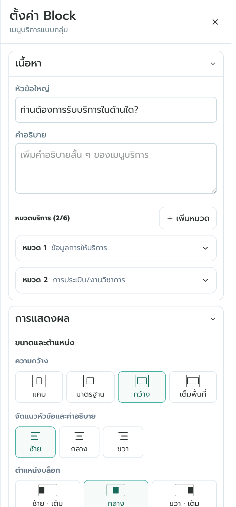

*ภาพที่ 6.9 กลุ่มบริการและรายการลิงก์ภายในกลุ่ม*

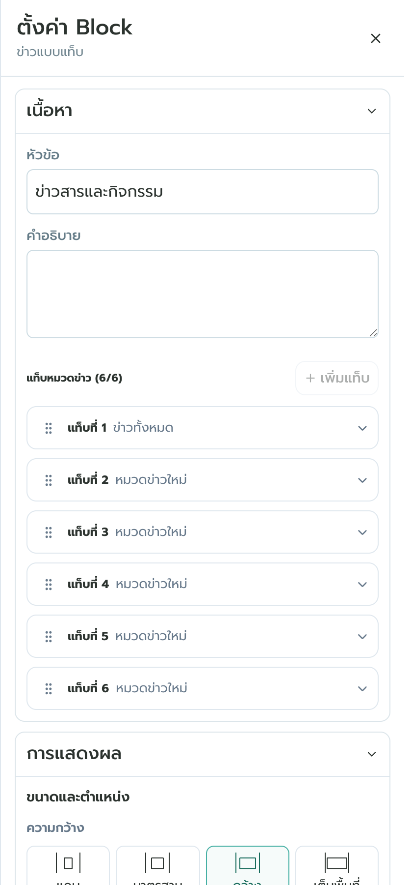

*ภาพที่ 6.10 แท็บและแหล่งข่าวของบล็อกข่าว*

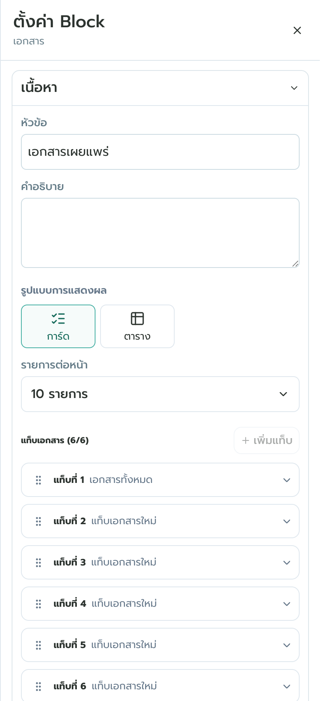

*ภาพที่ 6.11 แท็บเอกสารและรูปแบบการแสดงผล*

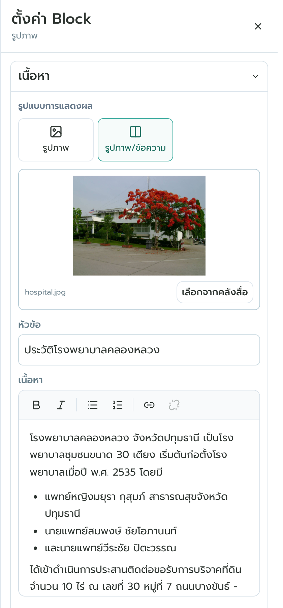

*ภาพที่ 6.12 ตัวเลือกรูปภาพเดี่ยวหรือรูปภาพพร้อมข้อความ*

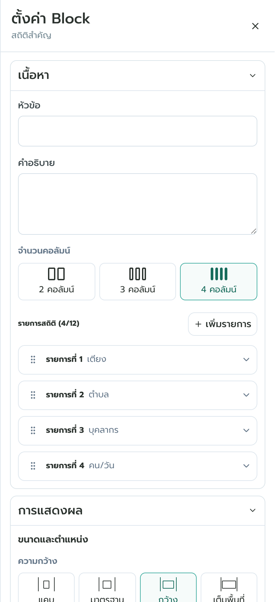

*ภาพที่ 6.13 จำนวนคอลัมน์และรายการตัวเลขสำคัญ*

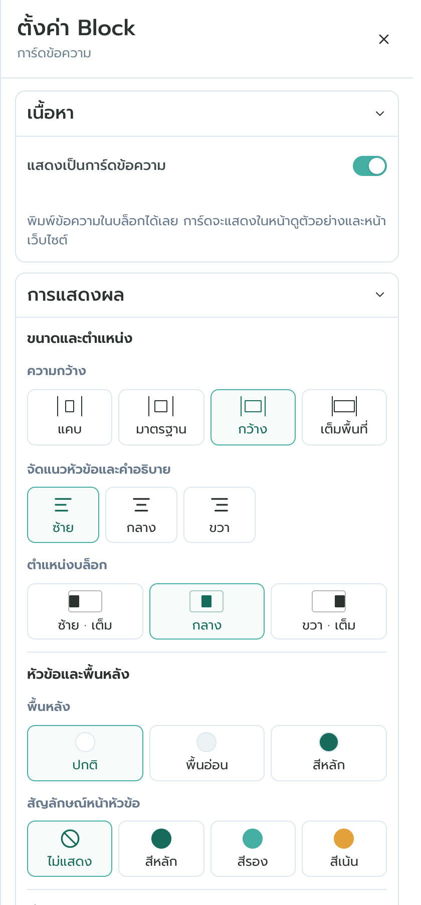

*ภาพที่ 6.14 การ์ดข้อความและการแสดงผล*

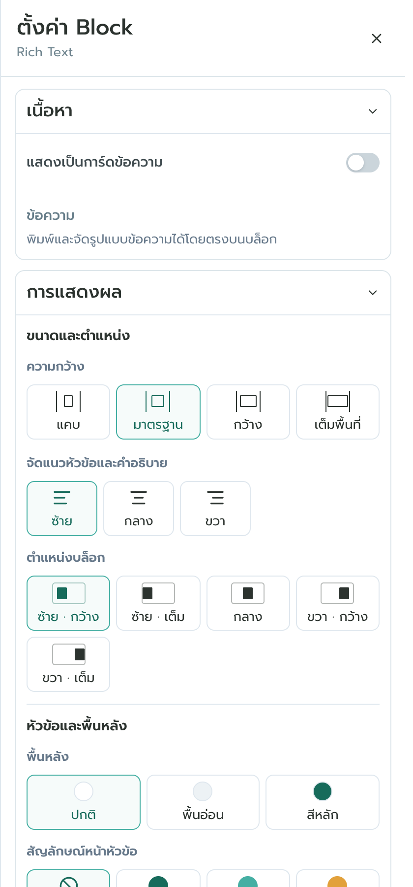

*ภาพที่ 6.15 ข้อความแบบ Rich Text และการจัดพื้นที่*

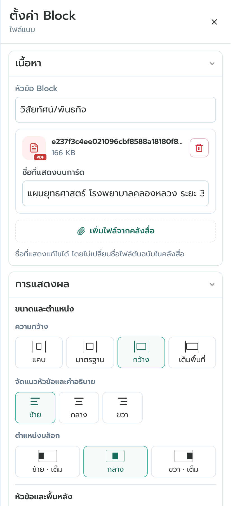

*ภาพที่ 6.16 รายการไฟล์แนบจากคลังสื่อ*

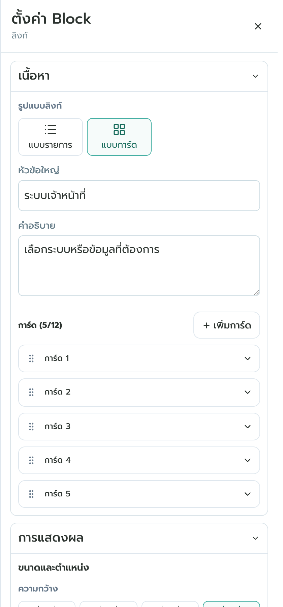

*ภาพที่ 6.17 ลิงก์แบบรายการหรือการ์ด*

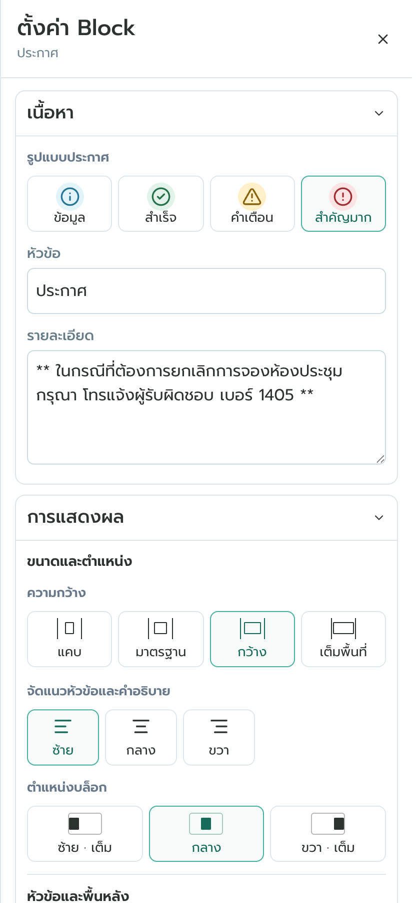

*ภาพที่ 6.18 ระดับสีของข้อความประกาศในหน้า*

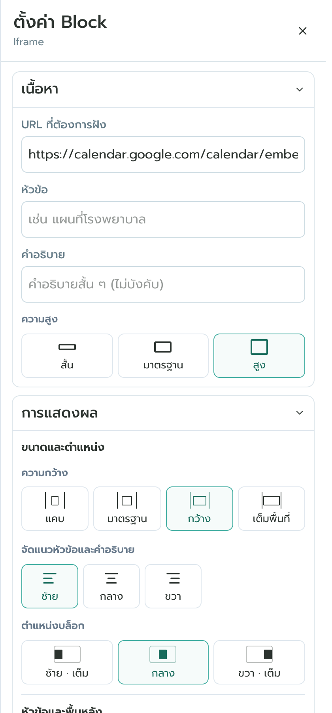

*ภาพที่ 6.19 ช่อง URL และความสูงของเนื้อหาภายนอก*

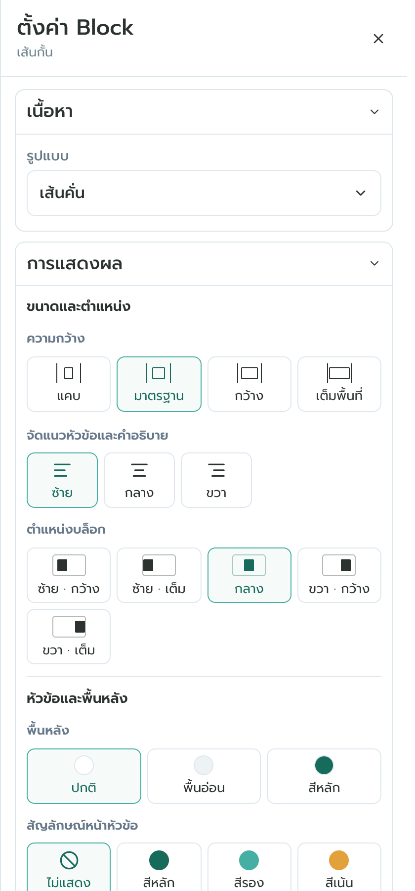

*ภาพที่ 6.20 รูปแบบเส้นกั้นและระยะห่าง*

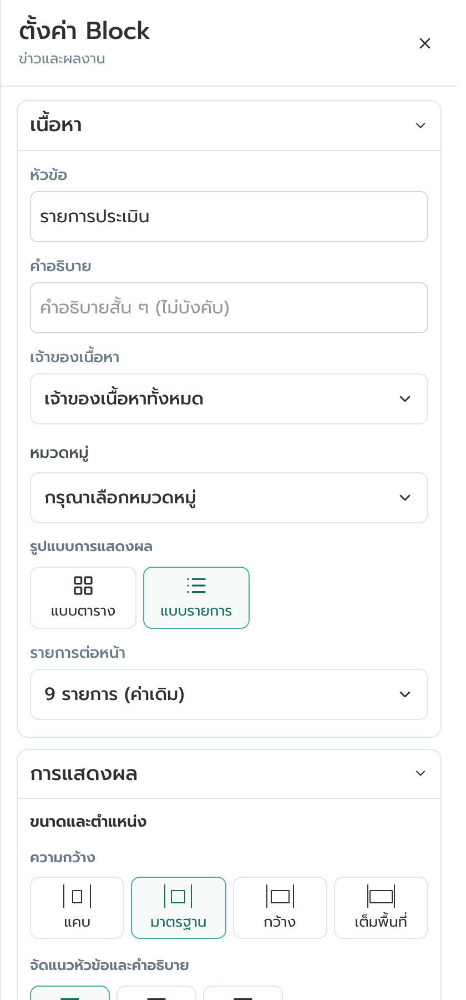

*ภาพที่ 6.21 แหล่งข่าว จำนวนรายการ และรูปแบบการแสดงผล*

---

# บทที่ 7 เมนูนำทางเว็บไซต์

เมนูนำทางกำหนดทางเข้าหน้าเว็บไซต์ประชาชน ผู้ดูแลแก้โครงสร้างในหน้าจัดการก่อน แล้วจึงกด **บันทึกและเผยแพร่** เพื่อให้เมนูใหม่ปรากฏจริง

## 7.1 ตรวจและจัดลำดับเมนู

**วัตถุประสงค์:** ทำให้ผู้เยี่ยมชมพบข้อมูลตามลำดับที่เข้าใจง่าย  
**สิทธิ์:** ผู้ดูแลระบบ  
**ทางเข้า:** **เว็บไซต์ → เมนูนำทาง**

1. อ่านตาราง **เมนูนำทาง** ซึ่งมีลำดับ ชื่อเมนู ปลายทาง สถานะ และเครื่องมือจัดการ
2. กดปุ่มลูกศร **เลื่อนขึ้น/ลง** เพื่อเปลี่ยนลำดับ หรือกดปุ่ม **ขยายเมนูย่อย** เพื่อดูรายการภายในเมนูหลัก
3. ใช้ไอคอน **ซ่อน/แสดง**, **แก้ไข** หรือ **ตัวเลือกเพิ่มเติม** ของรายการที่ต้องการ
4. ตรวจแถบแจ้ง **มีการเปลี่ยนแปลงที่ยังไม่ได้เผยแพร่** ก่อนกด **บันทึกและเผยแพร่** การกดเผยแพร่จะเปลี่ยนเมนู Public จึงไม่ได้ทดลองในรอบนี้

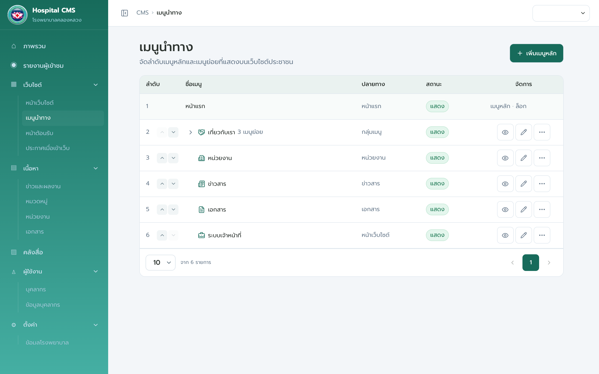

*ภาพที่ 7.1 รายการเมนูและเครื่องมือเรียงลำดับ/แก้ไข*

## 7.2 เพิ่มเมนูหลักและเมนูย่อย

**วัตถุประสงค์:** เพิ่มทางลัดไปเนื้อหาที่เผยแพร่  
**สิทธิ์:** ผู้ดูแลระบบ

1. กด **เพิ่มเมนูหลัก** หรือเปิด **ตัวเลือกเพิ่มเติม** ของเมนูหลักแล้วเลือก **เพิ่มเมนูย่อย**
2. กรอก **ชื่อเมนู** ให้สั้นและตรงกับปลายทาง
3. เลือก **ประเภทปลายทาง** และรายการปลายทางที่ระบบแสดง เช่น ส่วนหลักของเว็บไซต์ หน้าเว็บไซต์ หน่วยงาน หรือลิงก์ตามประเภทที่รองรับ
4. ตรวจตัวเลือกการเปิดลิงก์และการซ่อนจากผู้ที่ยังไม่ได้เข้าสู่ระบบ เมื่อใช้กับหน้าจำกัดสิทธิ์
5. กด **บันทึก** ในหน้าต่างเพื่อเพิ่มรายการลงร่างเมนู จากนั้นตรวจลำดับและกด **บันทึกและเผยแพร่** เมื่อได้รับอนุมัติ

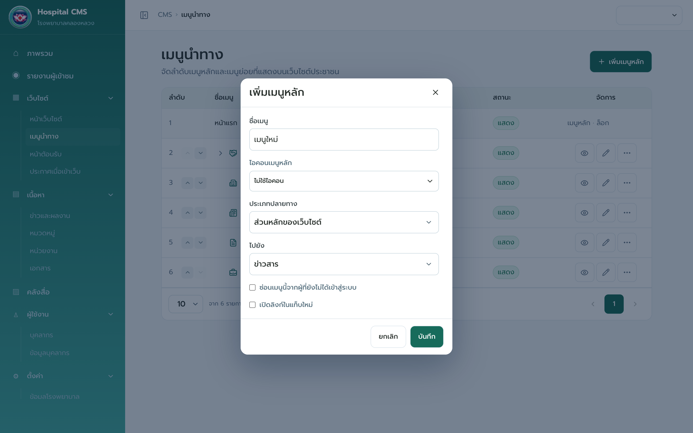

*ภาพที่ 7.2 ช่องชื่อเมนู ประเภทปลายทาง และตัวเลือกการแสดง*

**ผลลัพธ์ที่คาดหวัง:** เมนูที่เผยแพร่ปรากฏบนเว็บไซต์ Public และพาไปหน้าที่ถูกต้อง **ข้อควรระวัง:** การลบเมนูหลักอาจนำเมนูย่อยภายในออกจากโครงสร้าง ให้ตรวจรายการลูกก่อนยืนยัน การเปลี่ยนชื่อ URL ของหน้าไม่ควรใช้เป็นเหตุให้ละเลยการตรวจสิทธิ์ของหน้า

---

# บทที่ 8 หน้าต้อนรับและประกาศเมื่อเข้าเว็บ

สองเมนูนี้ต่างกัน: **หน้าต้อนรับ** เป็นหน้าก่อนเข้าสู่เว็บไซต์ ส่วน **ประกาศเมื่อเข้าเว็บ** เป็นหน้าต่างแจ้งข้อมูลบนเว็บไซต์ตามเงื่อนไขการแสดง ผู้ดูแลควรเลือกใช้ให้เหมาะกับความสำคัญของข่าวสาร

## 8.1 จัดการหน้าต้อนรับ

**วัตถุประสงค์:** แสดงสารสำคัญก่อนเข้าสู่หน้าแรก  
**สิทธิ์:** ผู้ดูแลระบบ  
**ทางเข้า:** **เว็บไซต์ → หน้าต้อนรับ**

1. ตรวจรายการและตัวกรอง **ทั้งหมด**, **เผยแพร่แล้ว**, **ฉบับร่าง**, **อยู่ในถังขยะ**
2. กด **เพิ่มหน้าต้อนรับ** เพื่อเปิดหน้า **สร้าง Splash Screen ใหม่**
3. กรอกหัวข้อ เลือก **ข้อความ** หรือ **รูปภาพ** แล้วเตรียมเนื้อหาหรือไฟล์จากคลังสื่อ
4. ตรวจ **การแสดงหน้า Welcome** รวมข้อความปุ่มและเงื่อนไขความถี่ที่หน้าจอแสดง
5. กด **บันทึกร่าง** เพื่อเก็บไว้ตรวจ หรือ **เผยแพร่** เมื่อได้รับอนุมัติ ก่อนเผยแพร่ควรใช้หน้า Preview ของรายการที่มีอยู่เพื่อตรวจว่าผู้เข้าชมมองเห็นครบ

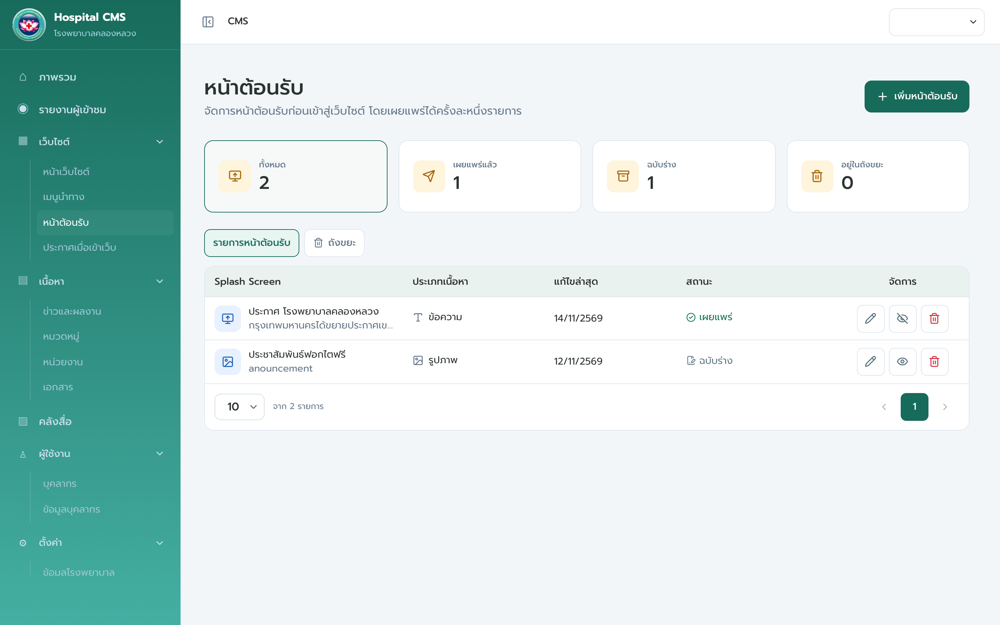

*ภาพที่ 8.1 หน้ารายการและสถานะหน้าต้อนรับ*

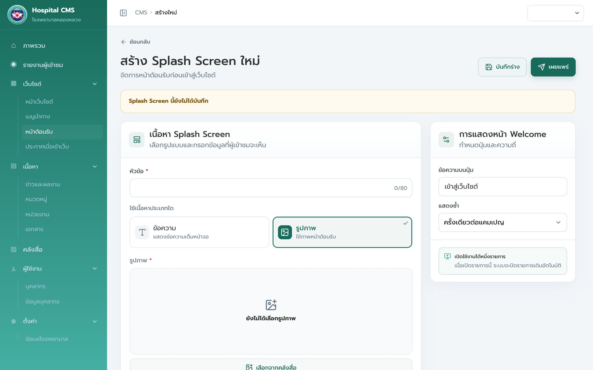

*ภาพที่ 8.2 ตัวเลือกข้อความ/รูปภาพและการแสดงหน้า Welcome*

**ผลลัพธ์ที่คาดหวัง:** ผู้เยี่ยมชมเห็นหน้าต้อนรับตามเงื่อนไขและกดเข้าสู่เว็บไซต์ได้ **ข้อควรระวัง:** อย่าใช้ภาพที่อ่านไม่ได้บนจอเล็ก หรือแสดงหน้าต้อนรับซ้ำบ่อยจนขัดขวางการเข้าถึงข้อมูลสำคัญ

## 8.2 จัดการประกาศเมื่อเข้าเว็บ

**วัตถุประสงค์:** แจ้งเรื่องสำคัญแบบหน้าต่างบนเว็บไซต์  
**สิทธิ์:** ผู้ดูแลระบบ  
**ทางเข้า:** **เว็บไซต์ → ประกาศเมื่อเข้าเว็บ**

1. ตรวจสถานะประกาศและใช้รายการ/ถังขยะตามงานที่ต้องทำ
2. กด **เพิ่มประกาศ** กรอก **หัวข้อประกาศ** แล้วเลือก **ข้อความ** สำหรับข่าวสั้น หรือ **รูปภาพ** สำหรับโปสเตอร์
3. หากประกาศพาไปข้อมูลเพิ่มเติม ให้เลือกปลายทางลิงก์และตรวจข้อความปุ่ม
4. ตั้งค่าเงื่อนไขการแสดง เช่น ความถี่หรือช่วงเวลาตามตัวเลือกที่หน้าจอรองรับ
5. ตรวจเนื้อหาแล้วกด **บันทึกร่าง** หรือ **เผยแพร่** ตามกระบวนการอนุมัติ ผู้เข้าชมจะเห็นเฉพาะประกาศที่เผยแพร่และเข้าเงื่อนไข

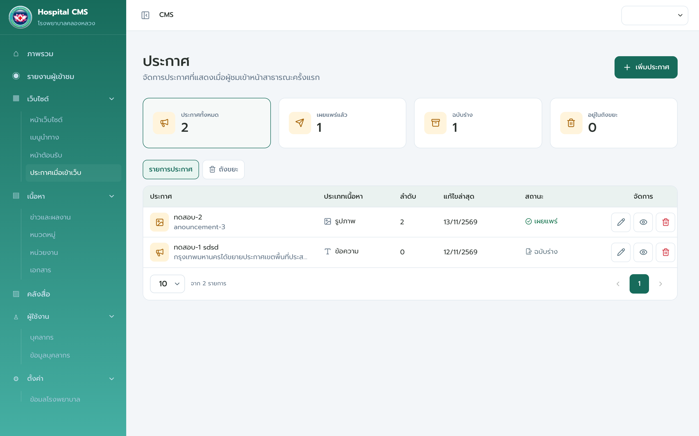

*ภาพที่ 8.3 รายการประกาศพร้อมสถานะและเครื่องมือแก้ไข*

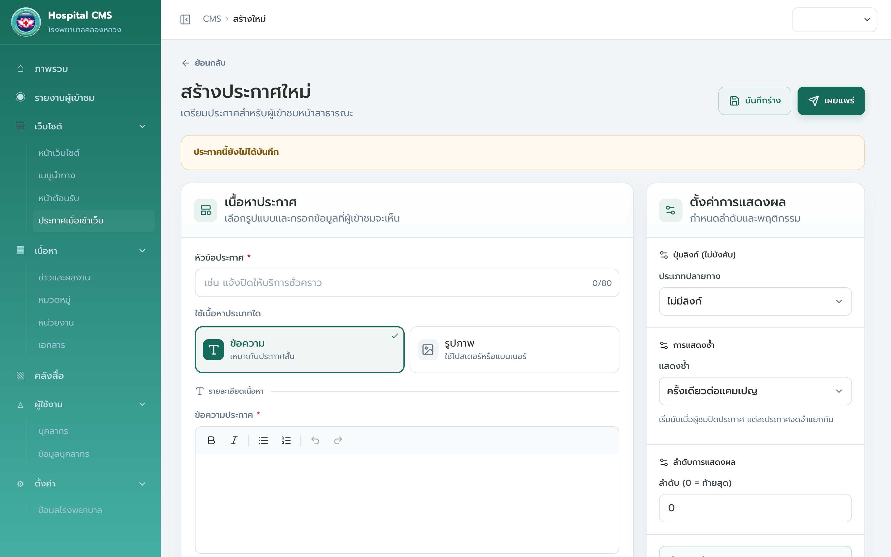

*ภาพที่ 8.4 แบบฟอร์มข้อความประกาศและเงื่อนไขการแสดง*

**ข้อควรระวัง:** ประกาศอาจบังเนื้อหาเมื่อผู้ใช้เปิดหน้า ตรวจว่าปุ่มปิดและเนื้อหาอ่านได้ครบ หากต้องการประกาศคงอยู่ในหน้า ควรพิจารณาบล็อก **ประกาศ** ใน Page Builder แทน

---

# บทที่ 9 ข่าวและผลงาน

ข่าวและผลงานแสดงต่อประชาชนหลังเผยแพร่ ผู้ดูแลเลือกวิธีเขียนได้สองแบบ: **ใช้แบบฟอร์ม** สำหรับลงข่าวรวดเร็ว และ **เขียนเอง** สำหรับจัดเนื้อหาด้วยบล็อก

## 9.1 ค้นหาและจัดการรายการข่าว

**วัตถุประสงค์:** หาเรื่องเดิม ตรวจสถานะ และเปิดแก้ไข  
**สิทธิ์:** ผู้ดูแลระบบ  
**ทางเข้า:** **เนื้อหา → ข่าวและผลงาน**

1. พิมพ์ใน **ค้นหาชื่อข่าว...** หรือเลือกตัวกรองหมวดหมู่ สถานะ กลุ่มงาน และปีที่เผยแพร่
2. เลือก **รายการข่าว** หรือ **ถังขยะ** ตามงานที่ต้องการ
3. กดไอคอน **แก้ไข** เพื่อเปิดข่าว หรือ **ตัวเลือกเพิ่มเติม** สำหรับคัดลอกเป็นฉบับร่าง ยกเลิกเผยแพร่ และลบตามสถานะ
4. เปิดข่าวที่เผยแพร่บนเว็บไซต์ Public เพื่อตรวจผลหลังเปลี่ยนเนื้อหา

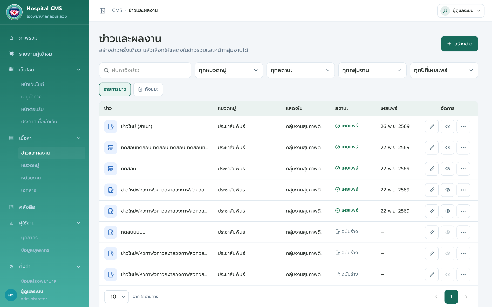

*ภาพที่ 9.1 ตัวกรองและรายการข่าว/ผลงาน*

## 9.2 เลือกวิธีสร้างข่าว

**วัตถุประสงค์:** ใช้เครื่องมือให้เหมาะกับรูปแบบเนื้อหา  
**สิทธิ์:** ผู้ดูแลระบบ  
**ทางเข้า:** **ข่าวและผลงาน → สร้างข่าว**

1. เลือก **ใช้แบบฟอร์ม** เมื่อเนื้อหาเป็นข่าวทั่วไปและต้องการกรอกตามช่อง
2. เลือก **เขียนเอง** เมื่อต้องจัดลำดับบล็อก ภาพ และส่วนประกอบหลายแบบ
3. ทั้งสองวิธีใช้ข้อมูลข่าว เช่น หมวดหมู่ เจ้าของเนื้อหา และรูปปกการ์ดข่าวร่วมกัน

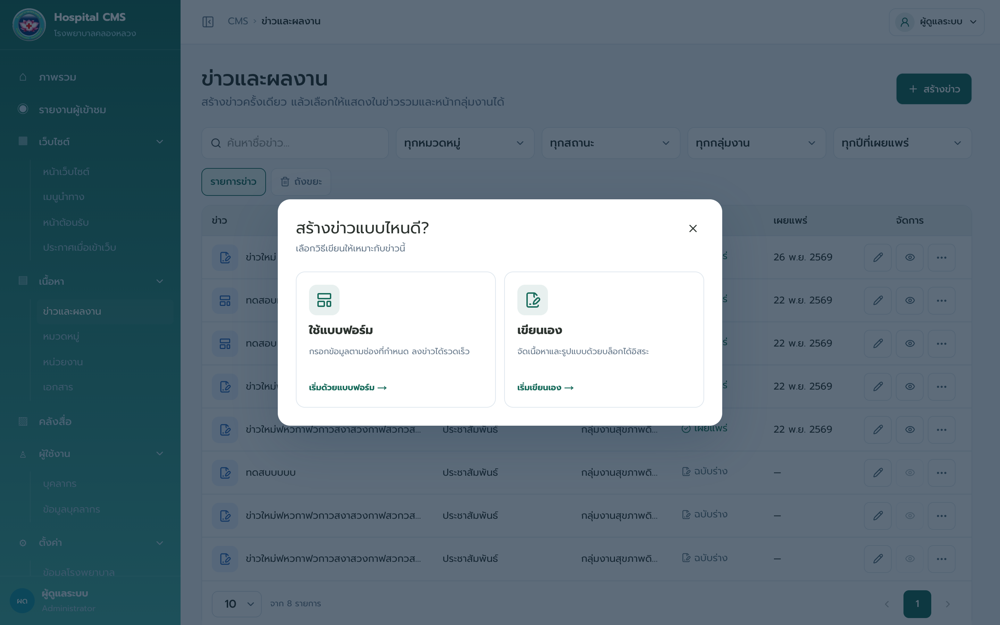

*ภาพที่ 9.2 ตัวเลือก **ใช้แบบฟอร์ม** และ **เขียนเอง***

## 9.3 เขียนข่าวด้วยแบบฟอร์ม

1. กรอก **ชื่อข่าวหรือผลงาน** ในช่องชื่อเรื่อง
2. กรอก **เนื้อหาข่าว** ด้วยเครื่องมือข้อความ เช่น ตัวหนา รายการ และลิงก์ แทรกรูป/วิดีโอ/PDF/ไฟล์แนบได้ตามเครื่องมือที่แสดง
3. เปิด **ข้อมูลข่าว** เลือก **หมวดหมู่**, **เจ้าของเนื้อหา** (โรงพยาบาลหรือหน่วยงาน) และรูปปกการ์ดข่าวจากคลังสื่อ
4. กด **ดูตัวอย่าง** เพื่อตรวจหน้าข่าวบนเดสก์ท็อป แท็บเล็ต หรือมือถือ
5. กด **บันทึก** เพื่อเก็บร่าง หรือ **เผยแพร่** เมื่อเนื้อหาได้รับอนุมัติ ข่าวที่เผยแพร่แล้วมีทางเลือกยกเลิกเผยแพร่

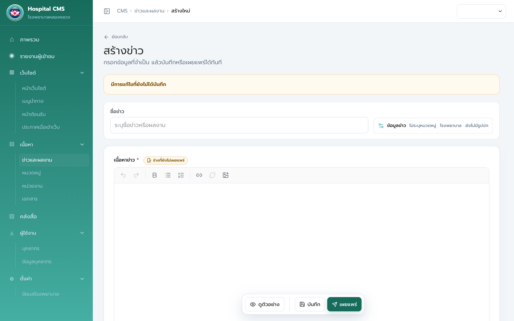

*ภาพที่ 9.3 ช่องชื่อและเนื้อหาข่าวแบบฟอร์ม*

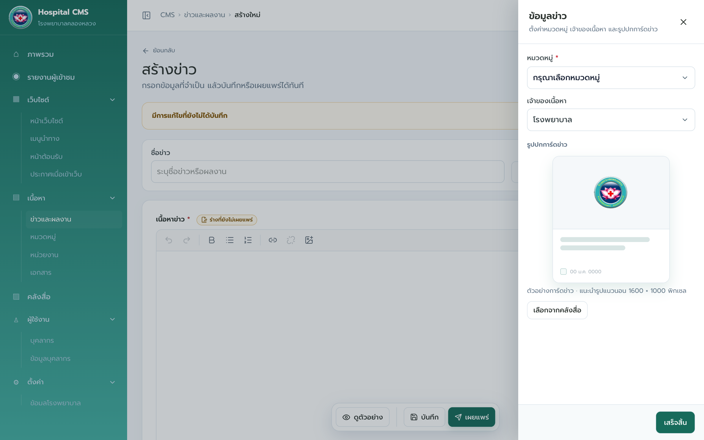

*ภาพที่ 9.4 แผงหมวดหมู่ เจ้าของเนื้อหา และรูปปก*

## 9.4 เขียนข่าวด้วยบล็อก

**วัตถุประสงค์:** สร้างข่าวที่มีส่วนประกอบหลายชนิด  
**สิทธิ์:** ผู้ดูแลระบบ  
**ทางเข้า:** **สร้างข่าว → เขียนเอง**

1. ตั้งชื่อข่าวและเปิดข้อมูลข่าวเพื่อตรวจหมวดหมู่ เจ้าของ และรูปปก
2. ใช้พื้นที่บล็อกเพื่อเพิ่มส่วนข้อความ ภาพ หรือสื่อที่ข่าวรองรับ เลือกบล็อกตามเมนูที่ตัวแก้ไขข่าวแสดง ซึ่งเป็นชุดย่อยของ Page Builder
3. จัดลำดับและตั้งค่าบล็อกตามหลักในบทที่ 6 แล้วตรวจ **ดูตัวอย่าง**
4. บันทึกร่างหรือเผยแพร่ตามกระบวนการอนุมัติของโรงพยาบาล

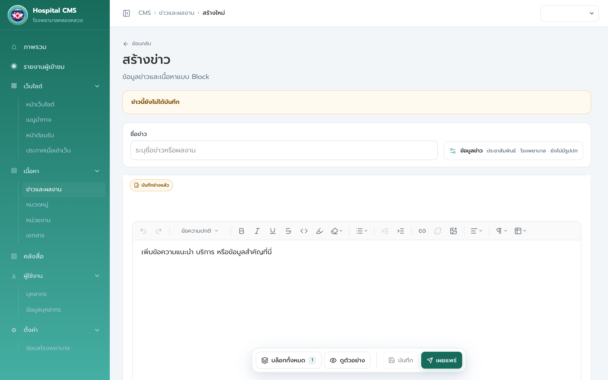

*ภาพที่ 9.5 พื้นที่เขียนข่าวแบบบล็อก*

**ผลลัพธ์ที่คาดหวัง:** ข่าวร่างอยู่ในรายการผู้ดูแลแต่ยังไม่แสดงต่อประชาชน; ข่าวเผยแพร่ปรากฏที่หน้า **ข่าวสาร** **ข้อควรระวัง:** ตรวจคำผิด วันที่ ภาพบุคคล ลิงก์ และไฟล์แนบก่อนเผยแพร่ ไม่ลงข้อมูลผู้ป่วยหรือข้อมูลส่วนบุคคลโดยไม่มีสิทธิ์

---

# บทที่ 10 หมวดหมู่ข่าวและเอกสาร

หมวดหมู่ช่วยให้ผู้ดูแลและผู้เข้าชมกรองรายการได้ ระบบแยกหมวด **ข่าว** กับ **เอกสาร** แต่จัดการอยู่หน้าเดียวกัน

## 10.1 เลือกและค้นหาหมวดหมู่

**วัตถุประสงค์:** ตรวจรายการก่อนเพิ่มหรือแก้ เพื่อไม่ให้ชื่อซ้ำ  
**สิทธิ์:** ผู้ดูแลระบบ  
**ทางเข้า:** **เนื้อหา → หมวดหมู่** หรือ **เอกสาร → จัดการหมวดหมู่**

1. เลือกแท็บ **หมวดหมู่ข่าว** หรือ **หมวดหมู่เอกสาร** ให้ตรงกับเนื้อหาที่จะจัด
2. พิมพ์ในช่อง **ค้นหาหมวดหมู่ข่าว/เอกสาร** เพื่อตรวจว่ามีชื่อที่ต้องการอยู่แล้วหรือไม่
3. ดูจำนวนรายการที่ใช้งานหมวดนั้นและสถานะ **ใช้งาน** ก่อนแก้หรือปิดใช้งาน

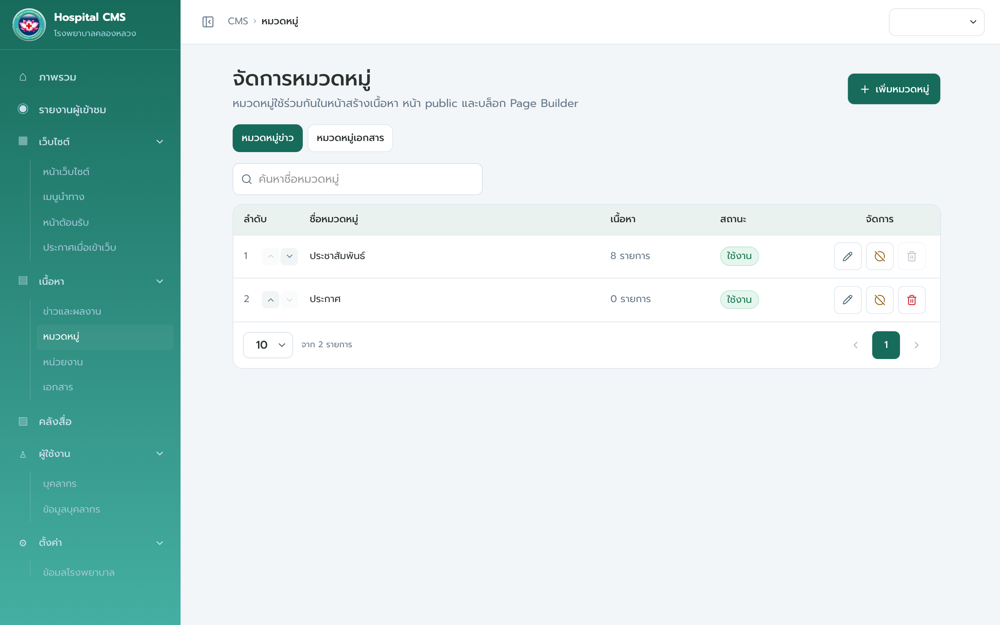

*ภาพที่ 10.1 แท็บและรายการหมวดหมู่ข่าว*

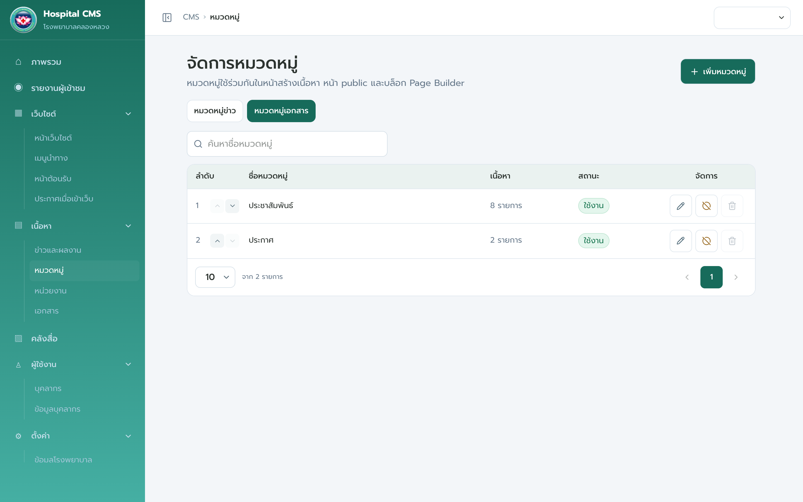

*ภาพที่ 10.2 แท็บและรายการหมวดหมู่เอกสาร*

## 10.2 เพิ่มและดูแลหมวดหมู่

**วัตถุประสงค์:** จัดโครงสร้างหมวดให้ใช้งานง่าย  
**สิทธิ์:** ผู้ดูแลระบบ

1. เลือกแท็บให้ถูก แล้วกด **เพิ่มหมวดหมู่**
2. กรอก **ชื่อหมวดหมู่** ให้สั้น ชัด และไม่ซ้ำ จากนั้นกดปุ่มเพิ่มในหน้าต่างเมื่อพร้อม
3. ใช้ลูกศร **เลื่อนขึ้น/ลง** เพื่อจัดลำดับ หรือปุ่ม **เปลี่ยนชื่อ** เมื่อคำเรียกไม่เหมาะสม
4. ใช้ **ปิดใช้งาน/เปิดใช้งาน** เมื่อไม่ต้องการให้เลือกหมวดนั้นชั่วคราว การ **ลบหมวดหมู่** ควรตรวจจำนวนเนื้อหาที่ใช้ก่อน

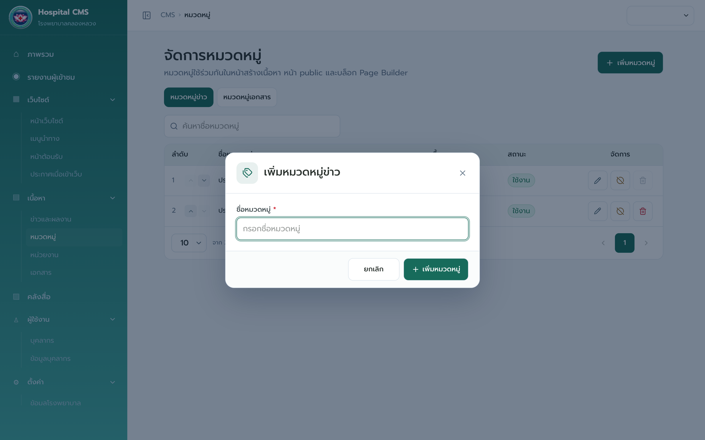

*ภาพที่ 10.3 แบบฟอร์มชื่อหมวดหมู่ใหม่*

**ผลลัพธ์ที่คาดหวัง:** หมวดใหม่ปรากฏในตัวเลือกของข่าวหรือเอกสารตามแท็บที่เลือก **ข้อควรระวัง:** เปลี่ยนหรือลบหมวดที่มีเนื้อหาอยู่ อาจกระทบตัวกรองและบล็อกที่ดึงข้อมูลตามหมวด ควรตรวจหน้าข่าว/เอกสารหลังจัดหมวดใหม่

---

# บทที่ 11 หน่วยงานและหน้าหน่วยงาน

หน่วยงานเป็นกลุ่มเนื้อหาภายในโรงพยาบาล ไม่ใช่เว็บไซต์แยก ผู้ดูแลสร้างหน้าหน่วยงาน จัดข้อมูลติดต่อ บริการ บุคลากร และสิทธิ์การเข้าถึงได้

## 11.1 รายการหน่วยงาน

**วัตถุประสงค์:** ค้นหาและติดตามสถานะหน้า  
**สิทธิ์:** ผู้ดูแลระบบ  
**ทางเข้า:** **เนื้อหา → หน่วยงาน**

1. ดูตัวกรอง **ทั้งหมด**, **เผยแพร่แล้ว**, **ฉบับร่าง**, **อยู่ในถังขยะ** และค้นหาชื่อหน่วยงาน
2. กด **แก้ไข** ของแถวที่ต้องการ หรือ **สร้างกลุ่มงาน** เพื่อเปิดแบบฟอร์มใหม่
3. ใช้ปุ่มเลื่อนขึ้น/ลงเพื่อจัดลำดับที่แสดงบนหน้า Public ใช้ตัวเลือกเพิ่มเติมสำหรับสถานะและถังขยะเมื่อจำเป็น

*ภาพที่ 11.1 รายการหน่วยงานและสถานะ*

## 11.2 ข้อมูลทั่วไปและช่องทางติดต่อ

**วัตถุประสงค์:** ระบุชื่อและข้อมูลที่ผู้เข้าชมใช้ติดต่อ  
**สิทธิ์:** ผู้ดูแลระบบ  
**ทางเข้า:** **สร้างกลุ่มงาน/แก้ไข → ข้อมูลทั่วไป**

1. ในแท็บย่อย **ข้อมูลกลุ่มงาน** กรอกชื่อ คำอธิบาย URL หรือ slug และเลือกรูปการ์ดหน่วยงานจากคลังสื่อเมื่อจำเป็น
2. เปิดแท็บย่อย **ช่องทางติดต่อ** ใส่สถานที่ โทรศัพท์/เบอร์ต่อ อีเมล และเวลาให้บริการตามช่องที่มี
3. ตรวจการแสดงรูปการ์ดและตัวอย่างข้อมูลก่อนบันทึก

*ภาพที่ 11.2 ช่องข้อมูลกลุ่มงานและรูปการ์ด*

## 11.3 เนื้อหา เมนูบริการ และบุคลากร

**วัตถุประสงค์:** ทำหน้าหน่วยงานให้ผู้เข้าชมเข้าใจบริการและผู้รับผิดชอบ  
**สิทธิ์:** ผู้ดูแลระบบ

1. เปิดแท็บ **เนื้อหาหน่วยงาน** เพื่อใส่หัวข้อและข้อความแนะนำ รวมส่วนเนื้อหาที่หน้าแสดง
2. เปิด **เมนูบริการแบบกลุ่ม** เพิ่มชื่อกลุ่มและรายการบริการ เลือกปลายทางของแต่ละลิงก์และลำดับการแสดง
3. เปิด **บุคลากร** เพื่อเลือกบุคคลจากบัญชีที่เกี่ยวข้องและจัดลำดับ/รูปภาพตามที่หน้าแสดง ตรวจการอนุญาตเผยแพร่ข้อมูลบุคลากร

*ภาพที่ 11.3 พื้นที่เขียนเนื้อหาหน่วยงาน*

*ภาพที่ 11.4 แท็บจัดกลุ่มบริการและลิงก์*

*ภาพที่ 11.5 แท็บเลือกบุคลากรของหน่วยงาน*

## 11.4 การจัดหน้า สิทธิ์ และการเผยแพร่

**วัตถุประสงค์:** กำหนดส่วนที่ปรากฏและผู้เข้าถึงได้  
**สิทธิ์:** ผู้ดูแลระบบ

1. เปิด **การจัดหน้า** แล้วกำหนดการแสดงแต่ละส่วน เช่น ข่าว เอกสาร เมนูบริการ และข้อมูลติดต่อ ตามสวิตช์ในหน้าจอ
2. กดปุ่ม **สิทธิ์: ...** เลือก **สาธารณะ**, **เฉพาะผู้เข้าสู่ระบบ** หรือ **กำหนดผู้มีสิทธิ์** แล้วระบุผู้ใช้/หน่วยงานตามกรณี
3. กด **บันทึกร่าง** หากต้องตรวจต่อ หรือ **เผยแพร่** เมื่อทุกแท็บพร้อมและได้รับอนุมัติ หากหน่วยงานเคยเผยแพร่แล้ว ร่างใหม่ยังไม่เปลี่ยนหน้าที่ประชาชนเห็นจนกว่าจะเผยแพร่

*ภาพที่ 11.6 สวิตช์เลือกส่วนที่จะแสดงบนหน้าหน่วยงาน*

**ผลลัพธ์ที่คาดหวัง:** หน่วยงานที่เผยแพร่แล้วปรากฏในรายการ Public ตามสิทธิ์ที่กำหนด **ข้อควรระวัง:** ตรวจข้อมูลติดต่อและรายชื่อบุคลากรก่อนเผยแพร่ และอย่าเปลี่ยนสิทธิ์เป็นสาธารณะโดยไม่ตรวจเนื้อหาภายใน

---

# บทที่ 12 เอกสารเผยแพร่

เมนูเอกสารใช้เผยแพร่ไฟล์พร้อมชื่อ หมวดหมู่ เจ้าของ และปีงบประมาณ ผู้เข้าชมเห็นเฉพาะรายการที่เผยแพร่แล้ว

## 12.1 ค้นหาและกรองเอกสาร

**วัตถุประสงค์:** หาไฟล์เดิมและตรวจสถานะก่อนแก้  
**สิทธิ์:** ผู้ดูแลระบบ  
**ทางเข้า:** **เนื้อหา → เอกสาร**

1. ดูการ์ด **เอกสารทั้งหมด**, **เผยแพร่แล้ว**, **ฉบับร่าง** และ **อยู่ในถังขยะ**
2. ค้นด้วย **ชื่อหรือเลขที่เอกสาร** แล้วกรอง **หมวดหมู่**, **ปีงบประมาณ** และ **สถานะ**
3. เลือก **แก้ไข** ของแถว หรือใช้ตัวเลือกของรายการสำหรับงานตามสถานะ เช่น ยกเลิกเผยแพร่ เก็บถาวร และลบ
4. ใช้แท็บ **ถังขยะ** เพื่อดูรายการที่ย้ายออกและกู้คืนเมื่อจำเป็น

*ภาพที่ 12.1 รายการเอกสารและชุดตัวกรอง*

*ภาพที่ 12.2 แท็บถังขยะ ซึ่งอาจว่างหากยังไม่มีรายการที่ลบ*

## 12.2 เพิ่มและแก้ไขเอกสาร

**วัตถุประสงค์:** เตรียมไฟล์ให้ผู้ใช้ค้นหาและดาวน์โหลดได้ถูกต้อง  
**สิทธิ์:** ผู้ดูแลระบบ  
**ทางเข้า:** **เอกสาร → เพิ่มเอกสาร** หรือปุ่มแก้ไขของรายการ

1. กรอก **ชื่อเอกสาร** ให้สื่อความหมาย และคำอธิบายเมื่อมี
2. เลือก **หมวดหมู่** และ **เจ้าของเอกสาร** ตรวจว่าเอกสารเป็นของโรงพยาบาลหรือหน่วยงานใด
3. กรอก **ปีงบประมาณ** และ **เลขที่เอกสาร** เมื่อเกี่ยวข้อง
4. เลือกไฟล์จากคลังสื่อหรือเพิ่มไฟล์ตามปุ่มที่แบบฟอร์มแสดง ตรวจชนิดไฟล์และข้อความแจ้งขนาด/ชนิดที่รองรับ
5. กด **บันทึกฉบับร่าง** เมื่อต้องตรวจต่อ หรือ **บันทึกและเผยแพร่** หลังตรวจไฟล์และได้รับอนุมัติ

*ภาพที่ 12.3 ช่องชื่อ หมวด เจ้าของ ปีงบประมาณ และไฟล์*

**ผลลัพธ์ที่คาดหวัง:** เอกสารร่างอยู่ในรายการผู้ดูแล; เอกสารเผยแพร่ปรากฏในหน้า **เอกสาร** ของเว็บไซต์และดาวน์โหลดได้ **ข้อควรระวัง:** ตรวจว่าไฟล์ไม่ใช่ร่างภายในหรือมีข้อมูลส่วนบุคคล ตรวจปีงบประมาณและเลขที่เอกสารก่อนเผยแพร่

---

# บทที่ 13 บัญชีบุคลากรและข้อมูลบุคลากร

ผู้ดูแลสร้างบัญชีให้บุคลากร ไม่มีการลงทะเบียนสาธารณะ บัญชีใหม่และบัญชีที่ผู้ดูแลรีเซ็ตรหัสผ่านต้องเปลี่ยนรหัสผ่านเมื่อเข้าใช้ครั้งถัดไป การจัดการบัญชีมีผลต่อสิทธิ์และ session จึงควรตรวจตัวบุคคลก่อนทุกครั้ง

## 13.1 ค้นหาและจัดการบัญชีผู้ใช้งาน

**วัตถุประสงค์:** ตรวจบัญชี บทบาท และสถานะการเข้าใช้  
**สิทธิ์:** ผู้ดูแลระบบ  
**ทางเข้า:** **ผู้ใช้งาน → บุคลากร**

1. ค้นด้วย **ชื่อ ชื่อผู้ใช้ หรืออีเมล** แล้วเลือกตัวกรองสถานะ เช่น **ใช้งาน**, **ปิดใช้งาน**, **ล็อกชั่วคราว** หรือสถานะ OTP ที่ระบบแสดง
2. อ่านคอลัมน์บทบาท สถานะ และ 2FA ของบัญชีที่ต้องการ
3. กด **แก้ไข** เพื่อปรับข้อมูลที่อนุญาต หรือใช้ **ตัวเลือกเพิ่มเติม** เมื่อต้องปลดล็อก รีเซ็ตรหัสผ่าน/2FA เพิกถอน session หรือดำเนินการอื่นตามสถานะ

*ภาพที่ 13.1 ตัวกรองและตารางบัญชี*

## 13.2 เพิ่มบัญชีและกำหนดบทบาท

**วัตถุประสงค์:** ให้บุคลากรที่ได้รับอนุญาตเข้าใช้ระบบ  
**สิทธิ์:** ผู้ดูแลระบบ  
**ทางเข้า:** **บุคลากร → เพิ่มผู้ใช้งาน**

1. กรอกชื่อที่แสดงและชื่อผู้ใช้ตามช่องในหน้าต่างเพิ่มบัญชี
2. เลือกบทบาทให้ตรงหน้าที่: **ผู้ดูแลระบบ** ใช้เมนู Admin; **ผู้ใช้งานทั่วไป** ใช้หน้าและข้อมูลที่ได้รับสิทธิ์
3. กำหนดรหัสผ่านเริ่มต้นตามเงื่อนไขของระบบและตรวจข้อมูลบุคลากรที่เกี่ยวข้อง
4. กดปุ่มสร้างบัญชีเมื่อได้รับอนุมัติ แล้วแจ้งข้อมูลเริ่มต้นแก่เจ้าของบัญชีผ่านช่องทางปลอดภัยโดยไม่ส่งผ่านเอกสารคู่มือ

*ภาพที่ 13.2 หน้าต่างเพิ่มบัญชี*

**ข้อควรระวัง:** ให้สิทธิ์ผู้ดูแลเท่าที่จำเป็น อย่าลบบัญชีผู้ดูแลคนสุดท้ายที่ยังใช้งานได้ การเปลี่ยนบทบาทอาจเพิกถอน session เดิม

## 13.3 นำเข้าจาก Excel

**วัตถุประสงค์:** เตรียมบัญชีบุคลากรจำนวนมากจากไฟล์  
**สิทธิ์:** ผู้ดูแลระบบ  
**ทางเข้า:** **บุคลากร → นำเข้าจาก Excel**

1. อ่าน **ดาวน์โหลดแบบฟอร์ม** และคำอธิบายคอลัมน์ที่หน้าจอแสดง
2. เตรียมไฟล์ตามรูปแบบ โดยตรวจชื่อผู้ใช้และข้อมูลซ้ำก่อนนำเข้า
3. เลือกไฟล์แล้วกด **ตรวจสอบข้อมูล** เพื่อดูรายการก่อนยืนยันการนำเข้า
4. หากข้อมูลไม่ผ่าน ให้แก้ไฟล์และตรวจใหม่; หากผ่านให้ตรวจผลรวมก่อนดำเนินการยืนยันในหน้าถัดไป

*ภาพที่ 13.3 ขั้นตอนดาวน์โหลดแบบฟอร์มและตรวจไฟล์ก่อนนำเข้า*

## 13.4 จัดการข้อมูลบุคลากร

**วัตถุประสงค์:** รักษารายการตัวเลือกมาตรฐานในโปรไฟล์  
**สิทธิ์:** ผู้ดูแลระบบ  
**ทางเข้า:** **ผู้ใช้งาน → ข้อมูลบุคลากร**

1. เลือกแท็บ **ประเภทบุคลากร**, **ตำแหน่ง** หรือ **ระดับ**
2. ค้นหารายการเดิมก่อนกด **เพิ่มรายการ** เพื่อลดชื่อซ้ำ
3. ใช้ปุ่มเลื่อนขึ้น/ลงเพื่อเรียงลำดับ หรือ **เปลี่ยนชื่อ**, **ปิดใช้งาน**, **ลบ** ตามความจำเป็น
4. ตรวจจำนวนผู้ใช้ที่อ้างถึงรายการก่อนปิดใช้งานหรือลบ

*ภาพที่ 13.4 แท็บประเภทบุคลากร ตำแหน่ง และระดับ*

## 13.5 รีเซ็ตรหัสผ่านและ 2FA

เมื่อต้องช่วยผู้ใช้ ให้ค้นหาบัญชีให้ตรง เปิด **ตัวเลือกเพิ่มเติม** แล้วเลือกการดำเนินการที่จำเป็น เช่น **รีเซ็ตรหัสผ่าน**, **ปลดล็อกการเข้าสู่ระบบ** หรือ **รีเซ็ต 2FA** ระบบอาจขอรหัสผ่านผู้ดูแลเพื่อยืนยัน การรีเซ็ต 2FA ทำให้คีย์ OTP และรหัสกู้บัญชีเดิมใช้ไม่ได้ และบัญชีอาจออกจากระบบทุกอุปกรณ์ ดำเนินการเฉพาะหลังยืนยันตัวบุคคลตามระเบียบโรงพยาบาล

---

# บทที่ 14 ข้อมูลโรงพยาบาล สีธีม และโลโก้

การตั้งค่านี้มีผลต่อหลายหน้าของเว็บไซต์ ควรให้ผู้รับผิดชอบข้อมูลและภาพลักษณ์ตรวจความถูกต้องก่อนบันทึก

## 14.1 ข้อมูลโรงพยาบาล

**วัตถุประสงค์:** แสดงข้อมูลติดต่อและช่องทางทางการให้ตรงกันทุกหน้า  
**สิทธิ์:** ผู้ดูแลระบบ  
**ทางเข้า:** **ตั้งค่า → ข้อมูลโรงพยาบาล**

1. ตรวจชื่อโรงพยาบาล ชื่อภาษาอังกฤษ ที่อยู่ และลิงก์ **Google Maps** ในส่วน **ข้อมูลทั่วไป**
2. ตรวจโทรศัพท์ อีเมล และช่องทางโซเชียล เช่น Facebook, YouTube และ LINE OA ตามช่องที่หน้าแสดง
3. เปิดลิงก์ที่กรอกเพื่อตรวจว่าเป็นช่องทางทางการและใช้งานได้
4. กด **บันทึกข้อมูล** หลังได้รับการตรวจทาน แล้วเปิดเว็บไซต์ Public เพื่อตรวจส่วนหัว/ท้ายและหน้าติดต่อ

*ภาพที่ 14.1 แบบฟอร์มข้อมูลทั่วไปและช่องทางติดต่อ*

**ผลลัพธ์ที่คาดหวัง:** ข้อมูลโรงพยาบาลที่เผยแพร่แสดงตรงตามที่บันทึก **ข้อควรระวัง:** ใช้ลิงก์ที่ปลอดภัยและเป็นทางการ ไม่ใส่เบอร์ส่วนตัวในช่องสาธารณะ

## 14.2 สีธีมและโลโก้

**วัตถุประสงค์:** ควบคุมสีและภาพลักษณ์ของเว็บไซต์ให้สม่ำเสมอ  
**สิทธิ์:** ผู้ดูแลระบบ  
**ทางเข้า:** **ตั้งค่า → สีธีมและโลโก้**

1. ตรวจ **โลโก้โรงพยาบาล** แล้วกด **เลือกจากคลังสื่อ** หากต้องเปลี่ยนไฟล์
2. เลือกชุดสีที่หน้าแสดง เช่น แบบทางการ แบบสุขภาพ โทนไว้อาลัย หรือเขียวมิ้นต์ หรือปรับค่าสีตามตัวเลือกที่มี
3. ดูตัวอย่างส่วนหัว ปุ่ม ข้อความ และพื้นหลังในแผง Preview เพื่อเช็กความอ่านง่าย
4. กด **บันทึกธีม** เมื่อได้รับอนุมัติ หากต้องการกลับค่าเริ่มต้นให้พิจารณา **คืนค่าเริ่มต้น** และตรวจผลก่อนบันทึก

*ภาพที่ 14.2 โลโก้ ชุดสี และตัวอย่างเว็บไซต์*

**ข้อควรระวัง:** ตรวจความตัดกันของสีตัวอักษร/พื้นหลังและภาพบนมือถือก่อนใช้จริง ชุดสีเป็นการตั้งค่าระดับเว็บไซต์ ไม่ใช่ของบล็อกแต่ละชิ้น

---

# บทที่ 15 บันทึกกิจกรรมและการติดตามระบบ

บันทึกกิจกรรมช่วยตรวจว่าใครดำเนินการกับข้อมูลในระบบและเมื่อใด ใช้ประกอบการติดตามงานหลังแก้ไขหรือเผยแพร่เนื้อหา ไม่ใช่หน้าสำหรับแก้ไขรายการย้อนหลัง

## 15.1 ค้นหาและกรองบันทึกกิจกรรม

**วัตถุประสงค์:** ค้นหาเหตุการณ์ที่เกี่ยวข้องกับงานหรือผู้ดำเนินการ  
**สิทธิ์:** ผู้ดูแลระบบ  
**ทางเข้า:** **ตั้งค่า → บันทึกกิจกรรม**

1. เลือกช่วงเวลา **วันนี้**, **เมื่อวาน**, **7 วันล่าสุด** หรือ **กำหนดช่วงวันที่** หากกำหนดเอง ให้กรอก **ตั้งแต่วันที่** และ **ถึงวันที่** แล้วกด **แสดงผล**
2. พิมพ์คำใน **ค้นหากิจกรรมหรือผู้ดำเนินการ...** ระบบค้นจากรายละเอียดกิจกรรม ชนิดการดำเนินการ และชื่อผู้ดำเนินการ
3. เลือก **ทุกประเภท** หรือประเภทข้อมูลที่มีบันทึกในช่วงเวลาที่เลือก เช่น บัญชีผู้ใช้ หน้าเว็บไซต์ ข่าวสาร หรือเอกสาร
4. อ่านตาราง **กิจกรรม**, **รายละเอียด**, **ผู้ดำเนินการ**, **วันและเวลา** และ **จัดการ** หากมีหลายรายการ ให้ใช้ตัวแบ่งหน้าและจำนวนรายการต่อหน้า

*ภาพที่ 15.1 ช่องค้นหา ตัวกรองช่วงเวลา/ประเภท และตารางกิจกรรม*

**ผลลัพธ์:** เห็นรายการที่ตรงเงื่อนไข หากระบบแสดง **ไม่พบกิจกรรมในช่วงวันที่และเงื่อนไขที่เลือก** ให้ขยายช่วงเวลาหรือลดตัวกรองก่อนสรุปว่าไม่มีเหตุการณ์

## 15.2 เปิดรายละเอียดเหตุการณ์

**วัตถุประสงค์:** ตรวจรายการที่เกี่ยวข้อง ผู้ดำเนินการ และเวลาให้ชัดเจน  
**สิทธิ์:** ผู้ดูแลระบบ  
**ทางเข้า:** **บันทึกกิจกรรม → ดูรายละเอียด** ในคอลัมน์ **จัดการ**

1. ค้นหารายการตามข้อ 15.1 แล้วกดไอคอน **ดูรายละเอียด** ที่แถวนั้น
2. อ่าน **ข้อมูลเหตุการณ์** ได้แก่ การดำเนินการ ประเภทข้อมูล รหัสรายการที่เกี่ยวข้อง และรายละเอียดที่บันทึก
3. อ่าน **ผู้ดำเนินการและเวลา** ซึ่งแสดงชื่อผู้ดำเนินการ ชื่อผู้ใช้เมื่อยังมีบัญชีอยู่ วันเวลาไทย และรหัสบันทึกกิจกรรม
4. กด **กลับไปบันทึกกิจกรรม** เพื่อกลับรายการพร้อมตัวกรองเดิม

*ภาพที่ 15.2 รายละเอียดเหตุการณ์ ผู้ดำเนินการ และวันเวลา*

**ข้อควรระวัง:** หน้ารายละเอียดระบุว่าบันทึกนี้ไม่เก็บค่าก่อน–หลังการแก้ไขหรือ IP จึงไม่ควรใช้สรุปเนื้อหาที่เปลี่ยนไปจากบันทึกเพียงรายการเดียว

## 15.3 ตรวจผลหลังเผยแพร่หรือแก้ไข

**วัตถุประสงค์:** ตรวจว่างานที่ทำปรากฏในหน้าที่ผู้ใช้เห็น  
**สิทธิ์:** ผู้ดูแลระบบ; หน้า Public ที่เผยแพร่เปิดได้ตามสิทธิ์ของหน้านั้น  
**ทางเข้า:** หน้ารายการเนื้อหาที่เกี่ยวข้อง, **บันทึกกิจกรรม**, แล้วเปิดเว็บไซต์ Public

1. กลับไปหน้ารายการของหน้าเว็บไซต์ ข่าว หน่วยงาน เอกสาร หรือเมนูที่ดำเนินการ แล้วตรวจสถานะที่ระบบแสดง
2. เปิด **บันทึกกิจกรรม** กรองช่วงเวลาที่ทำงาน และค้นหาชื่อรายการหรือผู้ดำเนินการเพื่อตรวจเหตุการณ์ที่บันทึกไว้
3. เปิดเว็บไซต์ Public และเข้าหน้าหรือเมนูที่เกี่ยวข้องเพื่อตรวจข้อความ ภาพ ลิงก์ และสิทธิ์การเข้าถึงตามที่ตั้งไว้
4. หากผลไม่ตรง ให้ตรวจว่ารายการยังเป็น **ฉบับร่าง**, **เผยแพร่แล้ว** หรืออยู่ใน **ถังขยะ** และตรวจสิทธิ์ของหน้า/หน่วยงานก่อนส่งต่อผู้ดูแล

*ภาพที่ 15.3 รายงานผู้เข้าชมสำหรับติดตามภาพรวมหลังเผยแพร่เนื้อหา; รายละเอียดการอ่านกราฟอยู่ในบทที่ 4*

**ข้อจำกัด:** คู่มือนี้ไม่ได้บันทึก เผยแพร่ ลบ หรือเปลี่ยนข้อมูลเพื่อสร้างเหตุการณ์ทดลอง จึงไม่ยืนยันผลของการกระทำเหล่านั้นผ่าน Browser

---

# บทที่ 16 ภาคผนวกและคำอธิบายการใช้งาน

บทนี้ใช้เปิดทวนความหมายของสถานะ สิทธิ์ และคำที่พบซ้ำในคู่มือ ขั้นตอนปฏิบัติพร้อมภาพอยู่ในบทที่เกี่ยวข้อง

## 16.1 สถานะของเนื้อหา

| คำบนหน้าจอ | ความหมายในการทำงาน | สิ่งที่ควรตรวจ |
|---|---|---|
| ฉบับร่าง | บันทึกไว้เพื่อแก้ไขหรือรอตรวจ | เปิดตัวอย่างและตรวจข้อมูลก่อนเผยแพร่ |
| เผยแพร่แล้ว | ฉบับที่ผู้มีสิทธิ์เข้าถึงตามการตั้งค่าเห็นได้ | เปิดหน้า Public เพื่อตรวจผลจริง |
| ยกเลิกเผยแพร่ | ถอนรายการออกจากการแสดงตามขั้นตอนของเมนูนั้น | ตรวจสถานะในหน้ารายการและลิงก์ที่เคยอ้างถึง |
| เก็บถาวร | สถานะที่ใช้กับเอกสารบางรายการ | ตรวจรายการเอกสารและการแสดงบนเว็บไซต์ |
| ถังขยะ | รายการที่ย้ายออกจากรายการปกติและอาจกู้คืนได้ | ตรวจรายการก่อนกู้คืนหรือลบถาวร |

สถานะที่มีให้เลือกต่างกันตามชนิดข้อมูล และบางเมนูมีขั้นตอนบันทึกร่างกับเผยแพร่แยกกัน อ่านปุ่มและข้อความยืนยันของหน้าจอก่อนดำเนินการ

## 16.2 สิทธิ์ผู้ใช้งาน

| ผู้ใช้ | เปิดเว็บไซต์ Public | เปิดหน้าเฉพาะผู้เข้าสู่ระบบ | เข้าแผงผู้ดูแล |
|---|---|---|---|
| ผู้เยี่ยมชมที่ไม่เข้าสู่ระบบ | ได้ เฉพาะเนื้อหาที่เผยแพร่และเป็นสาธารณะ | ไม่ได้ | ไม่ได้ |
| ผู้ใช้งานทั่วไป | ได้ | ได้ตามสิทธิ์ของหน้า/หน่วยงาน | ไม่ได้ |
| ผู้ดูแลระบบ | ได้ | ได้ตามสิทธิ์ของหน้า/หน่วยงาน | ได้ |

หน้าเว็บไซต์และหน้าหน่วยงานอาจตั้งเป็น **สาธารณะ**, **เฉพาะผู้เข้าสู่ระบบ** หรือ **กำหนดผู้มีสิทธิ์** ตามตัวเลือกที่หน้าจอแสดง ข้อความว่ามีสิทธิ์เข้าถึงไม่ได้หมายความว่าเนื้อหาที่ยังเป็นฉบับร่างจะปรากฏบน Public การจำกัดสิทธิ์ของข่าว สื่อ และเอกสารไม่ได้อยู่ในขอบเขตปัจจุบัน

## 16.3 ชนิดบล็อกใน Page Builder

ตารางนี้เป็นดัชนีสำหรับค้นหาคำอธิบายการตั้งค่าและภาพจริงในบทที่ 6 บล็อกที่มีตัวอย่างอยู่ในหน้าปัจจุบันมีภาพแผงตั้งค่า ส่วนชนิดอื่นดูได้จากหน้าต่าง **เพิ่ม Block** และตารางในข้อ 6.5

| กลุ่มงาน | ชนิดบล็อกที่เพิ่มได้ |
|---|---|
| ข้อความและการจัดหน้า | หัวข้อ, Rich Text, คำพูดเน้น, ประกาศ, เส้นกั้น, Timeline |
| ภาพและสื่อ | แบนเนอร์, รูปภาพ, แกลเลอรี, วิดีโอ, PDF Viewer, ไฟล์แนบ, Iframe |
| ลิงก์และบริการ | ปุ่ม CTA, ลิงก์, เมนูบริการแบบกลุ่ม, ขั้นตอนการรับบริการ, ข้อมูลติดต่อ, แผนที่ |
| ข้อมูลแบบมีโครงสร้าง | รายการเอกสาร, วันเวลาและสถานที่, คำถามที่พบบ่อย, ตาราง, สถิติสำคัญ |
| เนื้อหาที่ดึงจากระบบ | ข่าวและผลงาน, ข่าวแบบแท็บ, เอกสาร |

**การ์ดข้อความ** เป็นรูปแบบของ Rich Text ที่สลับได้ในแผงตั้งค่า ส่วน **บุคลากร** และ **ระยะห่าง** อาจมีในหน้าเดิม แต่ไม่ใช่ตัวเลือกที่เพิ่มใหม่ในหน้าต่าง **เพิ่ม Block** ปัจจุบัน

## 16.4 คำศัพท์บนหน้าจอ

| คำ | ความหมายสำหรับผู้ใช้งาน |
|---|---|
| Page Builder | หน้าจัดเรียงและตั้งค่าบล็อกของหน้าเว็บไซต์ |
| Block | ส่วนเนื้อหาหนึ่งชิ้น เช่น แบนเนอร์ ข้อความ รูปภาพ หรือรายการข่าว |
| URL ของหน้า | ที่อยู่ของหน้าในเว็บไซต์ ควรตรวจความถูกต้องก่อนสร้าง |
| ดูตัวอย่าง | เปิดตรวจหน้าตาและเนื้อหาก่อนเผยแพร่ |
| คลังสื่อ | ที่เก็บรูปและไฟล์ที่นำไปเลือกใช้ในเนื้อหา |
| หมวดหมู่ | กลุ่มสำหรับจัดและกรองข่าวหรือเอกสาร |
| 2FA/OTP | การยืนยันตัวตนขั้นที่สองด้วยรหัสชั่วคราว |
| Session | ช่วงการเข้าสู่ระบบของบัญชีบนอุปกรณ์หนึ่ง |
| บันทึกกิจกรรม | รายการเหตุการณ์ที่ระบบบันทึกพร้อมผู้ดำเนินการและเวลา |

## 16.5 การใช้ภาพและข้อมูลในคู่มือ

รหัสผ่าน Token, OTP, รหัสกู้บัญชี และข้อมูลลับด้านความปลอดภัยต้องไม่ปรากฏในคู่มือ หากนำขั้นตอนไปใช้กับระบบจริง ให้ตรวจสิทธิ์และความเหมาะสมของข้อมูลก่อนส่งต่อคู่มือหรือเผยแพร่ภาพเพิ่มเติม

## 16.6 ข้อจำกัดของการตรวจครั้งนี้

- ใช้บัญชีผู้ดูแลที่เข้าสู่ระบบไว้แล้วและเปิดหน้า Public จริง แต่ไม่ได้ทดสอบทุกบทบาทด้วยบัญชีแยก
- ไม่กดบันทึก เพิ่ม ลบ นำเข้า เผยแพร่ รีเซ็ตรหัสผ่าน ตั้งค่า OTP หรือเพิกถอน Session จึงอธิบายผลหลังการกระทำตามหน้าจอและกฎที่ระบบกำหนด โดยไม่ได้ยืนยันด้วยการเปลี่ยนข้อมูลจริง
- หน้ารหัสกู้บัญชีแสดงได้เฉพาะช่วงที่ระบบออกชุดรหัสใหม่ จึงไม่มีภาพรหัสกู้บัญชีในเล่ม
- เมนูและรายการเนื้อหาที่ดึงจากฐานข้อมูลอาจเปลี่ยนได้ภายหลังวันที่จับภาพ
